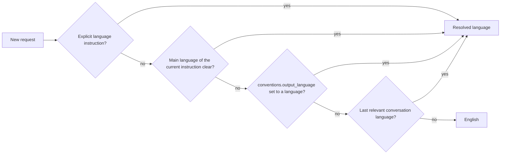

# Writing and Output Language Standard

## Summary

This standard sets how Super Compound writes human-facing output and which
language it uses. It covers chat replies, questions, checkpoints, reports,
summaries and new documents. English output applies ASD-STE100-inspired writing;
other languages adapt the same principles naturally. Machine literals are never
translated. Load this file on demand; `output-style.md` stays the document
structure standard.

## Language Resolution

`output_language: auto` is the default.

1. An explicit language instruction in the request.
2. The main language of the user's current instruction.
3. Project config `conventions.output_language` when the request language cannot
   be determined. Optional key; value `auto` or a language name or BCP-47 tag
   such as `id` or `en-GB`. Absent means `auto`.
4. The last relevant conversation language.
5. Fallback: English.

- Resolve the language again for each new request. Never infer it from code,
  links or attachments. In a mixed-language prompt, use the language of the
  instruction.
- Use the resolved language for replies, questions, checkpoints,
  recommendations, status, warnings, errors, blockers, summaries and new
  artifacts created from that request.
- Existing documents keep their language. Do not translate them automatically;
  write edits in the document language.
- An explicit language instruction applies to its own request. A standing
  instruction (for example "always reply in English") counts as step 1 for later
  requests until the user changes it.
- Subagent and handoff briefs carry the resolved language. Resume keeps the last
  resolved language unless the new request changes it.
- Do not mix languages at random in one output.

## Writing Modes

- **Mode A, English:** apply ASD-STE100 Issue 9 principles
  (https://www.asd-ste100.org/). Claim full compliance only after validation
  against the official specification with adequate checking; otherwise say
  "STE-inspired, not validated".
- **Mode B, other languages:** adapt the principles naturally to the target
  language grammar. Never translate English grammar rules mechanically. Never
  claim ASD-STE100 compliance.

## Rules

| Area | Rule |
| --- | --- |
| Sentences | Short, direct sentences with one main idea. Active voice when the actor is known. Action verbs. Put conditions before the action when order matters. Use numbered steps for procedures. No universal word limit. |
| Terminology | One term per concept, consistent across related documents. No synonyms that change meaning. Expand an abbreviation at first use when the reader may not know it. Keep technology, API, command and identifier names. Use the standard technical term when a translation is ambiguous. |
| Glossary | Reuse the approved glossary: project `CONTEXT.md` (via the `domain-modeling` skill) and the BRD 9.1, PRD 7.1 and FSD 3.1 glossary sections. Do not create a new glossary file. |
| Information | Answer the goal. Separate fact, assumption, recommendation and unknown. Give the rationale, material risks and dependencies, the next action, and evidence for verification claims. Keep all requirements and acceptance criteria. |
| Presentation | Choose the format by need. Keep workflow and artifact standard formats. |

Simplification never removes requirements, risks, exceptions, evidence,
decisions or dependencies. STE governs wording, not document structure or Super
Compound output contracts.

## Protected Literals

Never translate:

- JSON keys and enum values; YAML keys and parser-sensitive values.
- API fields and schemas; command names, flags and arguments; environment
  variables; file paths; identifiers.
- Stable IDs: BRD, PRD, FSD, GOAL, TDEC, ADR, AC, `Q<n>`, ERR, LRN.
- Machine-read status values such as `READY_FOR_SLICE` and `VALIDATED`.
- Required headings and section anchors such as `## Evidence of Completion`,
  `## Summary` and STATE headings.
- Evidence references, test assertions, literal program output and quotes.

A human summary of machine output is a separate presentation layer (additive
`--text`); the machine contract does not change.

## Quality Checks

- Deterministic checks: structure, protected literals, `doc-lint.mjs`.
- Semantic review: clarity, ambiguity, completeness, language fit.
- Never claim full compliance without adequate validation.

## Limitations

- Super Compound does not ship the ASD-STE100 dictionary or a checker. English
  output is STE-inspired, not validated.
- Non-English output follows adapted principles only; quality depends on the
  model's command of that language.
- Language detection is a judgment; an explicit instruction or
  `conventions.output_language` removes doubt.
