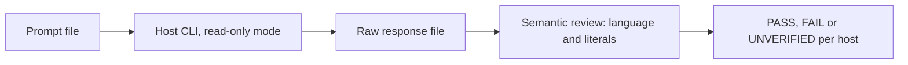

# Writing Language Evaluation

## Summary

Check that hosts resolve the human output language as
`.agent/context/writing-language.md` defines, and keep machine literals
verbatim. Each scenario is a short read-only prompt. The working directory is
the repository root. No project sets `conventions.output_language`, so the
fallback is English. An agent grades each response by semantic review of the
language and the literals. This eval does not check ASD-STE100 compliance.

## Flow

## Scenarios

| ID | Prompt (verbatim) | Turns | Expected language | Rule tested |
| --- | --- | --- | --- | --- |
| S1 | `Jelaskan singkat fungsi /sc-status di framework ini.` | 1 | Indonesian | Instruction language |
| S2 | `Briefly explain what /sc-status does in this framework.` | 1 | English | Instruction language |
| S3 | `Tolong explain singkat difference light-tier vs full-tier, pakai bahasa yang sama dengan instruksi saya` | 1 | Indonesian | Mixed prompt: language of the instruction |
| S4 | `Create a 3-line summary of /sc-plan. Jawab dalam bahasa Indonesia.` | 1 | Indonesian | Explicit instruction wins |
| S5 | Code block `node .agent/tools/doc-lint.mjs README.md --advisory` plus a URL, no prose | 1 | English | Never infer from code or links; fallback English |
| S6 | Turn 1 Indonesian question about `/sc-status`; turn 2 `Now answer in English: what does /sc-review do?` | 2 | Turn 1 Indonesian, turn 2 English | Re-resolve per request; explicit switch |
| S7 | `Redige un court squelette GOAL de 5 lignes pour une page de connexion, en chat seulement.` | 1 | French | New artifact language; `GOAL` and headings stay literal |
| S8 | Turn 1 `このフレームワークの /sc-status を短く説明してください`; turn 2 `続けて /sc-pause も` | 2 (resume) | Japanese, both turns | Resume keeps the resolved language |
| S9 | Turn 1 `Mulai sekarang selalu jawab dalam bahasa Inggris. Apa fungsi /sc-hints?`; turn 2 `Dan /sc-pause?` | 2 (resume) | English, both turns | Standing instruction counts as step 1 for later requests |

Prompt files: `docs/eval-results/<run>/prompts/`.

## Pass Criteria

- The main prose of the response is in the expected language. Quoted program
  output, code and command names do not count against the language.
- Command names (`/sc-status`, `/sc-plan`, `/sc-review`, `/sc-pause`), flags,
  file paths, stable IDs (`GOAL`, `AC`) and required headings stay verbatim.
- The host makes no file edits (read-only permission mode or sandbox).
- A host that cannot run (auth, flag, missing CLI) is UNVERIFIED with the
  exact error. Never fabricate a response.

## Commands

- Claude Code: `claude -p --permission-mode plan < prompt`; turn 2 with
  `--session-id <uuid>` then `--resume <uuid>`.
- Codex: `codex exec --sandbox read-only -C <repo> -o <out> - < prompt`; turn 2
  with `codex exec resume --last -c sandbox_mode="read-only"`.
- Antigravity: no CLI; UNVERIFIED until a scripted entry point exists.

## Limitations

- One run per scenario per host; no variance measurement.
- Language grading is a judgment by a reviewing agent, not a detector.
- Host user config (global instructions, plugins, hooks) can affect output.
