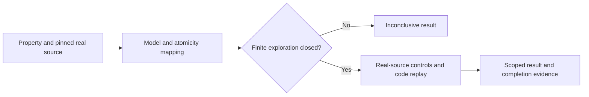

# Bounded Formal Checking

## Summary

Use this optional procedure when a named concurrency, retry or state-machine
invariant needs additional proof. Check a real target with the least costly
existing tool or project test harness that can answer the question. Record the
model's exact scope and connect its results to actual code. A bounded result
supplements ordinary regression, integration and completion evidence.

## Evidence Flow

## Choose and Pin the Question

Name the authoritative requirement, target files/functions, guarded state and
all writers to it. State the property as a predicate before running checks.
Separate safety (a bad state is unreachable) from liveness (progress eventually
occurs). A safety pass supplies no liveness proof; liveness requires its own
property, fairness/progress assumptions and suitable cycle or termination check.

Keep the existing light/full authority and all-AC completion contract. Follow
[authored-gate qualification](claim-evidence.md#authored-or-changed-gates) before
relying on a new or changed checker. Pin expected target and control verdicts;
an expected rejection does not qualify the target for downstream work.
Verification-only scope leaves product changes with their authorized owner.

Use an available verifier or an explicit finite model in the existing test
harness. When neither can answer the question, record the missing proof as
`INCONCLUSIVE` and run the useful real-code tests. Tool installation, broader
product changes and a reusable verification engine require their own scope.

## Define the Model and Code Correspondence

Record initial states, actors, calls/retries, data domains, failures, scheduling,
key normalization, environment and every abstraction/exclusion. Give numeric
bounds and explain why they address this question. Model each relevant state,
transition, guard and effect against exact source locations. Include all guarded
state writers and exceptional/cleanup paths; explain omitted behaviors.

Document the actual atomicity boundaries: synchronous sections, awaits,
Promise/microtask reactions, transactions or external operations. Splitting an
atomic source action or merging interleavable actions needs a justified mapping.
Track queued, running, settled and finalized states when these differ in code;
completion of an operation and cleanup of its queue entry are distinct events.
An executable source check may detect drift, but does not prove the abstraction
matches the implementation; inspect the correspondence itself.

Require nonvacuity witnesses for the property's meaningful preconditions and
branches. For a queue claim, show actual contention, successful serialization,
and rejection followed by recovery when recovery is claimed. Record reachable
state/transition counts and witness traces. An unreachable antecedent or an
assertion disabled by configuration cannot establish the property.

## Execute, Challenge and Replay

1. Capture repository root, HEAD, scoped dirty/untracked inventory and raw-byte
   digests before the run. Include real target source, model, properties, checker,
   relevant dependencies and configuration; record tool/runtime versions, exact
   command/arguments, environment and timestamp. A commit alone misses dirty
   bytes. Preserve outputs, exit status, pass/fail/skip counts and every attempt.
2. Explore the declared finite model and inspect completion evidence. A pass
   within bounds requires closure: every reachable state's enabled transitions
   were examined and the pending frontier is empty, with no unexplained skipped
   states. Distinguish finite actor/data/call bounds from an exploration cutoff.
   A depth/step/state/time/memory cutoff leaving unexplored behavior is
   `INCONCLUSIVE`, even when no counterexample was found or exit status is zero.
3. Create an isolated deliberately broken derivative of the **real source** that
   violates the pinned property. Inspect and retain its source diff and digest.
   Run the same checker, properties and configuration on baseline and derivative;
   change only the intended source behavior and its documented model mapping.
   The broken variant must reject for the intended semantic reason. A model-only
   mutation, setup error or missing copied dependency is insufficient sensitivity
   evidence. Keep user artifacts intact and verify baseline bytes afterward.
4. Preserve the ordered counterexample and first attempt deterministic real-code
   replay. If the scheduler cannot realize it, investigate the atomicity or
   correspondence mismatch. Refine an unjustified abstraction with evidence, or
   retain an explained overapproximation and find a realizable witness of the
   same pinned property violation, validated by the same model transitions and
   checker. Replay the realizable witness against the derivative and unchanged
   baseline. Retain both traces and disclose when the shortest abstract trace was
   not replayed exactly. Qualify sensitivity only after the intended actual
   violation reproduces and baseline remains protected; an unexplained or
   spurious order alone proves neither an implementation bug nor sensitivity.
5. Capture after-run digests and compare with the pinned inputs. Unexpected source,
   model, property, configuration or dependency drift invalidates affected proof.
   Keep failed, blocked and unexpected-pass runs, witnesses and replay evidence
   outside temporary resources before cleanup.

## Report and Maintain the Result

Report model verdict, control sensitivity, real-code replay and ordinary tests
separately, mapped to the acceptance criteria they exercise. For a closed finite
exploration with qualified controls and correspondence, say: "Property P held
within model M, assumptions A and bounds B." State excluded behavior alongside
that claim. A counterexample is a finding; a cutoff or missing correspondence,
witness, tool or control evidence is `INCONCLUSIVE`. Required unresolved proof
keeps completion incomplete under [Claim Evidence](claim-evidence.md).

Reinspect the mapping after target code, state writers, synchronization,
dependencies, properties or environment change. Include moved/new writers and
error/cleanup paths. Update the model from the code; change a property only with
evidence of an intentional authoritative contract change. Preserve the old
result, rerun affected checks and the real-source broken variant/replay, and
advance the recorded synchronization identity only after successful verification.
Weakening a property or excluding the counterexample to obtain a pass needs the
same explicit contract justification; retain the original failure.

These results do not establish unbounded correctness, production wiring,
cross-process coordination or liveness outside the checked assumptions. Ordinary
tests, mandatory gates and any required live-provider proof remain applicable.

## Repository Pilot

When working in this framework repository, the scoped pilot targets
`withLedgerLock` in `.agent/tools/work-package.mjs`: a process-local Promise queue,
two actors with two calls each on the same normalized key, separate queued,
running, settled and finalized states, and rejection recovery. Run
`node --test .agent/tools/bounded-formal-checking.test.mjs` and inspect its current
source identities, closure, witnesses, control verdict and real-code replay.
Other projects apply the procedure above to their own target and existing harness;
the repository pilot is an example, not an installation prerequisite.
