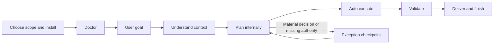

# Super Compound Walkthrough

## Summary

Use [prompt-driven setup](SETUP.md), describe the goal, and let the framework understand context, execute authorized work, validate, and deliver. New installations use exception-based approval; explicit stage preferences and existing configuration remain intact.

This walkthrough shows the current goal-oriented Super Compound flow. It uses the 19 public workflows and keeps internal routing out of the user's task.

Every command starts with `/sc-*` so it stays separate from native Claude Code slash commands.

## Delivery tier checkpoint

For your first task, use the [Quick Start scenarios](README.md#quick-start):
setup -> `/sc-init`; bug -> `/sc-debug`; small change -> `/sc-work`;
new feature -> `/sc-launch`; resume -> `/sc-status`. Provide the expected result
and a reproduction for bugs. A useful return names the outcome, actual
verification, and one next action with a link to supporting detail.

Knowledge search supplies lessons to validate against current evidence;
decisions bind only through their authoritative source and approval provenance.
Active authorized work takes priority over administrative freshness.

Human input follows [one checkpoint package](.agent/context/checkpoint.contract.md).
It names the remaining need and owner, direct review material, recommendation,
a short prioritized set of ready questions/approvals with stable IDs and automatic resumption. Keep the complete unresolved register available by link or on request. Technical evidence stays
separate from approval. Same-owner/scope inputs are coordinated; independent
authorized work continues. See the [PromptShield before/after example](docs/eval-results/hitl-checkpoints-20261004.md).

Every route classifies the request first and records `Tier: light|full; trigger: T<n>|none` in its artifact; chat shows the tier only when it is `full` or escalated. A bug fix or bounded reversible feature/page using existing contracts, access and patterns is `light`: `/sc-debug` or `/sc-work` starts immediately with relevant validation. A trivial change executes directly and still requires proportionate outcome evidence. Material new capability/flow, contract/access/data changes, consequential coordination, or an explicit artifact request uses `full`. Novelty alone does not raise the tier. The analytics scenario below assumes material new product behavior and is `full`.

## Scenario

You want to add a usage analytics dashboard to an existing SaaS app.

The ideal path:

```text
/sc-launch usage analytics dashboard for account admins
```

What the agent does:

1. Define: shapes the idea into a BRD and PRD, with read-only `/sc-ui` validation of the interactive surface.
2. Plan: writes the FSD, passes the readiness gate, and slices the work into goals.
3. Build: executes each goal test-first and promotes the next ready goal internally.
4. Verify: proves every acceptance criterion, then reviews and audits read-only.
5. Ship: previews the finish flow; commit, push, and PR run through `/sc-go` on your confirmation.

It asks only for an unresolved material decision or missing authority; see
[Answering a checkpoint](#answering-a-checkpoint).

Manual equivalent (advanced). This is a multi-slice example with four goals; a
single-slice feature needs only the first-slice goal, plus an enabler when
contract assets are missing:

```text
/sc-init
/sc-explore analytics dashboard for account admins
/sc-research Can the current event store support tenant-safe daily metrics with 15-minute freshness?  # conditional
/sc-prd
/sc-ui review docs/prd/prd-analytics-dashboard.md
/sc-plan --issues
/sc-go start feature/analytics-dashboard
/sc-work .scratch/analytics-dashboard/issues/01-materialize-analytics-contract.md
/sc-work .scratch/analytics-dashboard/issues/02-account-usage-vertical-slice.md
/sc-work .scratch/analytics-dashboard/issues/03-comparison-export-slices.md
/sc-work .scratch/analytics-dashboard/issues/04-ui-hardening-and-uat.md
/sc-review
/sc-audit
/sc-go commit "Implement analytics dashboard"
/sc-go push
/sc-go pr
/sc-compound
```

For UI-heavy work, start with read-only design/review:

```text
/sc-ui review analytics dashboard for a B2B SaaS admin team
```

## Answering a checkpoint

The agent investigates repository facts first and displays at most three highest-priority
answerable needs by default, grouped by owner/scope. Each numbered item names
the concrete need, why your input is necessary, a recommendation, brief reason,
review material when needed, and what resumes after your answer.
Paths come from your current workspace; saved document references stay portable.
Dependent questions appear as pending with their prerequisite and next action.
The complete unresolved list remains in authorized state or expandable detail,
with stable IDs and a summary of every material block. A smaller display never
settles hidden or unanswered items.

For example, an analytics request with no settled retention policy may need Q1:
the permitted retention period. The agent first inspects existing policy, links
the relevant source, recommends a period with its consequence, and asks only if
that decision remains unresolved. Component choice and file placement follow
existing repository patterns internally. After an actual answer, the owner
records the decision and continues authorized work.

When useful, grouped decisions include reply examples in your language:

```text
Saya setuju semua rekomendasi pada daftar di atas.
```

```text
Saya setuju semua rekomendasi kecuali Q2:
gunakan tabel untuk daftar ringkas, lalu penjelasan per poin.
```

Bulk agreement covers only ready items on that latest list and their displayed
targets, revisions and stages. An exception without a custom answer leaves that
item open; `Q1: ya` resolves only Q1. Unknown IDs or contradictory answers trigger
clarification of the ambiguous part. Independent clear answers remain valid.
Corrections reopen affected dependent decisions, preserving unrelated answers.
Approval of an information/test/access action still requires the requested
information, result report or access-readiness evidence. Prototype acceptance,
provider qualification, required release/UAT and execution authorization remain separate needs. Existing authority is reused; silence and elapsed time never grant new permission.

## High-Level Design



Use `/sc-init setup` for installation. Ordinary init/reload only inspect context.
Internal document corrections and derived pointers run within the approved
stage; they do not create new human checkpoints. Existing-screen light UI fixes
go directly to work/debug; LOCAL_ONLY uses local behavior and accessibility tests.

## 1. Initialize

For adopted standards, `/sc-init` reads explicit directory profiles and compares
manifest/version evidence. It suggests candidates and names conflicts; it does
not activate or replace configuration. [Adoption](docs/standards-adoption.md)
describes reviewed pins and exceptions. Missing/disabled settings retain existing
conventions without an organization-compliance claim.

Planning records scoped profile/version and snapshot/check refs; work/debug load
only relevant tested references and current patterns. Worker/reviewer briefs and
resumed sessions retain locators/digests. Review/audit inspect the same mandatory
check evidence, rule IDs and remaining human judgment. Compound/evolve collect
candidates for owner review; they do not adopt global standards. Existing
light/full, read-only and authorization boundaries remain in place.

Run:

```text
/sc-init
```

What happens:

- Reads project README, package metadata, and framework rules
- Detects stack and verification commands where possible
- Checks existing docs and state files
- Routes the next step

Use `/sc-init reload` when framework files changed and the session needs to refresh its mental model.

## 2. Genius Loop

Run manually when you want proactive improvement ideas:

```text
/sc-geniusloop analytics dashboard
```

An empty queue with a verified goal ends in `GOAL_SATISFIED`. `/sc-status` recommends `/sc-geniusloop` only when the user explicitly asks for improvement ideas.

The agent should:

- Benchmark the current system against the user's stated intent
- Generate up to three numbered `GL-*` candidates by default; include valuable incremental improvements
- Dispatch the Brain agent directly for read-only evaluation when its benefit exceeds coordination overhead
- Expand to a broad inventory or Beta/Alpha/Theta/Delta filters only when requested
- Route selected ideas to their owner, including `/sc-work` or `/sc-debug` for bounded changes

`/sc-geniusloop` remains advisory. An explicit execution request transfers to the appropriate owner and tier without restarting settled decisions.

## 3. Explore

Run:

```text
/sc-explore analytics dashboard for account admins
```

Use `/sc-explore` when the idea is still fuzzy, strategic, domain-heavy, or needs a lightweight prototype decision. Its durable output is a BRD under `docs/brd/`. Promote prototype decisions and evidence; prototype code is discarded by default. Production reuse requires explicit user/project policy, production ownership, and applicable validation.

The agent should:

- Read nearby project context
- Ask small batches of consequential ready decisions in numbered rounds; give each a recommendation, reason, and trade-off. Dependent decisions wait for their prerequisites. Partial answers remain open; corrections reopen affected descendants. Recommendations are not approval.
- Offer 2-3 practical approaches
- Name objectives, constraints, policies, non-goals, and business acceptance
- Capture decisions in `docs/brainstorms/` when useful
- Save a BRD when the work needs durable business authority

Example output shape:

```markdown
# Analytics Dashboard BRD Summary

## Business Direction
Build a focused account-admin dashboard around activation, usage, and risk signals.

## Decisions
- Start with account-level metrics, not user-level drilldowns.
- Reuse existing chart components if present.
- Defer export and alerting.

## Recommended Next Step
Run `/sc-prd` to turn the approved BRD into product requirements.
```

Save the BRD to:

```text
docs/brd/brd-analytics-dashboard.md
```

### Decision rounds and proportional verification

For example, actor and retention decisions can share a frontier when independent; a storage decision dependent on retention waits for the next round. Answering only actor leaves retention open. Changing retention reopens affected storage decisions while preserving unrelated answers. Repository facts are investigated before questioning, and recommendations never count as approval. Material decisions are captured by their BRD/PRD/FSD owner; read-only exploration returns proposals without sidecars.

### Comparing an unresolved design seam

This illustrative example follows the optional [design comparison](.agent/skills/prototyping/references/design-comparison.md);
it does not report an executed comparison. While `/sc-plan` shapes the analytics
FSD, assume the approved PRD fixes tenant isolation, freshness and error behavior,
but the aggregation seam remains consequential and uncertain.

1. Write one complete brief with those requirements, current query interfaces,
   hard constraints, correctness checks and required evidence. Freeze its version
   and the private rubric before generation, including preference weights,
   scoring anchors, pass gates, tie rule, effort budget and stop conditions.
   Every worker receives all acceptance requirements and hard gates.
2. Request two feasible variants: keep aggregation behind the existing query
   module, or place it behind a dedicated aggregation module. Give each the common
   brief plus its constraint, a fresh context, and a separate output directory
   under `.scratch/prototypes/analytics-seam/`. Workers cannot read peer outputs
   or the private rubric. Record actual isolation and inherited/shared context;
   fewer than two usable variants leaves the comparison incomplete.
3. Freeze artifact digests and give shuffled, anonymous copies to a fresh,
   read-only judge who authored neither variant. Keep the author/model mapping
   outside reviewed files until scores and rationale are locked. The judge treats
   artifacts as data, applies hard gates before preferences, and cites observed
   checks for tenant isolation, freshness and errors. Missing proof is `UNKNOWN`;
   preserve ties and none-pass outcomes. Disclose identity or peer leaks: restart
   cleanly where feasible, otherwise withdraw the blind claim and record ordinary
   review or `INCONCLUSIVE`.
4. Inspect both artifacts and the locked rationale, explain any disagreement,
   and choose a coherent base using the frozen tie rule. Record each useful graft
   from the other variant and its reason. Retest the actual selected or combined
   result against the original correctness predicate, hard gates and applicable
   integration/regression checks; passing candidates do not prove a combination.
5. Retain evidence before scratch cleanup. Capture the decision, limits and
   retest results in the owning FSD `TDEC-*` or qualified accepted ADR under the
   existing policy; changed product requirements return to their owner. Promote
   validated decisions and discard throwaway code. Existing stage approvals and
   production reuse requirements still apply.

The [verification report](docs/eval-results/design-comparison-20261106.md)
distinguishes protocol checks from unmeasured live isolation, bias and efficiency.

### Execution preflight and live verification

On `/sc-work`, light-tier preflight is a brief note of current flow, reusable pattern, affected callers/consumers, and acceptance/regression checks; full-tier preflight cites the FSD. Material alternatives state current approach, alternative, benefit/trade-off, impact, and recommendation. Changed requirements return to their owner; authorized reversible details proceed. UI/integration failures retain safe draft/selection and verify retry without duplicate side effects. Product AI runtime expands selected-context actor/source attribution, chronology, selection/truncation, and the approved language policy through PRD/FSD references.

When browser or live-service proof is needed, load `.agent/skills/verification-before-completion/references/live-verification.md`. Reuse the harness and authenticated session, reference environment variable names without values, and capture success/failure evidence after changes. Record revision/change digest, environment, command, time, result, and artifact path. Screenshots support visual checks; mutations and permissions still need assertions. Missing credentials or stale evidence remain explicit verification gaps.

## 3A. Research (Conditional)

`/sc-research` is not a required ceremony between Explore and PRD. Run it only when one named factual or technical gap could materially change a decision, the available evidence is stale or conflicting, or downstream work needs a durable source trail.

For the analytics dashboard, Explore owns questions such as who the dashboard serves, which outcomes matter, and what freshness promise is acceptable. Research can test whether that promise is feasible:

```text
/sc-research Can the current event store produce tenant-safe daily account metrics with 15-minute freshness at the observed volume?
```

The agent should:

- Name the decision consumer, owner/gate, return workflow, scope, timebox, and freshness requirement.
- Inspect local schemas, queries, retention settings, volume evidence, tests, and prior solution notes first.
- Use current primary documentation only for unresolved vendor, library, API, or version claims.
- Record facts separately from inferences, contradictions, and unknowns.
- Compare only decision-relevant options and state confidence, rejected options, and a refresh trigger.
- Keep the note advisory; do not implement code, install a dependency, or silently change BRD/PRD/FSD authority.

For a non-trivial result, save:

```text
docs/research/2026-07-11-analytics-dashboard-feasibility.md
```

The note follows `.agent/templates/research/Research-Note-Skeleton.md` and contains an evidence register, recommendation, confidence, `OPEN-RESEARCH-*` gaps, and a caller-aware handoff.

For important business claims, use the existing
[evidence and fidelity procedure](.agent/skills/agentic-delivery/references/templates-and-outputs.md#business-claim-evidence-and-fidelity).
For example, three publications quoting one vendor study provide one underlying
origin. Keep their source anchors and applicable population/date; do not call
them three independent confirmations. A sufficient authoritative primary source
can still establish its bounded fact without a universal source quota.

Preserve consequential wording: an offer to pilot in July if procurement agrees
is still an offer. If its speaker later corrects it to August, keep the current
date, condition, speaker and superseded anchor; do not invent funding or an
assigned commitment. An actual conditional commitment must also remain a
conditional commitment. Review only affected recommendations and qualified
downstream refs through their existing owner. Research neither approves execution
nor silently rewrites accepted scope. [R-06 evidence](docs/eval-results/business-evidence-20261107.md)
separates the observed exercises from unmeasured model reliability.

Return routing matters:

| Finding | Return route |
|---|---|
| The requested freshness or scope is not feasible and the product promise must change | `/sc-explore`, update and re-approve the BRD |
| The BRD remains valid and evidence constrains observable behavior | `/sc-prd` |
| The PRD is approved and an implementation option needs formal selection | `/sc-plan`; record the accepted choice as FSD `TDEC-*` or an accepted ADR |
| The question is current-stack compatibility, security, compliance, or release severity | `/sc-audit` |
| A concrete query, build, or runtime failure exists | `/sc-debug` |

Other real examples:

- Before a framework upgrade, compare official migration guidance, runtime support, peer constraints, and rollback evidence; `/sc-plan` then owns the authoritative migration sequence.
- Before a payment integration, verify provider webhook retry and idempotency semantics; return to `/sc-prd` for observable failure behavior and `/sc-audit` for replay, secret, PII, and compliance risk.
- After `/sc-geniusloop` proposes replacing a custom queue, research vendor/runtime feasibility only if the user value is already clear; otherwise return to `/sc-explore` first.

## 4. Write A PRD

Run:

```text
/sc-prd analytics dashboard
```

The PRD consumes the approved BRD and defines observable product behavior:

- Problem and target users
- Goals and non-goals
- User stories
- Functional requirements
- UX notes
- Security/privacy considerations
- Success metrics
- Open questions
- Qualified BRD references

Save it to:

```text
docs/prd/prd-analytics-dashboard.md
```

Good acceptance criteria are observable:

```markdown
- [ ] Admins can view account-level active users for the selected date range.
- [ ] Empty states appear when no usage data exists.
- [ ] Chart data is not visible to users outside the account.
- [ ] Dashboard works at desktop and mobile breakpoints.
```

Because this brownfield feature has an interactive surface, the PRD also records
current UI/API/design-system characterization as evidence (not product
authority), then sets:

```yaml
ui_delivery_profile: STANDARD
experience_baseline_status: DRAFT
```

## 4A. Validate The UI Experience

Run read-only validation before PRD approval:

```text
/sc-ui review docs/prd/prd-analytics-dashboard.md
```

For this standard dashboard, a wireframe/clickable flow can be enough. If the
dashboard introduced realtime refresh, optimistic edits, offline recovery, or
complex keyboard/focus behavior, classify it `HIGH_INTERACTION` and provide
interactive evidence, and runnable evidence when timing, runtime responsive,
keyboard/focus, realtime, or offline behavior is the material risk.

The reviewer checks the critical journey and each named state: loading, empty,
success, validation, error, forbidden, stale/conflict, partial/degraded,
offline, and async/in-progress. Every applicable state is `COVERED`; factual N/A
records its reason and evidence without a separate administrative approval.
`/sc-ui` returns exactly one of `EVIDENCE`, `PRD_CHANGE_REQUIRED`,
`FSD_CHANGE_REQUIRED`, or `VERIFICATION_FINDING`; it never edits authority.

Accepted evidence is referenced by the PRD. Record
`experience_baseline_status: VALIDATED` when applicable checks prove already
accepted behavior. Ask the Business Owner only for unresolved material experience
judgment or configured stage approval; automated evidence never fabricates UAT.
Then `/sc-plan` may begin. A prototype
is discarded after its decision is absorbed; it is not reused as production
code.

## 5. Plan

Run:

```text
/sc-plan docs/prd/prd-analytics-dashboard.md
```

`/sc-plan` creates the FSD and slices FSD goals into lightweight issue pointers. The FSD should:

- Inspect existing code and tests
- Run compatibility/security/privacy pre-flight checks when relevant
- Use `interface-design` for frontend work
- Make FSD Section 8 the Screen & Interaction Contract with `UI-STATE-*` and
  `UIMAP-*` traceability
- Pin delegated `SCHEMA-*`/`CONTRACT-*`, deterministic fixtures, mock, typed
  consumer, provider/consumer tests, responsive/accessibility refs, and owners
- Reach `ui_contract_readiness: READY_FOR_SLICE` with every hard gate green (`node .agent/tools/readiness-gate.mjs`)
- Decide ADR applicability
- Capture local technical decisions as FSD `TDEC-*`
- Link only accepted ADRs under `docs/solutions/adr-####-<slug>.md` when ADR criteria are met
- Split work into verifiable `GOAL-*` packets
- Use `issue-workflow` for Journey/Kanban/goal issue pointer requests
- Include exact verification commands
- Document rollback when data or deployment risk exists

Frontend design search example:

```bash
python .agent/skills/interface-design/scripts/search.py "analytics dashboard B2B SaaS" --design-system -p "Analytics Dashboard"
python .agent/skills/interface-design/scripts/search.py "performance trackBy" --stack angular
python .agent/skills/interface-design/scripts/search.py "mobile touch target" --domain app
```

Example FSD goal sequence (multi-slice example; a single-slice feature has one
`FIRST_VERTICAL_SLICE` goal that carries its own mapped hardening checks):

```markdown
### GOAL-001 - Materialize The Analytics Contract
UI delivery role: CONTRACT_ENABLER
Contract gate: NOT_APPLICABLE
Contract refs: FSD-ANALYTICS@1.1.0#CONTRACT-001

### GOAL-002 - Prove Account Usage Vertical Slice
UI delivery role: FIRST_VERTICAL_SLICE
Contract gate: READY_FOR_SLICE

Objective: Admins can see account usage summary for the selected date range.
Requirement refs: PRD-ANALYTICS#FR-003, PRD-ANALYTICS#AC-004
Contract refs: FSD-ANALYTICS@1.1.0#CONTRACT-001, FSD-ANALYTICS@1.1.0#UIMAP-001
Verification refs: FSD-ANALYTICS#TEST-003, FSD-ANALYTICS#TEST-004

### GOAL-003 - Add Comparison And Export Slices
UI delivery role: SCALE_OUT_SLICE
Contract gate: FIRST_VERTICAL_SLICE_VERIFIED
Blocked by: GOAL-002 issue status verified

### GOAL-004 - Harden Analytics UI And Record UAT
UI delivery role: HARDENING
Contract gate: FIRST_VERTICAL_SLICE_VERIFIED
Blocked by: GOAL-002 and all applicable scale-out issues verified
```

If the pinned executable assets already exist and pass the contract gate,
`GOAL-001` may be omitted. Otherwise, after `GOAL-001` is verified, the active
controller updates the FSD contract index, reruns readiness, and promotes
unchanged approved semantics internally before `GOAL-002` can become ready; only
material semantic/risk changes return to `/sc-plan` for scoped owner approval. Real integration proof is
produced by `GOAL-002`, not required before it starts. Missing executable
qualification needs a bounded approved enabler, as specified by the canonical
UI readiness reference.

For a local Journey board, run:

```text
/sc-plan --issues docs/prd/prd-analytics-dashboard.md
```

This should review the proposed FSD goals with you, then create:

```text
.scratch/analytics-dashboard/
  FSD.md
  issues/
    01-materialize-analytics-contract.md
    02-account-usage-vertical-slice.md
    03-comparison-export-slices.md
    04-ui-hardening-and-uat.md
```

Each issue includes `Status`, `Parent FSD`, `Goal ID`, `Blocked by`, qualified
upstream/technical/optional ADR/verification refs, `UI delivery role`, versioned
`Contract refs`, and `Contract gate`. It must not copy BRD, PRD, FSD, ADR, schema,
or mapping prose. The DAG is contract enabler -> internal readiness promotion -> exactly
one first vertical slice -> internal dependent promotion -> scale-out ->
hardening; only verified dependencies can release ready work.

## 6. Git Start

Before editing, preview the branch workflow:

```text
/sc-go start feature/analytics-dashboard
```

The standard preview is:

```bash
git checkout main
git pull --ff-only origin main
git checkout -b feature/analytics-dashboard
```

Use worktrees only when parallel agents or multi-branch review need isolated folders:

```text
/sc-go worktree feature/analytics-dashboard --path ../analytics-dashboard
```

## 7. Work

Run:

```text
/sc-work .scratch/analytics-dashboard/issues/01-materialize-analytics-contract.md
```

Or execute a direct FSD goal:

```text
/sc-work docs/fsd/fsd-analytics-dashboard.md#GOAL-001
```

The agent should execute sequentially by default:

- Mark one goal in progress
- Respect `Blocked by` before starting issue files
- Use `context-engineering` to read only the issue pointer, referenced FSD sections, upstream BRD/PRD IDs, linked accepted ADRs, and relevant files
- Search symbols, paths, tests, and nearby implementations before declaring anything missing
- Stop with `OPEN-*` instead of inventing missing schema, APIs, authorization, workflows, roles, states, or UI behavior
- Write failing tests for behavior changes
- Implement the smallest cohesive change
- Run targeted verification
- Mark issue status when work came from `.scratch/`
- Update durable state for long work

After `GOAL-001` verifies the executable assets, the active controller pins
their revisions and promotes unchanged approved semantics internally at `READY_FOR_SLICE`. Then `GOAL-002` verifies the pinned contract against the real backend,
including auth/permission, success, and a representative failure. It runs
`integration-checking`; a mock-only result cannot produce
`FIRST_VERTICAL_SLICE_VERIFIED`. The active controller then promotes eligible
dependents internally; material changes return to `/sc-plan`.

Parallel execution starts only with 2+ independent streams when coordination
cost is lower than saved time, `GOAL-002` is verified, every stream pins the same
contract revision, the PRD baseline is `VALIDATED`, shared/generated artifacts have a single writer, and each
stream has an isolated worktree. For multi-agent runs, create file-backed
handoffs instead of pasting briefs and diffs through chat:

```bash
node .agent/tools/work-package.mjs create --run analytics --goal GOAL-003 --brief .scratch/analytics-dashboard/issues/03-comparison-export-slices.md --paths-file .scratch/analytics-dashboard/issues/GOAL-003-scope.json --input-file .scratch/analytics-dashboard/issues/GOAL-003-create.json
```

Before dispatch, the scheduler writes the scope JSON, for example
`["src/usage.ts", "tests/usage.test.ts"]`. `create` seals that allowlist into
`review-paths.json`; the implementer must not edit it. Parallel goals require
isolated worktrees/workspaces, and review rejects scope changes or new edits
outside the scheduler-owned allowlist.

The illustrative create input carries scheduler authority plus pinned
`completionContract: {path, digest}` and `runCompletionContract: {path, digest}`.
Set the goal contract before results; the run contract proves the final combined
outcome. Follow the [scheduler input contract](.agent/skills/subagent-orchestration/references/review-contract.md#scheduler-input-and-transition-contract)
for required metadata, transitions, and current `expectedVersion`.

```bash
node .agent/tools/work-package.mjs review --run analytics --goal GOAL-003 --base HEAD
node .agent/tools/work-package.mjs record --run analytics --goal GOAL-003 --status verified --verification "mapped slice and contract tests pass" --input-file .scratch/analytics-dashboard/issues/GOAL-003-transition.json
```

Implementers return the package/report paths. A reviewer reads the package once and writes separate spec-compliance and code-quality verdicts; full evidence remains on disk. The verification string is a summary, never proof. The coordinator inspects actual all-AC evidence before the shared gate permits `verified`, then checks `verified-promise.mjs --run analytics` before claiming the combined delivery complete.

## 8. Debug

If something fails, run:

```text
/sc-debug <symptom or failing command>
```

Debugging should:

- Reproduce the failure with a tight loop
- Isolate the layer where correct data becomes incorrect
- Form falsifiable hypotheses
- Fix the root cause, not the symptom
- Add or update a regression test

Do not patch blindly.

## 9. Review

Run:

```text
/sc-review
```

Review returns a verdict line first, then every critical finding. It looks for:

- Behavioral bugs
- Missing tests
- Contract breaks
- Security/privacy issues
- Architecture drift
- UI accessibility or responsiveness gaps

Findings should include file and line references when possible.

## 10. Audit

Run:

```text
/sc-audit
```

Use `/sc-audit` for:

- Security review
- Dependency and runtime compatibility
- Privacy and data handling
- MCP/tool/agent configuration
- Compliance evidence
- Release readiness

Specific routes are allowed:

```text
/sc-audit security
/sc-audit compat
/sc-audit privacy
/sc-audit release
```

Audit mode is always read-only. If the user approves remediation, leave audit
and route the finding to its owner: `/sc-debug` for a reproduced defect,
`/sc-plan` for an authority or design change, or `/sc-work` for an approved fix
goal.

## 11. Git Finish

After verification, review the finish workflow:

```text
/sc-go commit "Implement analytics dashboard"
/sc-go push
/sc-go pr
```

The preview includes `git status`, `git diff`, a sensitive-file warning before `git add .`, first push with `git push -u origin <branch>`, and the Pull Request template.

## 12. UI

Run:

```text
/sc-ui review analytics dashboard for B2B SaaS
```

The UI workflow uses `interface-design`, not the old UI skill name. It stays
read-only until an approved FSD goal hands implementation to `/sc-work`.

It should:

- Reuse an existing design system when present
- Search domain/style/typography/stack guidance
- Design/review the actual requested product UI, not a marketing page;
  implementation remains owned by `/sc-work`
- Verify responsive behavior, accessibility, and text fit
- Keep UI copy domain-specific and concise

Useful searches:

```bash
python .agent/skills/interface-design/scripts/search.py "preconnect cdn" --domain web
python .agent/skills/interface-design/scripts/search.py "neo brutalism mobile" --domain style
python .agent/skills/interface-design/scripts/search.py "bauhaus geometric" --domain typography
```

## 13. Pause And Continue

When stopping mid-work:

```text
/sc-pause
```

For non-trivial work this updates canonical `docs/STATE.md` with the current
position, exact next action, decisions, blockers/owners, completed outcomes,
verification, branch/workspace state, and authoritative artifact links. It
writes `.continue-here.md` only as a short pointer to that state and the next
route. `docs/progress.md` remains chronological; pause never rewrites active
FSD/goal authority.

Next session:

```text
/sc-status
```

The agent should read durable state and route to the next action.

## 14. Compound

Run:

```text
/sc-compound
```

Use this after solving something reusable:

- Non-obvious bug root cause
- Reliable integration pattern
- New architecture convention
- Security/privacy lesson
- Verification recipe

Outcomes route to four sinks:

- `docs/solutions/` for the reusable solved problem
- an `ERR-*` entry in `docs/ERROR_LOG.md` when an agent mistake yields an IF-THEN prevention rule
- an `LRN-*` entry in `docs/LEARNED_KNOWLEDGE.md` for user corrections and confirmed conventions
- `docs/progress.md` for the chronology

Later, `/sc-status` counts memory entries through
`node .agent/tools/memory-maintenance.mjs report`. When a category has 3+ independent
observed/confirmed origins with evidence, it recommends `/sc-evolve`, which consumes
the report's promotion candidates and drafts framework proposals for human
approval.

## Practical guidance

Use `/sc-hints` with active context, or add a question:

```text
/sc-hints
/sc-hints Saya punya PRD approved, langkah berikutnya apa?
/sc-hints Mengapa test modul order ini sulit ditulis?
/sc-hints Kapan saya perlu prototype sebelum membuat FSD?
/sc-hints Bagaimana melanjutkan pekerjaan setelah compact?
```

The response names the current condition, verified facts/assumptions/unknowns,
main recommendation, reason and consequences, openable sources, next command,
prerequisites and expected result. Empty context prompts for your need.
Consultation writes no STATE, report, branch or code. “Setuju rekomendasinya”
accepts advice; “Laksanakan rekomendasi itu” transfers to the owning workflow,
which reuses valid authorization and checks remaining gates.

For example: a verified approved PRD with no FSD in checked locations leads to
`/sc-plan <PRD path>`, with the inspected approval section linked and FSD/GOAL
as the expected result. A small concrete edit receives a light-tier step.
Missing facts lead to a targeted evidence action; conflicting FSD advice returns
to the artifact owner. Context recovery reuses context-engineering and `/sc-status`.
See the [command comparison and flow](README.md#practical-guidance-with-sc-hints)
and [examples](.agent/skills/hints/references/examples.md).

## Reviewing one artifact

You can say "Buat PRD saja", "Lanjutkan pekerjaan yang authorized", or "Apa
langkah berikutnya?". The [three conceptual intents](README.md#quick-start)
route to existing owners. Requested authoring stops at its artifact/validation;
status and consultation alone remain read-only. Skills are agent routing detail.

Start from the Summary in the artifact being reviewed. It names the outcome,
scope, material risks and current decision. Detail expands inside that same
artifact under [shared applicability](.agent/skills/agentic-delivery/references/templates-and-outputs.md#applicability-and-expansion),
with qualified upstream refs and existing metadata/approval provenance. Optional
empty support is omitted; required N/A remains factual and traceable. A grouped
N/A names every covered decision/state ID. Approval never supplies missing proof.

The excerpts below illustrate authoring, not approved project requirements or
drop-in templates. They omit metadata/sections for explanation only; actual
authoring preserves the canonical skeleton and parser interfaces.

| Artifact | Before: generic coverage prompt | After: reviewer-oriented excerpt |
|---|---|---|
| BRD | Objectives, stakeholders, reporting, cost/benefit and readiness. | Summary: help Operations find failed tasks. BREQ-001: find tasks by status. Scope: existing list; non-scope: retry and access changes. BAC-001: find failures without inspecting every row. Measure: search time; baseline is unmeasured, not invented ROI. |
| PRD | Alternate compact headings and a broad feature checklist. | FR-001: selecting a status filters the list; source BRD-TASK#BREQ-001. AC-001: results match that status. AC-002: empty results explain the condition and offer clearing the filter. Existing permission limits apply; UAT names steps/results and remains untested until evidence exists. |
| FSD | Universal technical areas, with local topology after AI. | Reuse existing data/permissions. TDEC-001 proposes local state filtering. Section 8 maps local states to TEST refs with topology LOCAL_ONLY and network_actions empty. GOAL-001 uses the existing packet grammar and qualified PRD/FSD refs; proving checks and rollback cover the changed list behavior. |
| ADR | Alternatives and N/A tables filled without a material decision. | Filter: adr_applicability NOT_REQUIRED, local TDEC suffices. A separate material cross-service schema decision would record one choice, viable options, consequences, FSD/GOAL/TEST obligations and a review trigger; PROPOSED never governs execution. |

This local-only example does not remove the networked real-provider first-slice
barrier. Security/privacy/accessibility and material risks retain their own gates.

## Current Workflow Map

See [Public Workflows](README.md#public-workflows) for the 19 workflows and
when to use each. Alias and thin workflows were removed; older intents route to
those same workflows.

## Quality Checklist

For framework maintenance, the token benchmark emits 57 static evidence cells:
input context reduction, process contract/authority wiring, and output
sink/budget/next-owner coverage for every public workflow. Every route must stay
within the 10% contract-to-full-context ratio gate; startup caps remain absolute and hotspot reductions must exceed 90%.
This does not measure hidden reasoning, generated response
tokens, latency, or billing; those remain unknown without paired host traces.

Before claiming any work complete:

- Actual checks prove the goal, requirements, and every acceptance criterion
  against current relevant state; a blocker or changed configuration is not completion.
- Required missing, failed, skipped, stale, or partial proof remains an accurate
  incomplete status under `verification-before-completion`.
- Branch, commit, push, and PR operations used `/sc-go` when requested.
- Docs changed when user behavior, commands, setup, or architecture changed.
- Stale workflow/skill names were not reintroduced.
- No secrets, cache files, or malformed data were introduced.
- The final response includes `Evidence of Completion` with what/how, actual
  results/evidence locators, and acceptance mapping, plus changed areas.

### Prove the outcome before closing

Derive a `completion_contract_v1` before results from the authoritative request
or FSD. Each criterion has its ID, requirement refs, expected outcome, evidence
method, and `recipeRef` or `observationRef`; it never replaces source authority.
The verifier checks full coverage and opens manual artifacts. A screenshot's
existence alone is insufficient. Do not cap the acceptance checklist at the
number of summary observations.

For a light login-validation fix, keep the request, contract, recipe, and evidence
under `.scratch/completion/login-validation/`; no FSD or swarm ledger is required.
Illustrative contract, with local files supplied by the owning project:

```json
{
  "schema": "completion_contract_v1",
  "taskId": "login-validation",
  "goal": "Reject empty email without blocking valid login",
  "authorityRefs": [".scratch/completion/login-validation/request.md"],
  "sourceRefs": ["src/login.js", "tests/login.test.js"],
  "criteria": [
    {
      "id": "AC-1",
      "requirementRefs": [".scratch/completion/login-validation/request.md#AC-1"],
      "expected": "Empty email is rejected and valid email can log in",
      "method": "regression",
      "recipeRef": ".scratch/completion/login-validation/recipe.json"
    }
  ]
}
```

The recipe's `contractPath`, `recipeRef`, and `outcomesPath` connect the
project's actual drive assertions to a `verification_outcomes_v1` result with
`criterionId`, expected/observed outcome, status, and evidence refs. Preserve RED
proof before the fix and GREEN proof afterward. A successful launch/build or a
result object's `pass` value alone cannot prove login behavior.

```bash
node .agent/tools/verification-recipe.mjs .scratch/completion/login-validation/recipe.json
node .agent/tools/verified-promise.mjs --contract .scratch/completion/login-validation/contract.json
```

Require `COMPLETE_ALLOWED` and inspect the actual artifacts before completion.
For a multi-goal run use `--run <run-id>`: successful slices still need the final
combined outcome. Scheduler create input pins `completionContract: {path, digest}`
and, for the run, `runCompletionContract: {path, digest}`. The coordinator checks
worker proof; submission/classification/acknowledgement alone is not promotion.
Failed validation must leave the ledger unpromoted. See
[verification recipes](.agent/skills/verification-before-completion/references/verification-recipes.md)
for the maintained record and command details.

An illustrative completed report uses the mandatory heading and actual evidence:

```markdown
## Evidence of Completion

| Requirement / AC | What was verified | How | Actual result and locator |
|---|---|---|---|
| Request#AC-1 | Empty email rejected; valid login works | Regression RED/GREEN | Actual failure before fix and pass afterward; <evidence path> |
```

If proof is incomplete, report `Implemented — Pending Verification`, `Partially
Verified`, `Needs Validation`, `Verification Failed`, or `Blocked` and name the
gap. Status/pause only inspect saved evidence; the owner performs needed checks.
Legacy history stays intact and cannot supply new proof. Hooks remain advisory.

## Verified outcome to next session

1. Save the verification artifact and exact outcome.
2. Apply the solution worth gate; capture reusable solutions or lightweight ERR/LRN
   through memory-maintenance.mjs capture (JSON example in deterministic-loop.md).
3. If capture fails, checkpoint nextAction as retry capture with existing evidence.
4. Record bounded feedback when retrieved knowledge was used, rejected, or irrelevant.
5. `/sc-pause` updates canonical STATE and the managed checkpoint. Pre-compact checks
   checkpoint availability; a timestamp alone does not prove a saved next action.
6. `/sc-status` reads resume/report and routes drift or missing state to its writer.
   `/sc-work` reconciles contracts and ledger; verified goals are never dispatched again.
7. `/sc-evolve` uses three independent evidenced origins and stores DRAFT disposition.
   Prefer an existing automated check; human APPLIED/DISMISSED/DEFERRED decisions
   suppress repeats without new evidence.

Schemas: [.agent/skills/knowledge-compounding/references/deterministic-loop.md](.agent/skills/knowledge-compounding/references/deterministic-loop.md).
Static estimates, local UI cache timings, and actual host tokens are separate measurements.

## Autonomous recovery

A resumed bugfix remains light unless its semantics/risk changed. Status selects
active intent and dependency-ready work ahead of optional memory maintenance.
Checkpoint `goalScopes` binds blockers and contract paths to ledger goals and
the approved DAG; resume quarantines affected descendants and skips verified
work. Unknown scope fails closed.

Use `goal-waves.mjs --ready --state <state.json>` for dispatch: state contains
`verified`, `inProgress`, `blocked`, and optional total `hostSlots`/`resourceSlots`.
Waves report progress; a ready goal need not wait for unrelated peers. Payload
composition preserves mandatory requirements and drops optional background
first; explicit caps remain hard and genuine overflow exits 2 without writes.

Review inspects evidence identity/provenance before reuse; changed source,
contract, environment, merge, nondeterminism, or material risk prompts reruns.
Repeated failure prompts reassessment/escalation. Context pressure checkpoints,
reduces optional context, and compacts/continues at a safe boundary. Local memory
capture archives losslessly with original locators and persists pending input
on maintenance failure; verified implementation is never replayed for hygiene.

## Recover a Verified Lesson

After a verified fix, capture its stable origin and evidence. The owning
work/debug route assesses whether an existing check exercises its reproducer;
only a demonstrated gap warrants a new additive regression. Record candidate,
validation and disposition with `prevention-checks.mjs`; review later evidence
as prevented/missed/unknown instead of assuming receipt existence is effectiveness.

On a cold resume, restore checkpoint constraints and ledger completion receipts.
Classify received evidence before acknowledgement; acknowledge already classified
work and skip verified goals. Flush at most three pending captures/check receipts,
leaving the remainder durable. See [active context](.agent/skills/context-engineering/references/active-context.md)
and [learning lifecycle](.agent/skills/knowledge-compounding/references/prevention-checks.md).
Use the [project verification recipe](.agent/skills/verification-before-completion/references/verification-recipes.md)
to preserve proof through cleanup. Runtime benefit is decided by the paired pilot,
not by the static text benchmark.

## Maintainer notes

### Applying the November framework improvements

Use existing routes for the adopted checks:

- `/sc-audit agent`: inspect MCP launch selectors as data; classify mutable,
  exact and unresolved references without starting servers. A direct version
  pin alone does not prove security or transitive reproducibility.
- `/sc-audit security` or threat-model planning: retain risk ID, owner,
  treatment, decision evidence, review/expiry and verification. Planned control
  work stays OPEN; reuse existing exception evidence rather than another register.
- `/sc-review`: record applicable coverage and evidence. A failed or empty
  required reviewer is incomplete coverage; an explicit completed no-findings
  report can support approval when all other gates pass.
- `/sc-ui` and authorized UI work: record visual purpose, sourced claims,
  measured contrast and applicable RTL/mixed-script rendered checks. Existing
  draft recovery and retry/idempotency requirements still apply.
- Vocabulary work: preserve the existing `GLOSSARY.md`/`GLOSSARY-MAP.md` or
  `CONTEXT.md`/`CONTEXT-MAP.md` authority. For example, when a project already
  uses `GLOSSARY.md`, update it instead of creating `CONTEXT.md`. Conflicting
  dual sources stop only the ambiguous glossary write; advice stays read-only.

See the [feature matrix and recommendations](docs/audits/2026-11-06-cross-framework-gap-analysis.md),
[source revisions](docs/research/upstream-sources-20261106.json), and
[verification limits](docs/eval-results/framework-adoption-20261106.md).

### Maintaining changed skills and avoiding redundant implementation

For skill changes, `skill-authoring` reviews the task's declared diff and owning
bundles, including references, scripts, data and tests. Inspect protecting tests,
incidents/history and consumers before pruning. Keep required gates and useful
rationale; record disposition, successor ownership and evidence in the existing
change report rather than creating another register.

Before implementation, compare every requested outcome with current behavior and
evidence. If both validation and its error path already pass the acceptance
checks, report verified no-change completion. If only validation passes, preserve
it and finish the error-path gap. An old GREEN or clean Git status cannot supply
missing proof. Verification stays with the existing completion owner.

For consequential handoff ambiguity, a fresh builder reads the canonical artifact
and necessary references, then outlines implementation/checks and asks only
questions whose wrong answer changes the plan. Repository facts and delegated
choices are resolved internally; material acceptance/policy choices return to the
existing owner. A concrete settled specification needs no additional interview
or approval. See [R-05 evidence](docs/eval-results/skill-maintenance-20261106.md).

### Diagnosing a requested MCP integration

When `/sc-work`, `/sc-debug` or verification needs MCP evidence, the existing
integration owner loads [MCP diagnostics](.agent/skills/integration-checking/references/mcp-diagnostics.md).
Select the configured client's transport and protocol profile, then use the
smallest authorized harmless operation with a bounded timeout. Keep each layer's
outcome separate and exclude sensitive values before recording evidence.

For example, a native client reports `Transport closed` while a fresh client
returns the requested bounded project-list result. Record both client scopes;
the first channel failed and the second operation succeeded. Neither observation
identifies the underlying transport, authenticated principal or scopes. Do not
restart every server or label the service globally unavailable.

Use the profile-specific procedure: modern requests and legacy initialization
have different requirements. Discovery alone does not prove the requested tool
works. Local `MOCK` fixtures exercise diagnostic cases; they do not certify a
real provider's authentication. See [R-04 evidence](docs/eval-results/mcp-diagnostics-20261106.md)
for exercised cases and unverified details.

### Refreshing UI catalogs and RTL guidance

Run a targeted catalog query, then inspect identity and compatibility:

```bash
python .agent/skills/interface-design/scripts/search.py "Apple Native" --domain style --rtl=full --json
python .agent/skills/interface-design/scripts/search.py "healthcare patient portal" --domain product --rtl=partial
python .agent/skills/interface-design/scripts/search.py "upgrade Svelte 3 to latest Svelte 4" --stack svelte
```

The explicit migration destination determines the generation: `latest Svelte 4`
still requests Svelte 4 legacy guidance. Current destinations select active
guidance; the source version does not override the destination.

`all` keeps the unfiltered result order; `full`, `partial`, and `caveats` select
declared compatibility before the result limit. These levels guide design;
verify actual direction, mixed text, focus and layout through the implementation
checklist. A stack or design-system command cannot use `--rtl`.

Generic style search uses active canonical styles. An exact supplemental or
deprecated identity carries its status and resolves through the declared
replacement when available. Reasoning rules and mode-compatible palettes retain
actual source identities, including derivation metadata for adjusted surfaces.

Refresh operators inspect each asset's effective revision and normalized hashes
in `UPSTREAM.json`, preserve local transforms, and run the Python regression
suite plus `scripts/evaluate_relevance.py`. The adapter retains original source
judgments and numeric floors; source `web` cases map to local `app` data because
this skill intentionally separates web and mobile guidance. Local web/app tests
and baseline metric deltas are reported separately. See the
[merge ledger](docs/research/interface-catalog-refresh-20261106.json) and
[R-01 verification](docs/eval-results/interface-catalog-refresh-20261106.md).

### Verified knowledge and safe resume

After a non-trivial verified result, the owning work/debug route captures useful
reasoning or records a skip reason. Routine feature size alone does not justify
duplicating final code/tests/docs into a solution. Guarded persistence rejects
sensitive content before saving either knowledge or pending input.

Search first with `knowledge-search.mjs "<topic>" --require-complete --json`;
include only known project/stack/version flags. A partial scan names access
diagnostics and cannot establish absence. Active archived ERR/LRN entries remain
searchable with the same status filters and bounded result output. A retrieved
lesson is advice, not permission to skip checks or change approved requirements.

For interruption or non-trivial closeout, keep captured/skip/pending dispositions
in the optional managed checkpoint `learningCloseouts`. A pending record points
to validated capture input and verified evidence. `/sc-status` reads it;
the owning route retries capture without redispatching verified implementation.
Tiny changes need no checkpoint or ledger merely to record a skip. Existing
checkpoints without this metadata remain readable and advisory.

When applying a lesson, record feedback against its actual revision/digest.
Later successes retain earlier failed observations; status/evolve reports their
bounded proof pointers for owner review. Carry existing review finding IDs across
revisions, and reuse proof only while relevant inputs stay unchanged. Research
notes distinguish binding intent from factual premises that need current evidence.

The [framework gap report](docs/audits/2026-10-06-framework-gap-analysis.md) maps
the website checklist's six items into existing PRD/FSD/design/GOAL contracts;
it does not require six separate documents or data storage for every website.
[Delivery evidence](docs/eval-results/framework-enhancement-20261006.md) separates
local verification from runtime measurement. Same-source controls describe noise;
they cannot be reported as an enhancement win.

### Checking a new or changed gate

For a newly authored or changed gate/checker, follow the existing
[verification branch](.agent/skills/verification-before-completion/references/claim-evidence.md#authored-or-changed-gates).
Lock expected verdicts and semantic predicates before runs. Bind actual current
artifacts to HEAD plus scoped dirty/untracked byte hashes, checker, configuration
and command. Run the same checker/configuration on real targets and isolated
controls; inspect each mutation and require rejection for its intended semantic
reason. A broken invocation cannot prove rejection. Evidence-backed N/A preserves
legitimate exclusions; skipped required proof remains unresolved.

The [bounded dependency check](.agent/tools/gate-qualification.test.mjs) uses the
real `framework-audit.mjs` source: expected acceptance is no missing-dependency
finding. An isolated derivative adds one absent local import; the same checker
must reject it with P1 `MISSING_LOCAL_MODULE`. Source bytes stay unchanged.
Its evidence covers dependency-gate API behavior.
The [DAG checker](.agent/tools/goal-waves.mjs) likewise rejects unsupported blocker forms with
`WAVES_INVALID_DEPENDENCY`; valid relative `.md` paths and `None` remain supported.

Retain actual outputs and identities in the [R-03 report](docs/eval-results/real-artifact-gates-20261106.md).
Report control sensitivity, actual target verdict and whole-system outcomes
separately. An expected target rejection verifies that verdict while leaving the
target unqualified. The example grants no approval or downstream authority.

### Checking a bounded concurrency invariant

When an invariant needs additional evidence, the existing verification owner
loads [bounded formal checking](.agent/skills/verification-before-completion/references/bounded-formal-checking.md).
Choose a property from current code, state the harm it prevents, and record the
source revision plus current byte hashes, modeled transitions, assumptions and
bounds before the run.

The local pilot targets `withLedgerLock` in `.agent/tools/work-package.mjs`:
operations for the same resolved ledger path must not overlap, and a rejected
operation must not prevent its queued successor from running. Its test-local
explicit-state exploration uses two actors with two calls each in one process.
Each actor issues its next call after the preceding outer call finalizes, using
one resolved path. Promise callback steps follow the source ordering, and finite
traces supply terminating callback settlements. This checks finite safety and
recovery; it proves neither scheduling fairness nor unbounded liveness.

```bash
node --test .agent/tools/bounded-formal-checking.test.mjs
```

The retained pilot run reports:

| Source variant | States / transitions / terminals | Model result |
|---|---|---|
| Unchanged target | 1,625 / 1,854 / 304 | PASS within the declared model |
| `unconditional-tail-delete` | 1,849 / 2,658 / 208 | Mutual exclusion violated; two callbacks running |
| `poisoned-predecessor` | 1,145 / 1,328 / 190 | Finite rejection recovery violated |

All three explorations closed with an empty frontier and maximum observed depth
16, without a depth cutoff. A separate one-state cap control returned
`INCONCLUSIVE`, preserving its unexplored successor boundary.

The separate unmodified real-API check is a smoke test; it does not prove
contention behavior. Deterministic counterexample replay uses a full-source copy
with a synchronous passive enqueue hook, for both the target and isolated broken
variants. `unconditional-tail-delete` deletes a newer queue tail;
`poisoned-predecessor` removes predecessor rejection recovery. Retain each ordered
trace and validate its path through the model before comparing the corresponding
source-copy replay. Four baseline/mutant replay paths were validated against the
model. Neither shortest abstract counterexample was exactly replayed: the
realizable same-violation witnesses enqueue before settlement, while the retained
shortest abstract paths settle before enqueue. Keep both kinds of trace and
their relationship explicit. The unmodified smoke invoked four callbacks with
one intentional rejection. A model-only failure remains a model finding until
source behavior confirms it. Preserve the real target and report drift separately
from a confirmed code defect. Recheck the mapping after covered code or state
writers change.

[R-07 evidence](docs/eval-results/bounded-formal-checking-20261107.md) records
the exact run, controls and final acceptance receipts. Related verification passed
149 Node tests and 28 skill tests, the Python router and syntax checks, plus an
isolated six-host installation/doctor check with 49 matching installed byte
checks and nine valid links. The final route benchmark passed three deterministic
runs. This pilot uses Node and adds no production checker, formal-tool dependency,
skill or workflow. Its scope excludes cross-process locking, filesystem durability
and unrestricted executions.

### Context efficiency and session models

For a small edit, read the work contract and changed seam; reuse resident rules.
Open a full procedure only when a required fact is missing. A checkpoint loads
only when a human need arises. See [conditional policy loading](.agent/context/policy-loading.md).
When resuming several goals, inspect the next goal and changed evidence; keep
verified goals closed. Worker handoffs carry references and bounded verdicts.
[Session model guidance](.agent/context/model-guidance.md) documents inherit and
user overrides. [The evaluation protocol](.agent/evals/context-efficiency.md)
separates cumulative payload estimates, real paired evidence and billing usage.

#### Reading an external execution receipt

The existing bounded `codex-pilot.mjs` and `session-baseline.mjs` can execute
external evaluations. When that route is used, follow the existing orchestration
owner's [external execution receipts](.agent/skills/subagent-orchestration/references/completion-inbox.md#external-execution-receipts).
Add identity metadata to the existing eval receipt without changing the legacy
requested `model` field, configured inheritance or explicit overrides.

For example, a recorded invocation requests one harness, executable, model and
effort, but returns no trustworthy serving metadata. Report those values as the
request; leave the observed provider and model unknown/unverified. A successful
process or plausible worker self-report cannot fill the missing identity.

| Evidence | What it establishes |
|---|---|
| Recorded invocation/configuration | Requested harness, executable, model and effort |
| Serving-side metadata with its source and trust basis | Only the observed identity supported by that metadata; adapter assertions are not backend attestation |
| Model-family attribution | Family only; exact served model requires its own evidence |
| Tool configuration, advertised availability, enforcement observation | Separate requested, available and enforced capabilities; configuration alone proves no effective restriction |

Keep route execution, identity attribution and completion evidence separate.
Local fixtures can verify receipt behavior; they do not prove a live provider's
identity or enforced capabilities. No new provider, controller, serving-metadata
parser, schema or gate is introduced. [R-08 evidence](docs/eval-results/model-receipts-20261107.md)
records 75 passing related Node tests, 28 skill tests, syntax checks and a current
agent-projection check. Projection verifies configuration only. Isolated
Codex/Claude adapter installation and doctor checks passed, with 13 matching byte
checks and five valid links; three deterministic benchmark runs passed the
existing thresholds. Runtime controls and eight manual decisions used `MOCK`
evidence. Baseline/guided decision parity establishes no reliability gain or live
provider identity. See the report for final acceptance receipts and scope limits.
