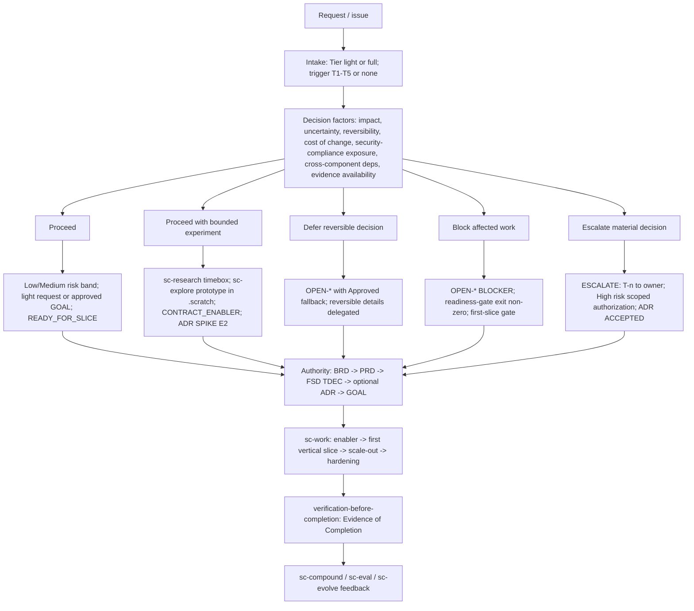
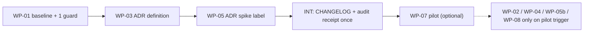

# Rencana Adopsi Risk-Driven Dual-Track untuk Super Compound

## Summary

- **Tujuan:** keputusan yang lebih baik, rework lebih sedikit, kontrol tetap terjaga, overhead serendah mungkin. Tujuan ini **bukan** menambah proses.
- **Cakupan:** audit fit-gap area A-L pada branch `docs/risk-driven-dual-track-adoption-plan`, commit `449cbd1a69fbff4b909ce5556d74686994308eea`. Dokumen ini hanya rencana. Dokumen ini tidak mengubah file framework.
- **Hasil utama (fakta):** Super Compound sudah memiliki hampir seluruh model risk-driven dan progressive commitment dengan nama lain: tier `light|full`, trigger T1-T5, risk band, `ESCALATE: T<n>`, `OPEN-*`, `CONTRACT_ENABLER` -> `FIRST_VERTICAL_SLICE` -> `SCALE_OUT_SLICE` -> `HARDENING`, readiness gate biner, TDEC/ADR, dan evidence grade E0-E4.
- **Gap nyata:** satu konflik kecil doc-vs-code (hard gate 7, `EXCEPTION_APPROVED`), satu definisi yang belum tertulis ("costly to reverse"), satu rute PoC teknis yang belum eksplisit, dua kalimat template yang tidak konsisten, test yang belum menjaga token `ESCALATE: T<n>`, dan belum ada tempat mencatat KPI pilot.
- **Keputusan yang diminta (maksimal 3):** `D01` adopsi hanya sebagai crosswalk untuk auditor, tanpa command/status/approval/artefak baru; `D02` G7 tetap fail-closed, WP-02 DEFER sampai owner menetapkan makna "explicit exception" dan pilot mencatat false BLOCKED; `D03` setujui WP-03 + WP-05 dalam satu PR bersama WP-01 dan INT, semua item P3 DEFER.
- **Work package (setelah review Bagian 14):** WP-01 (P0), WP-03, WP-05, INT (P1, satu PR), WP-07 pilot opsional (P2), WP-02/WP-04/WP-05b/WP-08 (P3, DEFER dengan trigger pilot). WP-06 dihapus. Paket pertama: **WP-01** (baseline read-only + satu assertion, tanpa perubahan perilaku).
- **Status verifikasi:** semua klaim implementasi dicek ulang pada file di commit di atas. `npm test` **belum** dijalankan (WP-01 langkah 1). [F] `framework-audit --verify-existing` dijalankan: stale dengan dokumen ini ada, 692/692 tanpa dokumen ini.

Legenda label: **[F]** fakta dari file (path:line), **[A]** asumsi, **[R]** rekomendasi, **[U]** belum diverifikasi.

## High-Level Design: Target Decision Architecture



Diagram ini adalah **view** dari mekanisme yang sudah ada. Diagram ini tidak membuat status, gate, atau approval baru.

## 1. Executive Summary

| Topik | Hasil |
|---|---|
| Kesesuaian umum | [F] Model target sudah ada dengan nama lain. Tidak ada konflik arsitektur. Satu konflik kecil doc-vs-code (G7). |
| Pendekatan | [R] ENHANCE file pemilik yang sudah ada. Tidak ada `/sc-*` baru, approval baru, status baru, atau artefak authority baru. |
| Biaya perubahan tersembunyi | [F] Banyak file policy di-pin dengan SHA-256 di test. Edit pada file itu wajib memperbarui pin pada perubahan yang sama. [R] Pilih file yang tidak di-pin jika rule bisa ditempatkan di sana tanpa salah pemilik. |
| Prioritas | P0: baseline + satu guard. P1: dua edit kalimat + CHANGELOG + receipt dalam satu PR. P2: pilot opsional. P3 (termasuk G7): ditunda sampai ada bukti pilot. |
| Klaim hasil | [A] Tidak ada klaim perbaikan sebelum pilot; target persentase hanya diuji pada minimal 3 fitur sebanding (`README.md:358-371`, `SUPER-COMPOUND.md:57-60`). |

## 2. Current-State Assessment

### 2.1 Basis audit

| Item | Nilai |
|---|---|
| Worktree | `D:\BATI\Development\framework\.sc-worktrees\sc-adoption-plan` |
| Branch | `docs/risk-driven-dual-track-adoption-plan` |
| Commit diaudit | `449cbd1a69fbff4b909ce5556d74686994308eea` (dicek dengan `git rev-parse HEAD`) |
| Status working tree saat audit | bersih |
| Input | empat laporan fit-gap: risk-adr (A, C, E), ux-arch (B, F, H), stack-poc (D, G), verify-ops-metrics (I, J, K, L, routing) |
| Test dijalankan | Tidak. Audit ini read-only. Baseline test adalah langkah pertama WP-01. |

[F] Semua sitasi path:line diperiksa ulang pada `main` `7704023` setelah PR #26 (writing-language policy: `.agent/context/writing-language.md`, `output-style.md`, `AGENTS.md`, `.agent/rules/super-compound.md`); tidak ada file yang disitasi dengan nomor baris berubah, dan PR #26 tidak menambah workflow, gate, approval, atau pin hash, jadi analisis gap Bagian 4 tidak berubah.

### 2.2 Current-State Capability Inventory

| Kapabilitas | Lokasi canonical | Bukti |
|---|---|---|
| Klasifikasi tier saat intake | `workflow-integration.md` | [F] `.agent/skills/agentic-delivery/references/workflow-integration.md:9-22`; `delivery_mode: "auto"` di `.agent/rules/project-config.md:58` |
| Trigger T1-T5 dan pemiliknya | `workflow-integration.md` | [F] `workflow-integration.md:24-30` |
| Eskalasi per keputusan | `workflow-integration.md`, contract | [F] `workflow-integration.md:35-38`; `.agent/context/workflows/sc-work.contract.md:5-8`; `.agent/context/workflows/sc-review.contract.md:4` |
| Risk band Low/Medium/High | `workflow-integration.md` | [F] `workflow-integration.md:45-52` |
| Delegasi detail reversible | `workflow-integration.md` | [F] `workflow-integration.md:57-59` |
| Approval mode | `project-config.md`, checkpoint | [F] `approval_mode: "exception"` di `project-config.md:52`; `.agent/context/checkpoint.contract.md:14-16` |
| Authority dan precedence | `authority-and-adr.md` | [F] `.agent/skills/agentic-delivery/references/authority-and-adr.md:1-16` |
| ADR kondisional, TDEC default | `authority-and-adr.md` | [F] `authority-and-adr.md:18-34`; `.agent/agents/architect.md:15-17` |
| `OPEN-*` stop condition | `open-stop-conditions.md` | [F] `.agent/skills/agentic-delivery/references/open-stop-conditions.md:1-33` |
| UI profile dan evidence ladder | `ui-contract-readiness.md` | [F] `.agent/skills/agentic-delivery/references/ui-contract-readiness.md:9-56` |
| Readiness gate biner (8 hard gate) | `ui-contract-readiness.md`, `readiness-gate.mjs` | [F] `ui-contract-readiness.md:96-114`; `.agent/tools/readiness-gate.mjs:153-382` |
| Enabler -> first slice -> scale-out -> hardening | `sc-plan.contract.md`, `ui-contract-readiness.md` | [F] `.agent/context/workflows/sc-plan.contract.md:43-53`; `ui-contract-readiness.md:150-158` |
| Qualification tanpa prasyarat melingkar | `ui-contract-readiness.md` | [F] `ui-contract-readiness.md:167-180` (research dan read-only check berjalan sebelum eksekusi produk) |
| Change routing class | `ui-contract-readiness.md` | [F] `ui-contract-readiness.md:213-230` |
| Research timebox (read-only) | `sc-research.md` | [F] `.agent/workflows/sc-research.md:21-44` |
| Prototype throwaway | `sc-explore.contract.md`, `prototyping/SKILL.md` | [F] `.agent/context/workflows/sc-explore.contract.md:3-6,19-28`; `.agent/skills/prototyping/SKILL.md:10,29-40` |
| Compatibility pre-flight | `compatibility-check` | [F] `.agent/skills/compatibility-check/SKILL.md:38-40` |
| Evidence grade E0-E4 | ADR template | [F] `.agent/templates/agentic-delivery/ADR-Agentic-Ready-Reusable-Template-OPTIONAL.md:190-198` |
| Completion gate "No Evidence = Not Done" | `verification-before-completion` | [F] `.agent/skills/verification-before-completion/SKILL.md:10-12` |
| KPI pilot (definisi saja) | `README.md` | [F] `README.md:358-371`; `SUPER-COMPOUND.md:57-60` |
| Knowledge capture dan evolusi | contract | [F] `.agent/context/workflows/sc-compound.contract.md:1-13`; `.agent/context/workflows/sc-evolve.contract.md:5-14` |
| Spesifikasi AI produk | FSD template | [F] `.agent/templates/agentic-delivery/FSD-Agentic-AI-Ready-Template.md:1559-1561,1653-1655` |
| 19 public workflow | dispatch, test | [F] `.agent/context/workflow-dispatch.md:9`; `.agent/tools/workflow-contracts.test.mjs:15-35` |

### 2.3 Temuan baru saat pemeriksaan ulang (melengkapi laporan input)

| ID | Temuan | Bukti | Dampak ke rencana |
|---|---|---|---|
| N1 | `ui-contract-readiness.md` juga di-pin SHA-256, bukan hanya tiga reference lain. | [F] `.agent/skills/agentic-delivery/tests/progressive-disclosure-wave3.test.mjs:20,24-26` | Edit B1/F3/F5 pada doc ini wajib update pin. [R] Hindari edit doc ini bila code atau file lain cukup. |
| N2 | `sc-plan.*`, `sc-work.*`, `sc-status.*`, `sc-review.*`, `sc-compound.*`, `sc-evolve.*`, `sc-debug.*`, `sc-audit.*`, `sc-init.*`, dan contract `sc-eval`, `sc-launch`, `sc-pause` di-pin di dua test. | [F] `.agent/tools/hitl-checkpoints.test.mjs:14-51`; `.agent/tools/questions-and-hints.test.mjs` (blok pin hash) | [R] Jangan edit file workflow/contract ini untuk gap kecil. Rute G2 dipindah ke `prototyping/SKILL.md` (tidak di-pin). |
| N3 | Receipt audit framework diverifikasi di CI. Manifest mencakup semua file tracked dan untracked non-ignored, bukan hanya `.agent/`. | [F] `.github/workflows/ci.yml:149-150`; `package.json:17-18`; `.agent/tools/framework-audit.mjs:299-302`; `--verify-existing` stale dengan dokumen ini, 692/692 tanpa dokumen ini | [R] Satu PR; `npm run audit` sekali di langkah INT, termasuk dokumen ini. |
| N4 | Qualification research sebelum eksekusi produk sudah diizinkan. | [F] `ui-contract-readiness.md:175-176` | Gap B1 (paralel UX/arsitektur) sebagian besar sudah tertutup. Tidak perlu rule baru di doc yang di-pin. |
| N5 | Root cause terverifikasi sudah masuk `docs/solutions/`; perubahan material dikembalikan ke owner. | [F] `sc-compound.contract.md:1,8` | Gap J (umpan balik insiden) menjadi NOT_REQUIRED. |
| N6 | `/sc-ui` sudah ada di daftar rute `/sc-status`. | [F] `.agent/workflows/sc-status.md:50-51` | Gap routing status menjadi kosmetik. DEFER. |
| N7 | G7 tidak punya cabang exception. `EXCEPTION_APPROVED` tidak dicek di G7. | [F] `readiness-gate.mjs:271-276` vs `ui-contract-readiness.md:112-113`; `:101` "Real risk exceptions still require the authorized owner" | Ketidakcocokan teks dikonfirmasi; makna "explicit exception" [A]. G7 tetap fail-closed; WP-02 DEFER (D02). |
| N8 | Koreksi sitasi: `delivery_mode` ada di `project-config.md:58`, bukan `:55`. | [F] `.agent/rules/project-config.md:58` | Sitasi dokumen ini memakai baris yang benar. |

## 3. Existing Capabilities Worth Preserving

| Kapabilitas | Alasan dipertahankan | Bukti |
|---|---|---|
| Tier `light` proporsional | Light tidak butuh BRD/PRD/FSD baru. Mencegah overhead. | [F] `authority-and-adr.md:12-16`; `open-stop-conditions.md:5-9` |
| Eskalasi hanya pada keputusan terdampak | Kerja independen tetap berjalan. | [F] `workflow-integration.md:35-36`; `open-stop-conditions.md:9` |
| `approval_mode: exception` default | Tidak ada ceremony approval tambahan. | [F] `project-config.md:52`; `checkpoint.contract.md:14-16` |
| `OPEN-*` dengan `Approved fallback` | Ini mekanisme "defer" yang sudah teruji. | [F] `open-stop-conditions.md:23-33` |
| Prototype bukan production seed | Eksperimen tidak bocor ke produk. | [F] `prototyping/SKILL.md:29-32`; `ui-contract-readiness.md:52-56`; `sc-explore.contract.md:3-6` |
| Readiness gate biner dengan exit code | Gate deterministik, bukan opini. | [F] `ui-contract-readiness.md:98-99` |
| Real-provider first slice; mock tidak membuka scale-out | Mencegah defect integrasi terlambat. | [F] `ui-contract-readiness.md:155-158`; `sc-work.contract.md:22-24` |
| `LOCAL_ONLY` tanpa artefak sintetis | Proporsional untuk UI lokal. | [F] `ui-contract-readiness.md:28-36` |
| TDEC default, ADR kondisional | Mencegah ADR berlebihan. | [F] `authority-and-adr.md:20-22` |
| Research advisory sampai ditulis ke TDEC/ADR | Authority tetap satu sumber. | [F] `sc-plan.contract.md:30`; `.agent/context/workflows/sc-research.contract.md:3-4,14` |
| `/sc-evolve` hanya draft, tanpa self-modification | Perubahan framework tetap lewat review manusia. | [F] `sc-evolve.contract.md:5-12` |

## 4. Evidence-Based Gap Analysis

Status: EXISTING, PARTIAL, MISSING, CONFLICT, NOT_REQUIRED.

| Area | Capability | Existing implementation | Evidence path | Status | Gap | Impact | Recommendation |
|---|---|---|---|---|---|---|---|
| A | Tier saat intake | Satu baris `Tier: light\|full; trigger: T<n>\|none` | `workflow-integration.md:11-13`; `sc-work.contract.md:5-6` | EXISTING | Dijaga hash pin (`progressive-disclosure-wave3.test.mjs:25`) | Rendah | ADOPT AS-IS (pin cukup) |
| A | Trigger T1-T5 | Tabel trigger + owner | `workflow-integration.md:24-30` | EXISTING | Dijaga hash pin; regex tabel rapuh terhadap layout | Rendah | ADOPT AS-IS (pin cukup) |
| A | Eskalasi per keputusan | `ESCALATE: T<n>` | `workflow-integration.md:35`; `sc-work.contract.md:7` | EXISTING | Token tidak dijaga saat pin di-refresh; hanya precedence T2 di `workflow-contracts.test.mjs:44` | Rendah | [R] WP-01: satu assertion |
| A | Risk band | Low/Medium/High | `workflow-integration.md:45-52` | EXISTING | - | - | ADOPT AS-IS |
| B | UX dan arsitektur paralel | Alur utama sekuensial; qualification research sebelum eksekusi produk diizinkan | `workflow-integration.md:100-102`; `ui-contract-readiness.md:175-176`; `sc-explore.contract.md:20-21` | PARTIAL | Rute prototype teknis yang dapat dijalankan dari `/sc-prd`/`/sc-plan` belum eksplisit | Sedang untuk scope T2/T3/HIGH_INTERACTION [A] | DEFER (WP-04): tanpa insiden; goal "Compatibility/smoke spike" (FSD template `:2264`) dipakai sementara |
| B | Cross-validation UX <-> kontrak | G3 UIMAP; `FSD_CHANGE_REQUIRED`; change class `PRODUCT_BEHAVIOR` | `readiness-gate.mjs:223-230`; `ui-contract-readiness.md:218-219` | EXISTING | Arah balik (TDEC membatasi perilaku) sudah dicakup `PRODUCT_BEHAVIOR` | - | NOT_REQUIRED |
| C | Reversibility sebagai input | Light "bounded reversible"; Medium "reversible"; delegasi; ADR "costly to reverse" | `workflow-integration.md:18,47,57`; `authority-and-adr.md:22` | EXISTING | - | - | ADOPT AS-IS |
| C | Definisi "costly to reverse" | Enum ADR `reversibility`; TDEC "Rollback/reversal rule" | ADR template `:18`; `authority-and-adr.md:22` | PARTIAL | Kriteria tidak tertulis; keputusan kasus per kasus | Rendah-Sedang: batas TDEC vs ADR tidak konsisten | [R] WP-03: satu kalimat definisi, tanpa trigger baru |
| C | Defer / bounded experiment / block / escalate | `OPEN-*`+fallback; research/prototype/enabler; `OPEN-* BLOCKER`; `ESCALATE` | `open-stop-conditions.md:9-33`; `sc-research.md:37`; `sc-plan.contract.md:43-49` | EXISTING | Hanya beda nama | - | Crosswalk di dokumen ini saja (Bagian 5) |
| D | Trigger research stack | Use When / Do Not Use; lookup inline | `sc-research.md:21-33`; `.agent/workflows/sc-plan.md:41` | EXISTING | - | - | ADOPT AS-IS |
| D | Perbandingan opsi | Architect; Research Note; ADR options | `architect.md:15`; ADR template `0.6` | EXISTING | - | - | ADOPT AS-IS |
| D | Grade evidence di jalur research | Research Note hanya `primary/local` + confidence | `.agent/templates/research/Research-Note-Skeleton.md:31-33` | PARTIAL | Grade E0-E4 hanya di ADR | Rendah: pilihan stack bisa bertumpu pada E1 saja | DEFER (WP-05b): tanpa bukti kebutuhan; menambah kosakata kedua |
| D | Trigger tier untuk stack/vendor baru | T2 "external integration"; High risk "external spending" | `workflow-integration.md:27,50-51` | PARTIAL [A] | Tidak ada trigger eksplisit | Rendah | REJECT (YAGNI); `compatibility-check` sudah wajib di jalur FSD |
| E | TDEC default, ADR kondisional | Kriteria ADR; `adr_applicability` | `authority-and-adr.md:20-34`; `.agent/templates/agentic-delivery/skeletons/FSD-Skeleton.md:29` | EXISTING | - | - | ADOPT AS-IS |
| E | TDEC berisiko tinggi | Aturan E0/E1 hanya di ADR | ADR template `:198` | NOT_REQUIRED | High-risk sudah kriteria ADR (`authority-and-adr.md:22`) | - | ADOPT AS-IS; tanpa klausa tambahan |
| F | Evidence ladder per risiko | Profile + ladder | `ui-contract-readiness.md:9-24,38-56` | EXISTING | - | - | ADOPT AS-IS |
| F | Record evidence prototype | Locator, digest, question, reviewer, date, disposition | `ui-contract-readiness.md:49-56` | PARTIAL | G1 tidak mengecek locator saat `VALIDATED` | Sedang [A] | DEFER (WP-08): menambah check bisa memblokir proyek lama (kompatibilitas) |
| F | Usability dengan user nyata | Tidak ada | pencarian `usability\|task success\|participant` di `.agent/` (laporan ux-arch) | MISSING | Tidak ada protokol | Rendah-Sedang untuk HIGH_INTERACTION [A] | DEFER: opsional, tunggu bukti pilot |
| F | Jalur exception HIGH_INTERACTION | Doc: "addresses runtime risk or has an explicit exception" | `ui-contract-readiness.md:112-113` vs `readiness-gate.mjs:271-276` | CONFLICT (kecil, tafsir) | Code tidak punya cabang exception; makna "explicit exception" belum ditetapkan (`:101`) | False BLOCKED untuk baseline `EXCEPTION_APPROVED` [A]; belum teramati | DEFER (WP-02, D02): G7 tetap fail-closed |
| G | Prototype throwaway tahap bisnis/UX | `/sc-explore` + `prototyping` | `sc-explore.contract.md:19-28`; `prototyping/SKILL.md:10-40` | EXISTING | - | - | ADOPT AS-IS |
| G | PoC teknis saat menyusun FSD | `/sc-research` tanpa code; goal 1 "Compatibility/smoke spike" | `sc-research.md:43`; FSD template `:2264`; `prototyping/SKILL.md:3` | PARTIAL | Description skill hanya menyebut `/sc-explore` | Sedang: PoC dilewati atau masuk tree produk [A] | DEFER (WP-04, body skill saja bila aktif) |
| G | Label spike ADR | `throwaway` atau `production-candidate` | ADR template `:844` | CONFLICT (kecil) | Lebih longgar dari aturan reuse (`prototyping/SKILL.md:29-31`) | Ambigu | [R] WP-05: rujuk aturan reuse |
| G | Pengecualian TDD untuk eksplorasi | Balanced/relaxed exception | `.agent/skills/test-driven-development/references/modes-and-exceptions.md:13-19` | EXISTING | - | - | ADOPT AS-IS |
| H | Contract-first dan slice | Enabler -> first slice -> scale-out -> hardening | `sc-plan.contract.md:43-53`; `readiness-gate.mjs:306-379` | EXISTING | - | - | ADOPT AS-IS |
| H | `LOCAL_ONLY` proporsional | Gate dilewati dengan alasan | `ui-contract-readiness.md:28-36` | EXISTING | - | - | ADOPT AS-IS |
| H | Exception hanya membuka first slice | Spesifikasi + gate | `ui-contract-readiness.md:72-75` | EXISTING | - | - | ADOPT AS-IS |
| I | Completion gate | 7 langkah, red flag | `verification-before-completion/SKILL.md:10-58` | EXISTING | - | - | ADOPT AS-IS |
| I | Kontrak semua AC sebelum hasil | `verified-promise.mjs` | `sc-plan.contract.md:34-36` | EXISTING | - | - | ADOPT AS-IS |
| I | Analisis alternatif saat kerja | approach -> alternative -> trade-off | `sc-work.contract.md:32-34` | EXISTING | - | - | ADOPT AS-IS |
| J | Security/PII sebagai trigger | T2 | `workflow-integration.md:27` | EXISTING | - | - | ADOPT AS-IS |
| J | Privacy guard runtime | `privacy-guard.mjs` | `.agent/tools/privacy-guard.mjs:1-3` | EXISTING | - | - | ADOPT AS-IS |
| J | Umpan balik insiden produksi | Root cause ke `docs/solutions/`; perubahan material ke owner | `sc-compound.contract.md:1,8` | NOT_REQUIRED | Sudah dicakup secara umum (N5) | - | REJECT edit contract (file di-pin) |
| K | Definisi KPI pilot | Metrik + rumus + target >90% | `README.md:358-371` | PARTIAL | Belum ada tempat dan cara mencatat | Sedang: efek adopsi tidak bisa dibuktikan | [R] WP-07 (sink sudah ada: `templates-and-reporting.md:5`) |
| K | Eval dan perbandingan | `/sc-eval` sink; `adaptive-eval.mjs` | `.agent/context/workflows/sc-eval.contract.md:1-3` | EXISTING | - | - | Reuse untuk pilot |
| L | Spesifikasi AI produk + release gate | FSD Section 11 | FSD template `:1559-1561,1653-1655` | EXISTING | - | - | ADOPT AS-IS |

## 5. Proposed Target Architecture

### 5.1 Decision factors (kualitatif, tanpa skor numerik)

[R] Faktor dinilai sebagai `rendah | material` dengan alasan faktual. Skor numerik tidak dipakai karena belum dikalibrasi.

| Faktor | Pertanyaan uji | Sinyal yang sudah ada |
|---|---|---|
| Impact | Apakah perilaku yang dapat diamati, AC, atau outcome produk berubah? | T1, T3; change class `PRODUCT_BEHAVIOR` (`ui-contract-readiness.md:218`) |
| Uncertainty | Apakah ada fakta bernama yang belum terjawab oleh code/test lokal? | `OPEN-RESEARCH-*`; `sc-research.md:23-24` |
| Reversibility | Apakah pembalikan butuh migrasi data, break consumer/wire, rollback access policy, atau exit vendor? | ADR `reversibility` (ADR template `:18`); definisi WP-03 |
| Cost of change | Apakah perubahan setelah baseline memaksa rework lintas goal? | `WIRE_BREAKING` (`ui-contract-readiness.md:224-225`) |
| Security-compliance exposure | Apakah menyentuh access policy, PII, billing, audit? | T2; `open-stop-conditions.md:21` |
| Cross-component deps | Apakah kontrak lintas stream atau lintas sistem berubah? | T4; kriteria ADR "cross-system" |
| Evidence availability | Apakah bukti E2 atau lebih tinggi tersedia untuk driver utama? | E0-E4 (ADR template `:190-198`) |

### 5.2 Graded outcomes dipetakan ke mekanisme yang ada

| Outcome | Kondisi (semua faktor dibaca bersama) | Mekanisme yang ada | Status/gate yang dipakai |
|---|---|---|---|
| Proceed | Semua faktor rendah, atau risiko material sudah tercakup authority yang disetujui | Low/Medium risk band | `Tier: light`; GOAL `ready-for-agent`; `READY_FOR_SLICE` |
| Proceed with bounded experiment | Uncertainty material, reversibility tinggi, fakta bisa dijawab dengan biaya kecil | `/sc-research` timebox; prototype `.scratch/prototypes/`; `CONTRACT_ENABLER`; ADR SPIKE | Hanya enabler boleh ready saat `DRAFT/BLOCKED` (`sc-plan.contract.md:43-45`) |
| Defer reversible decision | Keputusan reversible dan tidak memblokir kerja independen | `OPEN-*` dengan `Approved fallback`; delegasi detail reversible | `Status: OPEN` (`open-stop-conditions.md:32`) |
| Block affected work | Authority hilang, kontrak konflik, bukti mock diklaim real | `OPEN-* BLOCKER`; readiness gate | exit non-zero; `blocked` pada goal terdampak |
| Escalate material decision | Trigger T1-T5 muncul, atau High risk di luar authority | `ESCALATE: T<n>`; scoped authorization; ADR | ADR `ACCEPTED`; `adr_applicability: LINKED` |

[F] Tidak ada status atau gate baru yang diperlukan. Semua kolom kanan sudah ada.

### 5.3 Jawaban 10 pertanyaan Phase-2

| # | Pertanyaan | Jawaban | Bukti |
|---|---|---|---|
| 1 | Bagaimana risiko memengaruhi keputusan di tier light vs full? | Light: agent memutuskan pilihan reversible yang tercakup kontrak dan dapat dibuktikan check. Full: keputusan wajib didukung FSD `TDEC-*` atau ADR `ACCEPTED`. High risk di kedua tier wajib scoped authorization. | [F] `workflow-integration.md:18-20,45-52`; `authority-and-adr.md:10-16` |
| 2 | Reversible vs sulit dibalik? | Reversible: delegasi default atau `OPEN-*` dengan fallback. Sulit dibalik: TDEC dengan "Rollback/reversal rule", atau ADR bila memenuhi kriteria. [R] WP-03 menuliskan kriteria "costly to reverse". | [F] `workflow-integration.md:57-59`; `authority-and-adr.md:22`; FSD template `:625-663` |
| 3 | Kapan UX dan arsitektur berjalan paralel? | Hanya full tier dengan T2/T3 atau `HIGH_INTERACTION`, untuk fakta `OPEN-*` bernama (kapabilitas provider, latency, offline, auth). Jalur arsitektur read-only atau prototype throwaway, advisory sampai `/sc-plan` menulis `TDEC-*`/ADR. Light dan `LOCAL_ONLY` tidak paralel. | [F] `ui-contract-readiness.md:175-176`; `sc-plan.contract.md:30`; WP-04 DEFER |
| 4 | Kapan UX butuh prototype/usability evidence? | `STANDARD`: wireframe/static/clickable cukup bila menjawab risiko. `HIGH_INTERACTION`: evidence interaktif. Runnable wajib untuk timing, responsive runtime, keyboard/focus, realtime, offline. State diagram untuk branching/role/async/multi-screen. Usability dengan user: opsional (DEFER). | [F] `ui-contract-readiness.md:13-21,40-47` |
| 5 | Kapan stack butuh comparison/research/PoC? | Comparison: selalu oleh architect. Research: fakta bernama yang dapat mengubah FSD/TDEC/pilihan dependency. Compatibility pre-flight: setiap dependency/runtime/vendor/major version baru. PoC (E2): bila compatibility material, atau driver utama ADR HIGH/CRITICAL hanya punya E0/E1. | [F] `architect.md:15`; `sc-research.md:23-24`; `compatibility-check/SKILL.md:38-40`; ADR template `:198,390` |
| 6 | Kapan FSD `TDEC-*` cukup? | Keputusan lokal proyek, satu sistem, reversible atau reversible lokal, bukan security/privacy/vendor-lock/recurring-cost/policy. | [F] `authority-and-adr.md:20,31-34` |
| 7 | Kapan ADR wajib? | Bila salah satu kriteria benar: cross-system, high-risk, costly to reverse, security/privacy, platform, vendor-locking, recurring-cost material, policy. ADR harus `ACCEPTED`; FSD `LINKED`. | [F] `authority-and-adr.md:22-29` |
| 8 | Kapan readiness gate memblokir? | Setiap gate yang berlaku gagal -> BLOCKED, exit non-zero (baseline, state, UIMAP, revision, derived asset, verification ref, HIGH_INTERACTION evidence, `OPEN-*` aktif, first slice, scale-out, hardening, cycle). | [F] `ui-contract-readiness.md:98-114`; `readiness-gate.mjs:211-379` (G1-G8 `:211-285`, first slice/scale-out/hardening/cycle `:306-379`) |
| 9 | Kapan exploratory coding diizinkan tanpa menjadi produksi? | Di `/sc-explore` (atau goal "Compatibility/smoke spike") di bawah `.scratch/prototypes/`, satu pertanyaan, dengan locator dan disposition. Pengecualian TDD hanya bila output dibuang. Reuse butuh scoped exception + tests/security/accessibility. `/sc-research` dan `/sc-plan` tidak menulis code produk. | [F] `sc-explore.contract.md:19-28`; `modes-and-exceptions.md:17-19`; `prototyping/SKILL.md:29-32`; `sc-plan.contract.md:14-15` |
| 10 | Bagaimana authority, approval, rollback dijaga? | Authority: BRD -> PRD -> FSD -> ADR terlampir. Approval: mode `exception` default; rencana ini tidak menambah approval. Rollback: setiap WP punya langkah rollback berbasis revert file; pin hash dan receipt dikembalikan bersama. | [F] `authority-and-adr.md:1-8`; `project-config.md:52`; Bagian 11 |

## 6. Existing vs Proposed Workflow Mapping (Framework Integration Map)

[R] Aturan: satu rule hanya punya satu pemilik canonical. Workflow lain merujuk, tidak menyalin.

| Workflow | Existing owner / canonical file | Perubahan terkecil | Interface terdampak | Template berubah? | Kompatibilitas | Test |
|---|---|---|---|---|---|---|
| `/sc-explore` | `sc-explore.contract.md` (tidak terdaftar di pin N2) | Tidak ada (rute feasibility WP-04 DEFER). | Tidak ada | Tidak | Tetap | `workflow-contracts.test.mjs:349` |
| `/sc-research` | `sc-research.md`, `sc-research.contract.md` | Tidak ada | Tidak ada | Tidak (hint `Research-Note-Skeleton.md:33` DEFER, WP-05b) | Tetap | `workflow-contracts.test.mjs` (blok sc-research) |
| `/sc-prd` | `sc-prd.contract.md` | Tidak ada | Tidak ada | Tidak | Tetap | test yang ada |
| `/sc-ui` | `sc-ui.contract.md`; policy di `ui-contract-readiness.md` | Tidak ada. G7 tetap fail-closed (WP-02 DEFER). | Tidak ada | Tidak | Tetap | `readiness-gate.test.mjs:305,314` |
| `/sc-plan` | `sc-plan.md`, `sc-plan.contract.md` (di-pin) | Tidak ada. PoC teknis memakai goal "Compatibility/smoke spike" yang sudah ada. | Tidak ada | Tidak | Tetap | `hitl-checkpoints.test.mjs` pin tetap hijau |
| `/sc-work` | `sc-work.contract.md` (di-pin) | Tidak ada | Tidak ada | Tidak | Tetap | `hitl-checkpoints.test.mjs` pin tetap hijau |
| `/sc-eval` | `sc-eval.contract.md`; `eval-harness` | Tidak ada. Sink `.agent/evals/<feature-name>.md` sudah ada (`templates-and-reporting.md:5`); dipakai pilot WP-07. | Tidak ada | Tidak | Tetap | `adaptive-eval.test.mjs`, `paired-eval.test.mjs` |
| `/sc-review` | `sc-review.contract.md` | Tidak ada | Tidak ada | Tidak | Tetap | test yang ada |
| `/sc-audit` | `sc-audit.contract.md` | Tidak ada | Tidak ada | Tidak | Tetap | test yang ada |
| `/sc-compound` | `sc-compound.contract.md` (di-pin) | Tidak ada (N5) | Tidak ada | Tidak | Tetap | `memory-maintenance.test.mjs` |
| `/sc-evolve` | `sc-evolve.contract.md` (di-pin) | Tidak ada. Penyesuaian hasil pilot diajukan lewat sini sebagai DRAFT. | Tidak ada | Tidak | Tetap | test yang ada |
| `/sc-launch` | `sc-launch.contract.md` | Tidak ada. Konsisten: launch = full (`sc-launch.contract.md:4`). | - | - | - | `workflow-contracts.test.mjs` |
| `/sc-hints` | `sc-hints.contract.md`; `route-selection.md` | Tidak ada. Memakai rubric tier yang sama (`route-selection.md:30-31`). | - | - | - | `hints.test.mjs` |
| `/sc-status` | `sc-status.contract.md`, `sc-status.md` (di-pin) | Tidak ada. `/sc-ui` sudah di daftar rute (`sc-status.md:50-51`). | - | - | - | `autonomy-policy.test.mjs` |

Policy owner lintas workflow yang diubah: `authority-and-adr.md` (WP-03) dan ADR template (WP-05). Satu assertion test (WP-01) dan satu entri `CHANGELOG.md` (INT). Tidak ada workflow yang diubah.

## 7. Tech Stack & UX Decision Integration

### 7.1 Keputusan tech stack

| Langkah | Mekanisme yang ada | Output authority | Perubahan |
|---|---|---|---|
| 1. Bandingkan opsi | `architect.md:15` | - | Tidak ada |
| 2. Jawab fakta yang hilang | `/sc-research` (`sc-research.md:23-24,37`) | Research Note (advisory) | Tidak ada (WP-05b DEFER) |
| 3. Cek kompatibilitas | `compatibility-check` (`SKILL.md:38-40`) | STOP gate | Tidak ada |
| 4. Bukti runnable bila material | Integration prototype (`prototyping/SKILL.md:17`) atau goal "Compatibility/smoke spike" (FSD template `:2264`) | Locator + disposition | Tidak ada (WP-04 DEFER) |
| 5. Rekam keputusan | `TDEC-*` atau ADR (`authority-and-adr.md:20-34`) | FSD / ADR `ACCEPTED` | WP-03: definisi "costly to reverse" |

### 7.2 Keputusan UX

| Profile | Evidence minimum | Gate | Perubahan |
|---|---|---|---|
| `NOT_APPLICABLE` | Alasan faktual | gate UI dilewati | Tidak ada |
| `STANDARD` | Wireframe/static/clickable yang menjawab risiko | G1-G8 yang berlaku | Tidak ada |
| `HIGH_INTERACTION` | Interaktif; runnable untuk risiko runtime | G7 | Tidak ada (WP-02 DEFER) |
| `LOCAL_ONLY` | Mapping lokal + responsive/keyboard/accessibility | gate provider dilewati | Tidak ada |

[A] Residual: G7 tetap meminta baris locator runnable untuk setiap `HIGH_INTERACTION` non-exception, walau doc `:19-21` menerima evidence interaktif bila tidak ada risiko runtime. [R] Biarkan fail-closed. Tinjau ulang hanya bila pilot mencatat false BLOCKED.

## 8. Prioritized Implementation Roadmap

Revisi setelah review Bagian 14. Rencana dipertajam menjadi tiga edit kecil dalam **satu PR**: WP-01, WP-03, WP-05, lalu langkah integrasi INT. WP-02, WP-04, dan WP-06 tidak dieksekusi sekarang.

Aturan receipt untuk setiap WP:

- [F] `npm run audit` menjalankan `bench` dan menulis kedua file `.agent/benchmarks/*.after.json` (`package.json:17-18`). CI memverifikasi receipt pada setiap push (`.github/workflows/ci.yml:149-150`).
- [F] Manifest audit memakai `git ls-files --cached --others --exclude-standard` (`.agent/tools/framework-audit.mjs:299-302`), jadi file untracked non-ignored juga masuk, bukan hanya `.agent/`.
- [F] Dengan dokumen ini ada di `docs/audits/` (untracked), `--verify-existing` melaporkan "Stored audit evidence is stale". Tanpa dokumen ini: "Verified ... (692/692 accounted)". Dicek pada `449cbd1`, 2026-10-31. Setelah dokumen ini di-commit (`a33f5f5`) dan `npm run audit` dijalankan ulang: `--verify-existing` keluar 0, "Framework audit: PASS", "Manifest accounted: 758/758 (100%)", "Findings: 0".
- [R] Di dalam setiap WP jalankan `npm test` saja. Jalankan `npm run audit` **sekali**, di langkah INT, setelah semua file PR (termasuk dokumen ini) ada.

### P0 - Foundation / critical

#### WP-01 - Pre-flight baseline + satu guard `ESCALATE`

| Field | Isi |
|---|---|
| Objective | Mencatat kondisi suite sebelum edit, dan menjaga token `ESCALATE: T<n>` saat pin hash di-refresh. |
| Current gap | [F] `workflow-integration.md` sudah di-pin SHA-256 (`progressive-disclosure-wave3.test.mjs:25`), jadi setiap edit sudah membuat CI merah. Pin tidak menjaga token saat pin di-refresh bersama edit. Token `ESCALATE: T<n>` ada di `workflow-integration.md:35` dan `sc-work.contract.md:7`; test hanya cek precedence T2 (`workflow-contracts.test.mjs:44`). |
| Exact target files | `.agent/tools/workflow-contracts.test.mjs` (satu assertion). Tidak ada file pinned yang diubah. |
| Proposed changes | (1) Baseline read-only: `npm test` dan `node .agent/tools/framework-audit.mjs --verify-existing .agent/benchmarks/framework-audit.after.json`. Tidak menjalankan `npm run audit` (menulis receipt). (2) Di test `:37-50` tambah satu baris: `assert.match(policy, /ESCALATE: T<n>/);`. Tidak ada regex tabel T1-T5 (rapuh terhadap layout `workflow-integration.md:24-30`). |
| Dependencies | Tidak ada |
| Priority + reason | P0. Murah dan tanpa perubahan perilaku. WP-03 dan WP-05 hanya memerlukan log baseline langkah (1), bukan assertion. |
| Complexity | Kecil. |
| Risk + mitigation | Baseline sudah merah, atau receipt stale karena dokumen ini. Mitigasi: catat kegagalan dan penyebab; jangan perbaiki di WP ini. |
| Acceptance criteria | AC1: log baseline `npm test` dan hasil `--verify-existing` tercatat. AC2: assertion baru lulus. AC3: saat mutasi (`ESCALATE: T<n>` dihapus sementara), assertion baru gagal. Kegagalan pin wave3 saat mutasi adalah noise yang diharapkan. |
| Verification | `node --test .agent/tools/workflow-contracts.test.mjs` (hanya file ini saat mutasi); `npm test`. |
| Rollback | Revert satu baris test. |
| Owner role | Framework maintainer |
| Deliverable | Log baseline + diff satu baris |
| Stop condition | Baseline `npm test` gagal pada test area A-L: stop dan laporkan sebelum WP-03. |

### P1 - Workflow + decision integration

#### WP-03 - Definisi "costly to reverse"

| Field | Isi |
|---|---|
| Objective | Batas TDEC vs ADR konsisten, tanpa trigger ADR baru. |
| Current gap | [F] `authority-and-adr.md:22` memakai "costly to reverse" tanpa definisi. |
| Exact target files | `.agent/skills/agentic-delivery/references/authority-and-adr.md`; pin `.agent/skills/agentic-delivery/tests/progressive-disclosure-wave3.test.mjs:20`. Pinned/receipt [F]: pin wave3 `:20`; hash saat ini `9aef59e4...` juga muncul 2 kali di `.agent/evals/blueprint-document.responses.json`. |
| Proposed changes | Tambah satu kalimat setelah `:22`: "Costly to reverse means reversal cannot be done by a code revert alone: it needs a data migration or rewrite, a coordinated break for consumers outside the project, or a vendor or recurring-cost exit." Klausa "a high-risk `TDEC-*` ... becomes an ADR" dihapus (high-risk sudah kriteria ADR di `:22`). Update hash pin. |
| Dependencies | WP-01 langkah (1); D03 |
| Priority + reason | P1. Satu-satunya gap dengan definisi yang terbukti hilang. Definisi membatasi kriteria yang sudah ada; tidak menambah approval. |
| Complexity | Kecil. Asumsi: pin dihitung ulang dengan normalisasi LF seperti test lain. |
| Risk + mitigation | Definisi memperluas ADR. Mitigasi: kriteria hanya kasus yang tidak bisa dibalik dengan revert; perubahan API lokal yang ber-versi tetap TDEC; light tier tidak terdampak (`authority-and-adr.md:12-16`). |
| Acceptance criteria | AC1: kalimat ada di bagian ADR Policy. AC2: test wave3 lulus dengan pin baru. AC3: `blueprint-document.test.mjs` lulus; [U] apakah file responses perlu update, cek dengan menjalankan test. AC4: `autonomy-policy.test.mjs:34-39` tetap lulus. |
| Verification | `npm run test:skills`; `node --test .agent/tools/blueprint-document.test.mjs`; `npm test`. |
| Rollback | Revert file + pin. |
| Owner role | Framework maintainer (pemilik policy ADR) |
| Deliverable | Diff satu kalimat + pin |
| Stop condition | Reviewer menilai kalimat mengubah semantik ADR `ACCEPTED` atau menambah jumlah ADR: stop, eskalasi ke owner. |

#### WP-05 - Label spike ADR merujuk aturan reuse

| Field | Isi |
|---|---|
| Objective | ADR template tidak bertentangan dengan aturan reuse prototype. |
| Current gap | [F] ADR template `:844`: "Do not put spikes into production without the applicable quality/security review". Aturan reuse yang lebih ketat ada di `prototyping/SKILL.md:29-31,40`. |
| Exact target files | `.agent/templates/agentic-delivery/ADR-Agentic-Ready-Reusable-Template-OPTIONAL.md:844`. Pinned/receipt [F]: tidak di-pin hash; template diperiksa struktur oleh `artifact-contracts.test.mjs` dan `workflow-contracts.test.mjs`. |
| Proposed changes | Ganti kalimat kedua `:844` dengan rujukan, bukan salinan: "`production-candidate` reuse follows the prototyping skill reuse exception." Hint grade E0-E4 di Research Note `:33` DEFER (WP-05b). |
| Dependencies | WP-01 langkah (1); D03 |
| Priority + reason | P1. Satu kalimat; menutup G4. |
| Complexity | Kecil. |
| Risk + mitigation | Parser template rusak. Mitigasi: heading/field tidak diubah. |
| Acceptance criteria | AC1: kalimat rujukan ada. AC2: `artifact-contracts.test.mjs` dan `workflow-contracts.test.mjs` lulus. |
| Verification | `node --test .agent/tools/artifact-contracts.test.mjs .agent/tools/workflow-contracts.test.mjs`; `npm test`. |
| Rollback | Revert satu baris. |
| Owner role | Framework maintainer |
| Deliverable | Diff satu baris |
| Stop condition | Test template gagal karena heading/field: stop, perbaiki tanpa menambah field. |

#### INT - Integrasi PR (CHANGELOG + receipt sekali)

| Field | Isi |
|---|---|
| Objective | Satu PR hijau di CI. |
| Exact target files | `CHANGELOG.md`; `.agent/benchmarks/token-benchmark.after.json`; `.agent/benchmarks/framework-audit.after.json` |
| Proposed changes | (1) Satu entri CHANGELOG: definisi "costly to reverse" (WP-03), label spike ADR (WP-05), guard test (WP-01); tanpa perubahan gate. (2) `npm run audit` sekali setelah semua file PR ada, termasuk dokumen ini. |
| Dependencies | WP-01, WP-03, WP-05 |
| Acceptance criteria | AC1: `--verify-existing` lulus dengan semua file PR. AC2: `npm test` lulus. |
| Rollback | Revert PR; receipt kembali bersama file sumber. |
| Stop condition | Benchmark token naik material: stop dan laporkan. |

### P2 - Automation / eval / quality

#### WP-07 - Pilot (opsional)

| Field | Isi |
|---|---|
| Objective | Mengukur efek nyata (Bagian 13). Rencana ini **selesai** setelah INT; pilot bukan syarat penutupan. |
| Current gap | [F] Belum ada data pilot (`SUPER-COMPOUND.md:57-60`). [F] Sink sudah ada: `.agent/evals/<feature-name>.md` (`eval-harness/references/templates-and-reporting.md:5`). WP-06 dihapus. |
| Exact target files | Tidak ada file framework. Output di proyek pilot: `.agent/evals/<feature>.md`, `docs/eval-results/<date>-<feature>.md`. |
| Proposed changes | (1) Install/sync framework versi PR INT ke proyek pilot dengan jalur install yang ada (`README.md`). (2) Jalankan fitur nyata; catat 4 KPI Bagian 13 per fitur dengan metode hitung yang tertulis di sana. |
| Dependencies | INT |
| Priority + reason | P2. Satu-satunya cara membuktikan nilai; juga sumber trigger untuk WP-02, WP-04, WP-05b, WP-08. |
| Complexity | Sedang. Fitur pertama boleh menjadi baseline bila data historis tidak ada. |
| Risk + mitigation | Fitur tidak sebanding. Mitigasi: catat ukuran/domain per fitur; klaim hanya arah, bukan persentase, bila n < 3. |
| Acceptance criteria | Bagian 13 exit criteria. |
| Verification | Review hasil eval + `adaptive-eval.mjs compare`. |
| Rollback | Hentikan pilot; framework tetap seperti setelah INT. |
| Owner role | Delivery lead + Business Owner |
| Deliverable | Laporan eval pilot |
| Stop condition | Rollback trigger Bagian 13. |

### P3 - Optional (DEFER, aktif hanya dengan bukti pilot)

| ID | Item | Trigger aktivasi | Spesifikasi bila aktif |
|---|---|---|---|
| WP-02 | G7 menerima exception | [F] Doc `:112-113` menyebut "explicit exception", tetapi `:101` meminta authorized owner untuk real risk exception, dan `EXCEPTION_APPROVED` adalah status baseline G1 (`readiness-gate.mjs:29,212`). Kesetaraan keduanya [A]. Aktif hanya bila D02 owner memilih maknanya **dan** pilot mencatat false BLOCKED berulang pada G7. | Target `readiness-gate.mjs` + test. AC: test baru; `HIGH_INTERACTION` + `EXCEPTION_APPROVED` + scale-out aktif -> BLOCKED; `VALIDATED` tanpa runnable tetap BLOCKED (sudah dicakup `readiness-gate.test.mjs:296`, loop mutasi; baris mutasi `high-interaction-evidence` di `:287`). Entri CHANGELOG wajib (perubahan perilaku gate). |
| WP-04 | Rute PoC teknis dari `/sc-prd`/`/sc-plan` | Pilot mencatat pertanyaan feasibility `OPEN-*` tanpa rute. Sementara itu pakai goal "Compatibility/smoke spike" (FSD template `:2264`) atau integration prototype (`prototyping/SKILL.md:17`). | Rule di body `prototyping/SKILL.md` saja; `description` (`:3`) tidak diubah karena dimuat saat routing di setiap sesi. |
| WP-05b | Hint E0-E4 di Research Note `:33` | Pilot mencatat pilihan stack yang bertumpu pada E0/E1. | Legenda E0-E4 satu baris inline di hint. |
| WP-08 | Locator wajib untuk `VALIDATED` di G1 | Pilot mencatat minimal satu baseline `VALIDATED` tanpa evidence. | Expand -> migrate -> switch; `readiness-gate.test.mjs`. |

### Urutan eksekusi

- **Sekuensial dalam satu PR:** WP-01 -> WP-03 -> WP-05 -> INT. Edit sangat kecil; paralel tidak menghemat waktu dan menambah koordinasi shared writer.
- **Setelah merge:** WP-07 (opsional) -> item P3 hanya bila trigger terpenuhi.
- **Shared writer:** `.agent/benchmarks/*.after.json`, hanya di INT.

## 9. File-Level Change Plan

| File | WP | Jenis | Ukuran | Pin/guard yang ikut berubah |
|---|---|---|---|---|
| `.agent/tools/workflow-contracts.test.mjs` | WP-01 | Test aditif | satu assertion | - |
| `.agent/skills/agentic-delivery/references/authority-and-adr.md` | WP-03 | Doc | satu kalimat | `progressive-disclosure-wave3.test.mjs:20`; cek `blueprint-document.responses.json` |
| `.agent/templates/agentic-delivery/ADR-Agentic-Ready-Reusable-Template-OPTIONAL.md` | WP-05 | Template | satu kalimat | - |
| `CHANGELOG.md` | INT | Doc | satu entri | - |
| `.agent/benchmarks/token-benchmark.after.json`, `.agent/benchmarks/framework-audit.after.json` | INT | Receipt generated | regenerasi sekali | CI `ci.yml:149-150` |
| File yang **tidak** diubah | - | - | - | `readiness-gate.mjs`, `prototyping/SKILL.md`, `Research-Note-Skeleton.md`, `templates-and-reporting.md`, `workflow-integration.md`, `open-stop-conditions.md`, `ui-contract-readiness.md`, semua `.agent/workflows/*.md` dan `.agent/context/workflows/*.contract.md` |

## 10. Dependencies and Critical Path



| Item | Isi |
|---|---|
| Critical path | WP-01 -> WP-03 -> WP-05 -> INT. Rencana selesai di INT. |
| Dependensi keputusan | D03 sebelum WP-03/WP-05. D02 hanya diperlukan bila WP-02 diaktifkan. |
| Dependensi eksternal | Hanya untuk WP-07: proyek pilot dengan minimal 1 fitur nyata. |

## 11. Risks, Compatibility, Migration & Rollback

| Risiko | Kemungkinan | Dampak | Mitigasi | Rollback trigger |
|---|---|---|---|---|
| Lupa update hash pin | Sedang | CI merah | Update pin pada diff yang sama (WP-03) | Test wave3 gagal |
| Receipt audit tidak cocok | Tinggi bila diabaikan ([F] dokumen ini sudah membuat receipt stale) | CI merah (`ci.yml:149-150`) | Satu PR; `npm run audit` sekali di INT | `--verify-existing` gagal |
| Definisi "costly to reverse" memperluas ADR | Rendah-sedang | ADR berlebihan | Kriteria hanya "tidak bisa dibalik dengan revert"; tanpa klausa TDEC -> ADR | Jumlah ADR naik pada pilot |
| G7 tetap fail-closed untuk `EXCEPTION_APPROVED` | Rendah | False BLOCKED [A] | Exception baseline hanya membuka first slice (`ui-contract-readiness.md:72-75`); WP-02 siap bila terbukti | False BLOCKED berulang pada G7 |
| Proses bertambah tanpa disadari | Rendah | Overhead | Tidak ada command/status/approval baru; KPI "workflow overhead" | Overhead pilot naik tanpa penurunan rework |
| Adapter agent/install rusak | Rendah | Instalasi gagal | `codex-install.test.mjs`, `setup.test.mjs`, `standards-install.test.mjs` di `npm test` (`package.json:9`) | Test install gagal |

**Kompatibilitas:** semua perubahan yang dieksekusi aditif atau klarifikasi teks. Tidak ada field, enum, heading parser, exit code, atau perilaku gate yang berubah. Perubahan perilaku gate (WP-02) ditunda; bila aktif, wajib dicatat di CHANGELOG sebagai perubahan perilaku. **Migrasi:** tidak ada. **Rollback:** revert PR; pin dan receipt kembali bersama file sumber.

## 12. Verification & Regression Test Plan

### 12.1 Cakupan dan test yang dipakai ulang

| Cakupan | Test yang ada (dipakai ulang) | Test baru (hanya bila perlu) |
|---|---|---|
| Workflow routing | `command-surface.test.mjs`; `workflow-contracts.test.mjs:15-35`; `hints.test.mjs` | - |
| Klasifikasi light/full | `workflow-contracts.test.mjs:37-50`; `autonomy-policy.test.mjs`; `grilling-sdlc-contracts.test.mjs` | WP-01 satu assertion |
| Semantik approval | `workflow-contracts.test.mjs:40-42`; `setup.test.mjs`; `hitl-checkpoints.test.mjs` | - |
| Klasifikasi UX profile | `readiness-gate.test.mjs:305,341`; `workflow-contracts.test.mjs` | - |
| Authority FSD/ADR | `agent-contracts.test.mjs`; `artifact-contracts.test.mjs`; `progressive-disclosure-wave3.test.mjs`; `blueprint-document.test.mjs` | pin baru WP-03 |
| Readiness gate | `readiness-gate.test.mjs` (24 `test(` top-level + loop mutasi `:296`, mis. `:196,226,296`) | - (WP-02 DEFER) |
| Contract enabler | `readiness-gate.test.mjs:292,296` (mutasi `enablers`: `Contract gate: READY_FOR_SLICE` -> BLOCKED), `:330` (cycle); `autonomy-policy.test.mjs` | - |
| First vertical slice | `readiness-gate.test.mjs:323,336,429,442,454` | - |
| Evidence of completion | `verified-promise.test.mjs`; `completion-evidence.test.mjs`; `completion-receipts.test.mjs` | - |
| Agent adapter & install | `codex-install.test.mjs`; `setup.test.mjs`; `standards-install.test.mjs`; `agent-projection.test.mjs` | - |
| Context/token regression | `token-benchmark.test.mjs`; `context-efficiency.test.mjs`; `context-load.test.mjs`; `npm run bench` | - |
| Resume/handoff | `hitl-checkpoints.test.mjs`; `file-state.test.mjs`; `session-baseline.test.mjs` | - |
| Error handling & negative case | `readiness-gate.test.mjs:355,361` (exit 2); `privacy-guard.test.mjs`; `test-hooks-security.js` | - |

### 12.2 Skenario

| Skenario | Hasil yang diharapkan | Cara verifikasi |
|---|---|---|
| Perubahan UI kecil di layar yang ada | `Tier: light; trigger: none`; tanpa PRD/FSD; Proceed | Baca transcript intake; `workflow-contracts.test.mjs:43` |
| Fitur interaktif kompleks baru | `Tier: full; trigger: T3`; profile `HIGH_INTERACTION`; evidence runnable; enabler -> first slice | `readiness-gate.mjs` exit code pada fixture pilot |
| Kapabilitas backend baru | T2 bila API/data berubah; `TDEC-*`; first slice real provider | Pointer goal + bukti integrasi |
| Tech stack dengan bukti kurang | Research Note -> bounded experiment (goal "Compatibility/smoke spike", E2) -> TDEC/ADR | Locator prototype + Research Note |
| Keputusan high-risk irreversible | ADR `ACCEPTED`; `reversibility: EFFECTIVELY_IRREVERSIBLE`; scoped authorization | ADR + `adr_applicability: LINKED` |
| Migrasi brownfield | Karakterisasi perilaku lama dulu (`ui-contract-readiness.md:22-24`); `WIRE_BREAKING` memblokir goal terdampak | Change routing record |
| Fitur AI-native | FSD Section 11 terisi; eval release gate 11.7 | Review FSD + eval |

### 12.3 Perintah

```text
node --test .agent/tools/workflow-contracts.test.mjs
node --test .agent/tools/blueprint-document.test.mjs
npm run test:skills
npm test
node .agent/tools/framework-audit.mjs --verify-existing .agent/benchmarks/framework-audit.after.json
npm run audit    # sekali, hanya di INT
node .agent/tools/doc-lint.mjs docs/audits/2026-10-31-risk-driven-dual-track-adoption-plan.md --advisory --requires-hld
```

## 13. Pilot KPIs and Success Criteria

[A] Semua target adalah **hipotesis**. Definisi dan rumus canonical ada di `README.md:358-371`; tabel ini hanya menambah metode hitung. Tidak ada klaim perbaikan sebelum hasil pilot ada.

| KPI | Sumber definisi | Metode hitung (artefak yang ada) | Baseline | Target wajar |
|---|---|---|---|---|
| Preventable rework hours | `README.md:364-368` | Log per fitur di `.agent/evals/<feature>.md` | Historis bila ada; bila tidak, fitur pertama | Turun; target >90% (`README.md:370`) hanya diuji bila n >= 3 fitur sebanding |
| Late contract/permission defects | `README.md:358-361` | Hitung change routing record `WIRE_BREAKING` dan defect state/permission/payload setelah baseline | Fitur pertama | Turun |
| Workflow overhead | Bagian ini | Hitung baris `ESCALATE: T<n>`, `OPEN-*` dibuka/ditutup, dan checkpoint per fitur dari transcript (`grep` atau `transcript-usage.mjs`) | Fitur pertama | Tidak naik |
| Token consumption | Bagian ini | `.agent/tools/transcript-usage.mjs`; `npm run bench` | Benchmark `449cbd1` | Tidak naik material |

| Kriteria | Isi |
|---|---|
| Entry | INT merged dan hijau; framework ter-install di proyek pilot; minimal 1 fitur nyata dipilih. |
| Exit | Fitur pilot selesai `HARDENING`/verifikasi; 4 KPI tercatat; laporan di `docs/eval-results/`. |
| Rollout readiness | Rework turun tanpa kenaikan overhead/token material; tidak ada regresi; perubahan lanjutan diajukan lewat `/sc-evolve` sebagai DRAFT. |
| Rollback trigger | Overhead atau token naik material tanpa penurunan rework; regresi pada gate; jumlah ADR naik karena WP-03. |
| Trigger item P3 | False BLOCKED berulang pada G7 (WP-02); `OPEN-*` feasibility tanpa rute (WP-04); pilihan stack pada E0/E1 (WP-05b); `VALIDATED` tanpa evidence (WP-08). |
| Monitoring pasca adopsi | `/sc-status` menjalankan `memory-maintenance.mjs report`; pola 3+ origin ke `/sc-evolve` (`sc-status.contract.md:6-7`). |

## 14. Five-Perspective Critical Review

**Metode dan batasan.** Lima agent reviewer terpisah (Contrarian, First Principles, Expansionist, Outsider, Executor) berjalan sebagai agent nyata dan independen dalam **satu sesi** dan memakai **base model yang sama**. Karena itu, perspektif mereka tidak sepenuhnya independen: blind spot model yang sama dapat muncul di semua reviewer. Setiap temuan diputuskan dengan bukti repo pada `449cbd1`. "Dikonfirmasi" berarti reviewer tidak menemukan masalah; tidak ada perubahan.

**Rekap:** 54 temuan; 46 diterima (termasuk diterima sebagian), 6 ditolak, 2 dikonfirmasi tanpa perubahan.

### 14.1 Contrarian

| # | Temuan | Keputusan | Alasan (bukti) | Perubahan |
|---|---|---|---|---|
| 1 | WP-02 melonggarkan gate tanpa bukti; dua exception disamakan | Diterima | [F] `ui-contract-readiness.md:101` meminta authorized owner; `EXCEPTION_APPROVED` status G1 (`readiness-gate.mjs:29,212`); false BLOCKED hanya [A] | WP-02 -> DEFER dengan trigger pilot; D02 diubah |
| 2 | WP-03 menambah ADR dan approval | Diterima | [F] klausa kedua redundan dengan `authority-and-adr.md:22`; kategori T2 terlalu luas | Kalimat dipersempit ke "tidak bisa dibalik dengan revert"; klausa TDEC -> ADR dihapus |
| 3 | Token `description` WP-04 understated | Diterima | [F] `prototyping/SKILL.md:3` adalah metadata routing | WP-04 DEFER; bila aktif, rule di body saja |
| 4 | Guard WP-01 redundan dan rapuh | Diterima | [F] pin `wave3.test.mjs:25`; tabel `workflow-integration.md:24-30` | WP-01 = baseline + satu assertion; WP lain tidak menunggu assertion |
| 5 | Rencana receipt bentrok dengan CI | Diterima | [F] `package.json:17-18`; `ci.yml:149-150` | Satu PR; `npm run audit` sekali di INT |
| 6 | Pilot tidak pernah selesai | Diterima | [F] tidak ada baseline historis di repo | Pilot opsional; fitur pertama boleh jadi baseline; rencana selesai di INT |
| 7 | Scope D03 tiga versi | Diterima | [F] Summary, Bagian 10, Bagian 15 berbeda | D03 = WP-03 + WP-05 di semua bagian |
| 8 | WP-05 menyalin aturan reuse | Diterima | [F] `prototyping/SKILL.md:29-31,40` | `:844` menjadi rujukan |
| 9 | CHANGELOG tidak ada | Diterima | [F] `AGENTS.md` meminta CHANGELOG untuk perubahan behavior/contract | Entri CHANGELOG di INT; wajib untuk WP-02 bila aktif |
| 10 | Dokumen terlalu panjang | Ditolak | Struktur Bagian 1-16 adalah format deliverable audit; `docs/audits/` tidak dimuat saat runtime; memindah ke appendix menambah churn tanpa kontrol baru | Tidak ada; Bagian 14 diisi |
| 11 | Spot-check sitasi | Dikonfirmasi | Sesuai repo | Tidak ada |

### 14.2 First Principles

| # | Temuan | Keputusan | Alasan (bukti) | Perubahan |
|---|---|---|---|---|
| 1 | Konflik G7 adalah interpretasi | Diterima | Sama dengan Contrarian 1; `ui-contract-readiness.md:19-21,101` | WP-02 DEFER; D02 = owner memilih makna exception |
| 2 | WP-01 duplikat pin; `sc-work.contract.md` tidak berisi `ESCALATE` | Diterima sebagian | Duplikasi benar. Klaim kedua salah: [F] `sc-work.contract.md:7` berisi `ESCALATE: T<n>` | WP-01 baseline + satu assertion "survives pin refresh"; sitasi `:5-8` tetap |
| 3 | WP-06 tidak perlu | Diterima | [F] `templates-and-reporting.md:5,46` sudah menyebut sink | WP-06 dihapus; sink di WP-07 |
| 4 | Kebutuhan WP-04 diasumsikan | Diterima | [A] tanpa insiden; goal FSD `:2264` sudah ada | WP-04 DEFER |
| 5 | Scope D03 tidak konsisten | Diterima | Sama dengan Contrarian 7 | Satu definisi |
| 6 | Klausa kedua WP-03 redundan | Diterima | [F] `authority-and-adr.md:22` | Klausa dihapus |
| 7 | Grade E0-E4 di Research Note menambah kosakata | Diterima | Dampak "Rendah"; tanpa bukti kebutuhan | WP-05b DEFER |
| 8 | Daftar pinned per WP belum [F] | Diterima | [F] dicek: `authority-and-adr.md` di `wave3:20`, hash juga di `blueprint-document.responses.json`; ADR template tidak di-pin hash | Baris pinned/receipt di WP-03 dan WP-05 |
| 9 | Panjang dokumen | Ditolak | Alasan sama dengan Contrarian 10 | Tidak ada |
| 10 | Klaim "semua aditif" salah untuk WP-02 | Diterima | WP-02 melonggarkan gate | WP-02 DEFER; Bagian 11 menyebut perubahan perilaku + CHANGELOG bila aktif |

### 14.3 Expansionist

| # | Temuan | Keputusan | Alasan (bukti) | Perubahan |
|---|---|---|---|---|
| 1 | Scope D03 tidak konsisten; usul WP-03..WP-06 | Diterima sebagian | Inkonsistensi benar; usulan rentang ditolak karena WP-06 dihapus | D03 = WP-03 + WP-05 |
| 2 | CHANGELOG untuk WP-02 | Diterima | `AGENTS.md` | Wajib bila WP-02 aktif |
| 3 | AC3 WP-02 sudah dicakup test yang ada | Diterima | [F] `readiness-gate.test.mjs:296` (loop mutasi; baris mutasi `:287`) | Dicatat di spesifikasi WP-02 (DEFER) |
| 4 | Separuh kalimat WP-03 mengulang policy | Diterima | Sama dengan First Principles 6 | Klausa dihapus |
| 5 | Nilai WP-01 dilebihkan; mutasi memicu pin | Diterima | [F] `wave3.test.mjs:25` | Noise pin dicatat di AC3 WP-01 |
| 6 | Dua metrik README hilang; definisi diduplikasi | Diterima sebagian | Rujukan ke README diterima; breaking contract dihitung dari `WIRE_BREAKING`. Critical-state coverage ditolak: sudah syarat gate G2 | Bagian 13 merujuk `README.md:358-371` |
| 7 | Metode hitung overhead/intervensi tidak ada | Diterima | [F] `transcript-usage.mjs` ada | Metode hitung `ESCALATE`/`OPEN-*`/checkpoint |
| 8 | Rollback WP-04 bentrok shared writer | Diterima | Benar, tetapi WP-04 DEFER | Tidak ada regenerasi di luar INT |
| 9 | Bagian 14 placeholder | Diterima | [F] baris placeholder | Bagian ini diisi |
| 10 | N3 masih [U] | Diterima | [F] `framework-audit.mjs:299-302`; verify stale dengan dokumen ini, 692/692 tanpa dokumen ini | N3 menjadi [F] |
| 11 | Pointer crosswalk di `WALKTHROUGH.md` | Ditolak | YAGNI; crosswalk hanya untuk auditor (D01) | Tidak ada |
| 12 | Hapus tabel ringkasan akhir; G7 "sesuai doc" | Ditolak | Tabel ringkasan adalah view WP yang ringkas; klaim G7 "sesuai doc" belum terbukti (Contrarian 1) | Tabel ringkasan diperbarui |

### 14.4 Outsider

| # | Temuan | Keputusan | Alasan (bukti) | Perubahan |
|---|---|---|---|---|
| 1 | Bagian 14 kosong; dokumen terlalu panjang | Diterima sebagian | Placeholder benar; pemindahan ke appendix ditolak (Contrarian 10) | Bagian 14 diisi |
| 2 | D03 dua versi | Diterima | Sama dengan Contrarian 7 | Satu definisi |
| 3 | Crosswalk menambah kosakata | Diterima sebagian | [F] "dual-track" tidak ada di `README.md`/`SUPER-COMPOUND.md`. Bagian 5.1 tetap sebagai alat audit | D01: crosswalk hanya untuk auditor, tidak diajarkan ke user |
| 4 | Token routing WP-04 | Diterima | Sama dengan Contrarian 3 | WP-04 DEFER |
| 5 | Mutasi menyentuh file pinned; `npm run audit` di WP-01 tidak berguna | Diterima | [F] `package.json:18` menulis receipt | WP-01 memakai `--verify-existing` read-only; mutasi hanya jalankan satu file test |
| 6 | WP-02 perubahan perilaku | Diterima | Sama dengan First Principles 10 | WP-02 DEFER |
| 7 | Legenda E0-E4 inline | Ditolak | WP-05b DEFER; legenda inline dicatat sebagai spesifikasi bila aktif | Tidak ada sekarang |
| 8 | Pointer KPI tersembunyi | Diterima | Sama dengan First Principles 3 | WP-06 dihapus |
| 9 | Gabungkan WP-03..WP-06 | Diterima sebagian | Satu PR sekuensial diterima; ID WP dipertahankan untuk jejak | Urutan eksekusi satu PR |
| 10 | Gabungkan D01-D03 menjadi satu | Ditolak | Owner dan trade-off berbeda; format paket keputusan maksimal 3 sudah dipakai | Tidak ada |

### 14.5 Executor

| # | Temuan | Keputusan | Alasan (bukti) | Perubahan |
|---|---|---|---|---|
| 1 | Aturan receipt kontradiktif; manifest lebih luas dari `.agent/` | Diterima | [F] `framework-audit.mjs:299-302`; verify stale karena dokumen ini | Aturan receipt Bagian 8; N3 [F] |
| 2 | Dua exception disamakan; AC scale-out | Diterima | [F] `ui-contract-readiness.md:72-75,112-113` | Kesetaraan [A]; AC ditambah di spesifikasi WP-02 |
| 3 | D03 scope | Diterima | Sama dengan Contrarian 7 | Satu definisi |
| 4 | CHANGELOG di langkah integrasi | Diterima | `AGENTS.md` | Langkah INT |
| 5 | AC3 token WP-04 | Diterima | Sama dengan Contrarian 3 | WP-04 DEFER, body-only |
| 6 | Spesifikasi regex samar; noise pin | Diterima | Regex tabel dihapus | Satu `assert.match`; noise pin di AC3 |
| 7 | Prosedur pin WP-03 kurang | Diterima | [F] `wave3.test.mjs:20`; hash `9aef59e4` muncul 2 kali di `blueprint-document.responses.json` | AC3 + `blueprint-document.test.mjs` |
| 8 | Hitungan test 25 salah | Diterima sebagian | [F] 24 `test(` top-level + 1 `test(` di loop mutasi (`readiness-gate.test.mjs:296`); "25 test" ambigu | Bagian 12.1 menyebut "24 top-level" |
| 9 | Pilot terlalu banyak proses | Diterima | Baseline historis tidak ada | 4 KPI, langkah install, sumber hitung |
| 10 | Panjang; §14 placeholder | Diterima sebagian | §14 diisi; [F] doc-lint `--advisory --requires-hld` keluar 0 dengan output "No structural findings; content review still required." (dijalankan pada `a33f5f5`, 2026-10-31); merge bagian ditolak (Contrarian 10) | Bagian 14 diisi |
| 11 | Kompleksitas, approval, kompatibilitas | Dikonfirmasi | Tidak ada command/status/approval baru | Tidak ada |

## 15. Final Optimized Recommendation

| Kategori | Item |
|---|---|
| **ADOPT AS-IS** | Tier intake + T1-T5; risk band; `ESCALATE: T<n>`; `approval_mode: exception`; `OPEN-*` + fallback; evidence ladder + profile; readiness gate biner (termasuk G7 fail-closed); enabler -> first slice -> scale-out -> hardening; `LOCAL_ONLY`; TDEC default/ADR kondisional; `/sc-research`; prototype throwaway; goal "Compatibility/smoke spike"; `compatibility-check`; E0-E4; `verification-before-completion`; `/sc-compound`, `/sc-evolve`, `/sc-eval` sink; FSD Section 11. |
| **ENHANCE** | `authority-and-adr.md` definisi "costly to reverse" (WP-03); ADR template `:844` rujukan aturan reuse (WP-05); `CHANGELOG.md` (INT). |
| **ADD** | Satu assertion test (WP-01). Tidak ada command, status, approval, atau artefak authority baru. |
| **REJECT** | Trigger tier baru untuk stack; skor risiko numerik; enum "commitment level"; edit `sc-compound.contract.md` untuk insiden; salinan rule ke banyak workflow; WP-06 (sink sudah ada); regex tabel T1-T5; klausa "high-risk TDEC -> ADR"; pointer crosswalk di `WALKTHROUGH.md`. |
| **DEFER** | WP-02 G7 exception; WP-04 rute PoC; WP-05b grade E0-E4 di Research Note; WP-08 locator G1; protokol usability; `/sc-ui` di `sc-status.contract.md`; evidence `interactive` di G7. Semua aktif hanya dengan trigger pilot (Bagian 13). |

**Keputusan yang diminta:**

| ID | Keputusan | Rekomendasi | Alasan | Trade-off |
|---|---|---|---|---|
| D01 | Adopsi model risk-driven dual-track hanya sebagai crosswalk untuk auditor, tanpa `/sc-*`, status, approval, atau artefak authority baru, dan tanpa mengajarkan istilah baru ke user | APPROVE | Semua outcome sudah punya mekanisme (Bagian 5.2) | Istilah "dual-track" hanya ada di dokumen ini |
| D02 | G7 tetap fail-closed. WP-02 DEFER. Owner menetapkan apakah "explicit exception" di hard gate 7 berarti `EXCEPTION_APPROVED` baseline atau real risk exception dari authorized owner (`ui-contract-readiness.md:101,112-113`) | APPROVE DEFER | Melonggarkan gate tanpa bukti false BLOCKED melemahkan kontrol runtime risk | Bila false BLOCKED nyata, ada delay sampai WP-02 aktif |
| D03 | Setujui WP-03 + WP-05 dalam satu PR bersama WP-01 dan INT; semua item P3 DEFER; WP-07 opsional | APPROVE | Dua kalimat, file pemilik, tanpa proses baru | Nilai belum terbukti tanpa pilot |

Format jawaban: `APPROVE D01`, `APPROVE D02`, `APPROVE D03`, atau koreksi per ID.

## 16. First Executable Work Package (ready for approval)

**WP-01 - Pre-flight baseline + satu guard `ESCALATE`.** Field lengkap di Bagian 8.

| Langkah | Perintah / aksi | Bukti |
|---|---|---|
| 1 | `npm test` di worktree pada `449cbd1` | Log pass/fail baseline |
| 2 | `node .agent/tools/framework-audit.mjs --verify-existing .agent/benchmarks/framework-audit.after.json` (read-only; tidak menulis receipt) | Hasil verify. [F] Stale yang diharapkan selama dokumen ini untracked; dicatat, tidak diperbaiki |
| 3 | Di `.agent/tools/workflow-contracts.test.mjs`, test `:37-50`, tambah `assert.match(policy, /ESCALATE: T<n>/);` | Diff satu baris |
| 4 | `node --test .agent/tools/workflow-contracts.test.mjs` | Lulus |
| 5 | Uji mutasi: hapus sementara `ESCALATE: T<n>` di `workflow-integration.md:35`; jalankan **hanya** `node --test .agent/tools/workflow-contracts.test.mjs`; kembalikan file; cek `git status` bersih untuk file itu | Assertion baru gagal saat mutasi, lulus setelah revert. Kegagalan pin wave3 saat mutasi diharapkan |
| 6 | Laporkan dengan `Evidence of Completion` | Laporan |

Acceptance criteria: AC1 log baseline + hasil verify tercatat; AC2 assertion lulus; AC3 assertion gagal saat mutasi. Rollback: revert satu baris test. Stop condition: baseline `npm test` gagal pada area A-L.

Otorisasi yang diperlukan: eksekusi WP-01 saja. Tidak ada commit, push, atau publish. `npm run audit` tidak dijalankan di WP-01.

## Ringkasan Work Package

| ID | Phase | Change | Target File | Priority | Dependency | Acceptance Criteria | Verification |
|---|---|---|---|---|---|---|---|
| WP-01 | Foundation | Baseline read-only + satu assertion `ESCALATE: T<n>` | `.agent/tools/workflow-contracts.test.mjs` | P0 | - | Baseline tercatat; assertion lulus; mutasi menggagalkan assertion | `node --test`; `npm test`; `--verify-existing` |
| WP-03 | Decision integration | Definisi "costly to reverse" (tanpa trigger baru) | `.agent/skills/agentic-delivery/references/authority-and-adr.md`; pin wave3 | P1 | WP-01 langkah 1, D03 | Kalimat ada; pin diperbarui; wave3 + blueprint test lulus | `npm run test:skills`; `npm test` |
| WP-05 | Decision integration | Spike ADR merujuk aturan reuse | ADR template `:844` | P1 | WP-01 langkah 1, D03 | Kalimat rujukan ada; test template lulus | `node --test .agent/tools/artifact-contracts.test.mjs` |
| INT | Integration | CHANGELOG + receipt sekali | `CHANGELOG.md`; `.agent/benchmarks/*.after.json` | P1 | WP-01, WP-03, WP-05 | `--verify-existing` lulus; `npm test` lulus | `npm run audit`; `npm test` |
| WP-07 | Eval/quality | Pilot opsional, 4 KPI | output `.agent/evals/`, `docs/eval-results/` (proyek pilot) | P2 | INT | Exit criteria Bagian 13 | Review eval; `adaptive-eval.mjs compare` |
| WP-02 | Optional | G7 exception | `.agent/tools/readiness-gate.mjs` | P3 (DEFER) | D02 + trigger pilot | Lihat Bagian 8 P3 | `readiness-gate.test.mjs` |
| WP-04 | Optional | Rute PoC (body skill saja) | `.agent/skills/prototyping/SKILL.md` | P3 (DEFER) | Trigger pilot | Description tidak berubah | `npm run bench` |
| WP-05b | Optional | Hint E0-E4 Research Note | `Research-Note-Skeleton.md:33` | P3 (DEFER) | Trigger pilot | Legenda inline | `artifact-contracts.test.mjs` |
| WP-06 | - | Dihapus (sink sudah ada) | - | REJECT | - | - | - |
| WP-08 | Optional | Locator wajib untuk `VALIDATED` | `.agent/tools/readiness-gate.mjs` | P3 (DEFER) | WP-07 + bukti | Ditentukan saat aktif | `readiness-gate.test.mjs` |

## References

- Laporan input: fit-gap risk-adr, ux-arch, stack-poc, verify-ops-metrics (disediakan oleh workflow, tidak disimpan di repo).
- `AGENTS.md`; `.agent/context/output-style.md`.
- Basis sitasi tunggal: semua path:line di atas mengacu ke commit audit `449cbd1a69fbff4b909ce5556d74686994308eea`. Pemeriksaan ulang pada `7704023` (Bagian 2.1) hanya mengonfirmasi bahwa nomor baris file yang disitasi identik; `7704023` bukan basis terpisah.
