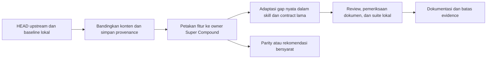

# Analisis Gap Framework dan Adopsi Super Compound

## Summary

Dua belas folder sumber diperiksa terhadap HEAD default branch upstream pada
6 November 2026. Sumber yang tertinggal diperbarui; perubahan lokal dan adaptasi
Ralph dipertahankan. Koordinator memeriksa ulang 13.984 entri ekspor terhadap
file lokal: 13.974 cocok setelah normalisasi line ending, sedangkan 10 entri
Ralph merupakan adaptasi yang tercatat. Identitas sumber dan fingerprint pohon
tersimpan di [source lock](../research/upstream-sources-20261106.json).

Lima perbaikan diterapkan pada pemilik yang sudah ada: audit statis selector
MCP, pencatatan lifecycle risiko, cakupan reviewer, pemeriksaan UI berbasis
bukti termasuk RTL, dan kompatibilitas nama glossary. Tidak ada skill, workflow,
dependency runtime, atau public command baru. Branch kerja:
`feature/framework-gap-adoption-20261106`.

Empat skenario tekanan baseline menghasilkan keputusan yang sudah benar.
Karena itu, analisis ini tidak mengklaim peningkatan reliability, kecepatan,
atau penghematan token terukur. Detail pengujian dan batas klaim berada di
[laporan verifikasi](../eval-results/framework-adoption-20261106.md).

## Overview

Perbandingan mencakup delivery/authority, planning dan execution, review dan
verification, pengetahuan dan context, UI, keamanan/dependency, serta risk dan
compliance. Setiap kandidat dipetakan ke owner Super Compound sebelum dipilih.
Temuan berasal dari permukaan fitur dan berkas yang disebutkan, bukan klaim
bahwa setiap baris semua repository telah diaudit secara semantik.

Pembaruan sumber menggunakan fast-forward ketika checkout aman. Snapshot dan
checkout dengan overlay dibandingkan dengan baseline upstream terdahulu;
file yang diganti/dihapus dibackup, tambahan lokal dipertahankan. Tidak ada
reset, stash, commit baru, push, publish, atau deployment.

## High-Level Design

## Identitas dan hasil pembaruan

SHA lengkap, timestamp pemeriksaan, subtree, jumlah entri, dan fingerprint ada
di source lock. `latest` berarti HEAD yang diamati saat pemeriksaan, bukan
jaminan bahwa upstream tidak akan berubah sesudahnya.

| Folder / sumber | Branch | SHA | Hasil |
|---|---|---|---|
| [anti-slop](https://github.com/miqdadbadjuber/anti-slop) | main | `9504989f162a` | Snapshot v3.2.26; 65 entri cocok |
| [pstack](https://github.com/cursor/plugins/tree/main/pstack) | main | `2776ddd2355d` | Hanya subtree pstack; 573 entri cocok |
| [bmad-method](https://github.com/bmad-code-org/bmad-method) | main | `022be9314e4f` | Snapshot; 626 entri cocok |
| [superpowers](https://github.com/obra/superpowers) | main | `22f0b463e7a5` | Fast-forward v7.0.2; 236 entri cocok |
| [compound-engineering](https://github.com/EveryInc/compound-engineering-plugin) | main | `7dc50943bbf9` | Konten v3.36.0; 2.042 entri cocok; Git HEAD lama dipertahankan |
| [everything-claude-code](https://github.com/affaan-m/everything-claude-code) | main | `b38be6a7f635` | Fast-forward v2.2.3; 4.701 entri cocok |
| [ui-ux-pro-max-skill](https://github.com/nextlevelbuilder/ui-ux-pro-max-skill) | main | `b7d5353e0130` | Fast-forward; 706 entri cocok |
| [gsd-core-next](https://github.com/open-gsd/gsd-core) | next | `f3f3a182627f` | Fast-forward v1.20.1; 4.238 entri cocok |
| [isms-public](https://github.com/Hack23/ISMS-PUBLIC) | main | `81f36563f0ee` | Fast-forward; 43 entri cocok |
| [gao-agent](https://github.com/generationappleone/gao-agent) | main | `4c8746654978` | Sudah terkini; 539 entri cocok setelah normalisasi CRLF |
| [mattpocock-skills-main](https://github.com/mattpocock/skills) | main | `4ae2317ddb22` | Konten v1.3.2; 184 entri cocok; Git HEAD lama dipertahankan |
| [ralph](https://github.com/snarktank/ralph) | main | `6c53cb0b831e` | Sudah terkini; 21 entri cocok, 10 adaptasi lokal |

Checkout compound-engineering dan Matt tetap menunjukkan dirty state karena
pembaruan konten di atas HEAD lama; itu bukan konflik yang disembunyikan.
Matt menggunakan representasi symlink Git Windows untuk `AGENTS.md`.
Backup perubahan snapshot berada di workspace induk
`.sync-backups/20261106/<folder>/`; fast-forward dapat ditelusuri melalui SHA
sebelum pembaruan pada source lock. Local-only files bukan fitur upstream.

### Ralph dan sumber Anthropic

Path `anthropics/claude-code/plugins/ralph-wiggum` telah dihapus. Riwayat
[pemindahan resmi](https://github.com/anthropics/claude-code/commit/10a5141d2d12b5a089a5fbb5f24af3fd345a34d2)
ditelusuri ke
[claude-plugins-official/plugins/ralph-loop](https://github.com/anthropics/claude-plugins-official/tree/1aa4a4b10e6c5e8694d0f72a03dbac4e93bcafd8/plugins/ralph-loop).
Sembilan file referensi dipin pada commit tersebut; tidak disalin sebagai
runtime pengganti. [Teknik asli Huntley](https://ghuntley.com/ralph/) digunakan
untuk membedakan loop proses baru dari kelanjutan Stop hook dalam satu session.

Integrasi Ralph lokal diperbaiki pada tiga perilaku yang memiliki reproduksi:
kepemilikan session sejak setup, inisialisasi lock Windows tanpa membaca byte
yang sedang dikunci, dan JSON Unicode yang aman untuk pipe encoding Windows.
Batas iterasi, cancel, typed state, atomic persistence, dan default permission
tetap dipertahankan. Provenance dan dokumentasi berada di `ralph/UPSTREAM.md`
pada workspace induk.

## Matriks fitur dan keputusan

Path sumber pada tabel relatif terhadap repository yang dipin di source lock.
`Setara` berarti mekanisme sudah ada pada owner yang diperiksa; tidak menuntut
salinan baru. Rekomendasi bersyarat belum menjadi implementation authority.

| Sumber dan fitur yang diperiksa | Owner / cakupan Super Compound | Keputusan dan alasan |
|---|---|---|
| anti-slop: purpose gate, klaim nyata, contrast; `antislop.md` dan `skills/antislop-human/SKILL.md` | `interface-design/references/implementation-and-checklist.md` | AD-04: purpose dan evidence eksplisit; ambang large-text diperbaiki ke unit WCAG, bukan menyalin `18px` |
| anti-slop: install/update, mode during/after, native plugin routes | Setup/adapter dan authority yang sudah ada | Tidak diimpor: preferensi mode dan installer sumber bukan policy Super Compound |
| pstack: shared-premise test; `skills/principle-attack-the-premise/SKILL.md` | `systematic-debugging` investigation/advanced techniques | Setara dalam keputusan baseline A; tidak menambahkan trigger duplikat |
| pstack: benchmark noise/limiter; `skills/benchmark-checklist/SKILL.md` | `eval-harness/references/paired-experiments.md` | Setara: A/A noise, paired trials, source identity, INCONCLUSIVE sudah tersedia |
| pstack: independent arena; `skills/arena/SKILL.md` | `prototyping`, `codebase-design`, `eval-harness` | R-02 implemented: perbandingan opsional terisolasi dan rubric blind pada owner lama; tanpa workflow arena |
| BMad: lens failure dan triage; `skills/bmad-code-review/step-02-review.md`, `step-03-triage.md`, `step-04-route.md` | `code-review` dan compact `sc-review` | AD-03: hasil kosong/gagal dipisahkan dari completed tanpa temuan; verifikasi sebelum grouping |
| BMad: publisher independence; `skills/bmad-deep-recon/references/verification.md` | `sc-research` dan research-note evidence register | R-06: penguatan klaim penting/berkonflik, bukan minimum dua sumber untuk semua fakta |
| BMad: clean-room skill eval dan ingestion | `eval-harness`, `agentic-delivery` authority | Paired eval sudah setara; fidelity proposal/commitment tetap rekomendasi sumber, bukan workflow baru |
| superpowers: task/interface preflight; `skills/subagent-driven-development/references/preflight.md` | `plan-verification`, `issue-workflow`, isolated `work-package` | Ownership dan dependency gates sudah ada; tabel bukti pair dapat dipakai saat kontrak lintas stream berubah |
| superpowers: fresh builder check dan anti-goals; `skills/brainstorming/builder-check-prompt.md` | `brainstorming`, `writing-plans` | R-05: selektif untuk ambiguitas material; tidak menambah checkpoint pada keputusan internal rutin |
| compound-engineering: provenance/pruning; `.agents/skills/ce-skill-work/SKILL.md` | `skill-authoring` | R-05: identifikasi test/incident/owner sebelum membuang aturan; tanpa skill authoring kedua |
| compound-engineering: already-satisfied execution dan prevention form; `skills/ce-work/references/implementation-loop.md`, `skills/ce-compound/references/form.md` | `executing-plans`, `knowledge-compounding` | Banyak overlap; gunakan outcome verification dan prevention checks yang sudah ada sebelum menambah dokumen |
| compound-engineering: retune dan cross-model receipts | `eval-harness`, `subagent-orchestration` | Noise-aware tuning sudah setara; R-08 mengadaptasi receipt provenance secara kondisional pada executor eval yang sudah ada, tanpa controller baru |
| ECC: `skills/mcp-dependency-review/SKILL.md` | `security-audit`, `compatibility-check`, compact risk contract | AD-01: audit no-exec npm/Python/Git/Docker selectors dan batas klaim direct pin |
| ECC: loop-design-check, iterative retrieval, skill-stocktake | `executing-plans`, context/recovery, `skill-authoring` | Recovery/criteria sudah kuat; R-05 untuk changed-skill stocktake, tanpa daemon/telemetry baru |
| UI UX Pro Max: RTL/mixed scripts; `src/ui-ux-pro-max/templates/base/skill-content.md`, RTL tests | `interface-design` implementation guidance | AD-04: direction-aware semantics, logical CSS, bidi isolation dan rendered checks |
| UI UX Pro Max: taxonomy, relevance engine, updated catalog | Search/provenance/data milik `interface-design` | R-01 implemented pada tindak lanjut: styles 22 ke 30 kolom, reasoning 10 ke 12; per-file revision membedakan sumber aktif dari default historis |
| GSD: verify-work reliance audit, real-artifact gate checks | `verification-before-completion`, `plan-verification` | R-03 implemented: expected verdict, input nyata saat ini dan rejection controls; baseline D tetap historis, bukan klaim peningkatan reliability |
| GSD: convergence/re-verification, resume, document readback | `gap-closure`, `state-management`, completion evidence | Resume dan evidence identity sudah setara; jangan mengadopsi fuzzy matching yang melemahkan exact goal IDs |
| ISMS-PUBLIC: risk register, treatment, due review; `Risk_Register.md` | `threat-modeling`, `security-audit` reporting | AD-02: tutup mismatch gate dan template, reuse risk/exception IDs dan decision evidence |
| ISMS-PUBLIC: control/evidence mapping dan metrics review | Existing scoped standards/adoption, security reporting | AD-02 bersyarat scope: observed vs planned control dan overdue review; bukan klaim compliance/certification |
| GAO: transport-specific MCP readiness; `.agent/mcp-configs/README.md` | `integration-checking`, live verification | R-04: availability/auth/capability dibedakan; probe harus scoped, credential values tidak dicetak |
| GAO: memory/caps/archive dan recovery | `context-engineering`, `state-management`, memory tools | Setara. GAO proprietary: konsep dianalisis mandiri, teks/kode tidak disalin |
| Matt Pocock: glossary naming; `skills/engineering/domain-modeling/SKILL.md` | `domain-modeling` dan lima caller terkait | AD-05: pertahankan GLOSSARY/CONTEXT family dan satu authority; default CONTEXT kompatibel |
| Matt Pocock: design-it-twice dan smell review | `codebase-design`, `prototyping`, `code-review` | R-02 implemented untuk alternatif constrained independen; smell tetap heuristik berbukti, bukan automatic gate |
| Matt Pocock: beta software factory | Existing local workflow/authority | Tidak ditambahkan: hosted runner/triggers/provider infrastructure tidak diperlukan scope ini |
| Ralph: one task, fresh process, stable specs, test backpressure | `executing-plans`, `subagent-orchestration`, verification | Setara; perbaikan session/Windows diterapkan pada Ralph lokal, bukan duplikasi loop di Super Compound |
| Root `.agents/skills`, `.claude/settings.json`, scaffolding `.agent` | Cavecrew/Caveman komunikasi, host hooks menuju Super Compound | Cakupan ancillary, bukan framework delivery tambahan. Bounded work-package/result contracts sudah ada |

## Perbaikan yang diterapkan

| ID | Perubahan dan manfaat | Berkas pemilik |
|---|---|---|
| AD-01 | Klasifikasi mutable/exact/review untuk launcher MCP tanpa menjalankannya; severity kontekstual dan transitive/provenance limits | [Agent surface](../../.agent/skills/security-audit/references/agent-surface.md), [compatibility inspection](../../.agent/skills/compatibility-check/references/inspection-surface.md), [risk contract](../../.agent/context/skills/risk-audit.contract.md) |
| AD-02 | Risk ID, owner, treatment, decision authority/evidence, review/expiry dan actual verification; rencana belum berarti accepted/mitigated | [Threat template](../../.agent/skills/threat-modeling/references/document-template.md), [security reporting](../../.agent/skills/security-audit/references/reporting.md) |
| AD-03 | Applicable coverage dicatat completed/failed/skipped; required reviewer gagal/kosong menahan approval; grouping setelah verifikasi tiap temuan | [Review reference](../../.agent/skills/code-review/references/findings-and-self-review.md), [review contract](../../.agent/context/workflows/sc-review.contract.md) |
| AD-04 | Tujuan visual, klaim bersumber, contrast terukur dan RTL/mixed-script checks; recovery/idempotency lama dipertahankan | [Implementation checklist](../../.agent/skills/interface-design/references/implementation-and-checklist.md) |
| AD-05 | GLOSSARY/MAP dan CONTEXT/MAP didukung tanpa rename/duplikasi; runtime context tidak otomatis menjadi domain authority | [Domain policy](../../.agent/skills/domain-modeling/SKILL.md#files), skill index dan caller codebase-design/triage/review/issue-workflow |

Definisi contrast dan base direction diperiksa pada sumber primer
[W3C WCAG 2.2 SC 1.4.3](https://www.w3.org/WAI/WCAG22/Understanding/contrast-minimum.html)
dan [W3C structural RTL markup](https://www.w3.org/International/questions/qa-html-dir).
Keputusan adopsi tidak mengandalkan ambang unit yang keliru dari sumber sekunder.

## Tindak lanjut R-01

R-01 kini **implemented**. Sumber aktif selective refresh adalah
`b7d5353e0130feb8c5574ef1251f8a1db1873ccb`: 35 CSV upstream diperbarui,
1 CSV web lokal dipertahankan, total 36 katalog/4.357 baris dan 106 transformasi
sel lokal. Default `3da52ff1cab1be91848072ec1be5f493d730fd5f` tetap berlabel
historis; revision per-file dan nilai yang dipertahankan tercatat dalam
[merge ledger](../research/interface-catalog-refresh-20261106.json).
[Laporan R-01](../eval-results/interface-catalog-refresh-20261106.md) memuat
bukti regression, oracle relevance, source/hash dan batas verifikasi terbaru.

Hasil tahap adopsi awal di atas tetap historis. Run broad default pada tindak
lanjut menghasilkan 587/588 tool tests; fixture manifest Python yang tidak
berubah gagal pada run itu dan lulus saat diulang terpisah. Pengulangan inventory
588 yang sama dengan concurrency 4 lulus 588/588 tanpa skip. Fase skill, hooks
dan Python juga lulus terpisah; default broad wrapper tidak diklaim lulus.

## Tindak lanjut R-02

R-02 kini **implemented** melalui satu reference opsional pada `prototyping`,
ditautkan dari `codebase-design`, `eval-harness`, eksplorasi compact dan owner
alternatif eksekusi. Rubric privat dibekukan sebelum generasi, seluruh acceptance
tetap terbuka bagi pembuat, dan judge baru menilai paket anonim sebelum mapping
dibuka. Hasil terpilih/gabungan diuji pada predicate awal; keputusan mengikuti
authority light/full yang sudah ada, dengan kode prototype tetap disposable.

Regresi terkait lulus 47/47, skill tests 28/28, dan audit nol temuan. Satu
exercise lokal sintetis memakai dua worker berkonteks baru: masing-masing 6/6,
hasil terpilih 6/6, graft incompatible ditolak. Batas isolasi prosedural,
identitas model unknown, dan ketiadaan klaim bias/reliability terukur tercatat
dalam [laporan R-02](../eval-results/design-comparison-20261106.md) beserta
[arsip bukti](../eval-results/design-comparison-20261106.exercise.json).

## Tindak lanjut R-03

R-03 kini **implemented** pada owner verification/planning/eval yang sudah ada:
expected verdict ditetapkan sebelum eksekusi, input nyata diikat ke HEAD dan
dirty/untracked bytes, serta control invalid harus ditolak untuk alasan yang
dimaksud. Bukti sensitivity gate, status target dan hasil seluruh sistem tetap
dibedakan. Tidak ada workflow, gate engine atau approval baru.

Uji artifact nyata juga menemukan blocker DAG yang dibuang diam-diam.
`goal-waves.mjs` kini menolak format tak didukung dengan
`WAVES_INVALID_DEPENDENCY`; path `.md` valid dan `None` tetap didukung.
Board pstack asli dan readiness legacy yang gagal tetap **belum qualified**;
artifact approved tidak ditulis ulang. [Laporan R-03](../eval-results/real-artifact-gates-20261106.md)
menyimpan hasil aktual, controls, batas bukti dan tindak lanjut input legacy.

## Tindak lanjut R-04

R-04 diimplementasikan melalui reference opsional pada `integration-checking`,
ditautkan dari live verification dan compact execution/work. Diagnostik memilih
transport serta revision yang didukung client, kemudian memisahkan transport,
protocol, authentication, authorization, discovery dan hasil operasi. Static
dependency audit tetap tidak menjalankan launcher atau probe.

Verifikasi mencakup 605/605 tool tests, 10 kasus runtime lokal `MOCK`, 8 kasus
manual panduan, dan observasi native yang dibedakan menurut client. SDK lokal
menegosiasikan `2025-11-25`; panduan modern `2026-07-28` direview terhadap sumber
primer, bukan diklaim telah diuji runtime. Channel utama `Transport closed`
tidak disamakan dengan channel subagent yang berhasil. Transport, principal dan
scope native tetap unknown. [Laporan R-04](../eval-results/mcp-diagnostics-20261106.md)
memuat bukti, provenance, redaction dan batas pengujian.

## Tindak lanjut R-05

R-05 diimplementasikan pada skill-authoring, execution dan brainstorming yang
sudah ada. Stocktake memakai baseline task dan memetakan lima path milik empat
owner; usage yang tidak terukur tidak menjadi dasar retirement. Pruning mencari
provenance dan consumer: satu calon duplikasi justru dipertahankan karena
melindungi jalur compact/reference-only yang tidak selalu memuat router penuh.

Fresh builder menilai ambiguity material dari artifact kanonis, tanpa checkpoint
baru untuk pilihan internal. Precheck membedakan hasil yang sudah terbukti,
parsial dan bukti lama/tidak lengkap. Kontrol aktual menunjukkan 2/2 tanpa edit,
perbaikan parsial 1/2 menjadi 2/2, serta penolakan stale proof. Baseline manual
tetap benar; tidak ada klaim peningkatan reliability model. Final affected suite
lulus103/103 dan skills28/28; broad611/611 sebelumnya tidak mendeteksi bug batas
loading tersebut. [Laporan R-05](../eval-results/skill-maintenance-20261106.md)
memisahkan bukti aktual, koreksi, stocktake dan batas verifikasi.

## Tindak lanjut R-06 (2026-11-07)

R-06 diimplementasikan melalui research dan reference authoring yang sudah ada.
Klaim bisnis penting memakai anchor dan scope tepat; independensi dinilai dari
publisher serta underlying evidence, bukan jumlah domain atau tool. Koreksi,
speaker, modality dan kondisi komitmen dipertahankan dua arah, lalu hanya
kesimpulan serta referensi turunannya yang terdampak ditinjau kembali.

Register dan authority lama tetap berlaku; tidak ada minimum dua sumber universal,
approval baru atau engine riset. Lima belas kontrol semantik sesuai oracle
terkunci (lima ACCEPT, sepuluh REJECT), sedangkan baseline/guided menunjukkan
parity. Suite terkait lulus109/109 dan skills28/28. Note pada artifact nyata tetap
menyatakan runtime INCONCLUSIVE dan P2 proposed, bukan manfaat terukur atau
persetujuan. [Laporan R-06](../eval-results/business-evidence-20261107.md) menyimpan
snapshot sumber sebelum perubahan status ini, hasil aktual dan batas bukti.

## Tindak lanjut R-07 (2026-11-07)

R-07 diadopsi sebagai [reference opsional](../../.agent/skills/verification-before-completion/references/bounded-formal-checking.md)
pada owner verification lama. Target pilot adalah Promise queue process-local
`withLedgerLock`: operasi pada resolved ledger path yang sama tidak overlap,
dan rejection tidak menghentikan successor yang sudah antre. Eksplorasi state
eksplisit di test Node dibatasi dua actor dengan dua call per actor; mapping
source, asumsi, batas dan counterexample dipertahankan. Replay memakai copy
source dengan hook enqueue pasif yang sinkron untuk kasus concurrency yang
dimodelkan. Check real API tanpa modifikasi hanya smoke test, bukan proof
contention. Kontrol `unconditional-tail-delete` menghapus tail antrean yang
lebih baru; `poisoned-predecessor` menghapus recovery rejection predecessor.
Model memasok settlement callback yang terminating; tidak ada proof fairness.
Model target PASS pada 1.625 state / 1.854 transition / 304 terminal; kedua
mutant gagal pada properti yang dituju. Tiga eksplorasi closed tanpa frontier,
maximum observed depth 16 tanpa depth cutoff; kontrol cap 1 menghasilkan
`INCONCLUSIVE`. Empat replay path baseline/mutant valid terhadap model.
Shortest abstract counterexample tidak persis direplay: witness aktual enqueue
sebelum settlement, sedangkan shortest path abstrak settlement sebelum enqueue.
Kedua trace dan hubungan same-violation disimpan terpisah. Smoke real API
menjalankan empat callback dengan satu rejection disengaja. Verifikasi terkait
lulus 149 Node test dan 28 skill test, router Python dan pemeriksaan syntax, instalasi/doctor
enam host terisolasi (49 byte check dan sembilan link), serta tiga run benchmark
deterministik. [Laporan R-07](../eval-results/bounded-formal-checking-20261107.md)
menyimpan hasil aktual, batas dan receipt acceptance final.

Konsep mengacu pada pstack
[create](https://github.com/cursor/plugins/blob/2776ddd2355d6d6c8747d3964600f28daf62f049/pstack/skills/create-formal-verification-skill/SKILL.md)
dan [maintain formal verification](https://github.com/cursor/plugins/blob/2776ddd2355d6d6c8747d3964600f28daf62f049/pstack/skills/maintain-formal-verification-skill/SKILL.md)
pada revision `2776ddd2355d6d6c8747d3964600f28daf62f049`, yang sudah tercatat
di [source lock](../research/upstream-sources-20261106.json). Adaptasi memakai
owner lama dan Node yang tersedia; tidak membuat skill/workflow, checker
produksi atau dependency formal baru. Hasil finite tidak membuktikan locking
antarproses, durability filesystem, liveness tak terbatas atau keseluruhan sistem.

## Tindak lanjut R-08 (2026-11-07)

R-08 mengadaptasi [external execution receipts](../../.agent/skills/subagent-orchestration/references/completion-inbox.md#external-execution-receipts)
pada owner completion-inbox lama. Pilot bounded `codex-pilot.mjs` dan
`session-baseline.mjs` sudah menjadi executor eval eksternal; metadata additive
memisahkan harness/executable/model/effort yang diminta dari provider/model yang
diamati, sambil mempertahankan field legacy `model` sebagai request. Inherit dan
override eksplisit tetap berlaku. Verifikasi lokal lulus 75 Node test terkait,
28 skill test dan pemeriksaan syntax; agent projection memverifikasi konfigurasi
saja. Instalasi/doctor adapter Codex dan Claude terisolasi lulus dengan 13 byte
check dan lima link, serta tiga run benchmark deterministik pada threshold lama.
Kontrol runtime dan delapan keputusan manual memakai bukti `MOCK`; keputusan
baseline/guided tetap parity, bukan peningkatan reliability. Hasil dan receipt
acceptance final berada pada [laporan R-08](../eval-results/model-receipts-20261107.md).

Receipt membutuhkan sumber dan dasar kepercayaan: assertion adapter bukan
attestation backend, family bukan exact served model, dan konfigurasi tool tidak
membuktikan capability yang tersedia atau benar-benar enforced. Identitas tanpa
metadata tepercaya tetap unknown/unverified. Fixture lokal tidak membuktikan
identitas provider live atau enforcement; tidak ada parser metadata serving,
provider, controller, schema atau gate baru.

Konsep dianalisis dan diadaptasi mandiri tanpa menyalin teks/kode dari
compound-engineering, MIT Copyright 2025 Every, revision
`7dc50943bbf959dbe6a93a175e41e5fff8395e00` pada
[source lock](../research/upstream-sources-20261106.json). Referensi utama:
[cross-model execution](https://github.com/EveryInc/compound-engineering-plugin/blob/7dc50943bbf959dbe6a93a175e41e5fff8395e00/skills/ce-work/references/cross-model-execution.md),
[return identity](https://github.com/EveryInc/compound-engineering-plugin/blob/7dc50943bbf959dbe6a93a175e41e5fff8395e00/skills/ce-work/references/return-to-caller.md),
dan [review attribution](https://github.com/EveryInc/compound-engineering-plugin/blob/7dc50943bbf959dbe6a93a175e41e5fff8395e00/skills/ce-code-review/references/cross-model-review.md).
Controller dan resep dispatch upstream tidak diimpor.

## Rekomendasi berikutnya

R-01 sampai R-06 di bawah mencatat status implementasi tindak lanjut. R-07
mengadopsi reference bersyarat pada owner lama dengan pilot finite, test dan
instalasi terverifikasi.
R-08 mengadopsi guidance bersyarat dan metadata eval pada owner lama dengan
verifikasi source/test dan instalasi lokal; identitas serving live dan effective
capabilities tetap unverified.
Tidak diperlukan skill/workflow baru; interface dan authority lama tetap berlaku.

| ID / prioritas | Nilai, syarat dan biaya | Owner dan bukti penerimaan sebelum adopsi |
|---|---|---|
| R-01 / P1 | **Implemented**: selective UI catalog/RTL retrieval refresh | `interface-design`: per-file revision, schema, local transforms, regression dan relevance pada [laporan tindak lanjut](../eval-results/interface-catalog-refresh-20261106.md) |
| R-02 / P2 | **Implemented**: independent constrained design alternatives dan blind rubric; opsional untuk ketidakpastian desain bermakna | `prototyping`/`codebase-design` + eval lama: frozen rubric, keluaran terisolasi, retest hasil aktual, authority capture dan disposal pada [laporan R-02](../eval-results/design-comparison-20261106.md) |
| R-03 / P2 | **Implemented**: authored/changed gates diuji terhadap artifact nyata dan rejection controls | `plan-verification`/verification: expected outcomes, HEAD+dirty identities, intended rejection, DAG fix dan status target terpisah pada [laporan R-03](../eval-results/real-artifact-gates-20261106.md) |
| R-04 / P2 | **Implemented**: optional MCP diagnostics per transport/protocol, authentication, authorization dan capability | `integration-checking` + verification lama: independent outcomes, bounded harmless probe, before-output allowlist, owned cleanup serta MOCK/native limits pada [laporan R-04](../eval-results/mcp-diagnostics-20261106.md); static audit tetap no-exec |
| R-05 / P2 | **Implemented**: changed-skill stocktake, provenance-protected pruning, selective fresh-builder ambiguity dan already-satisfied precheck | `skill-authoring`/execution/brainstorming: lima path/empat owner, guard lintas load dipertahankan, fresh reader dan kontrol complete/partial/stale pada [laporan R-05](../eval-results/skill-maintenance-20261106.md); tanpa skill/workflow/gate baru |
| R-06 / P2 | **Implemented**: source independence dan correction/commitment fidelity untuk klaim bisnis penting | Research/agentic-delivery lama: origin serta scope per klaim, kondisi dan koreksi dua arah, selective impact, kontrol15/15 dan scope aktual pada [laporan R-06](../eval-results/business-evidence-20261107.md); target historis tetap belum qualified |
| R-07 / P3 | **Implemented**: checking opsional untuk invariant concurrency/retry/state-machine; pilot finite, test dan instalasi terverifikasi | Verification lama: source-bound `withLedgerLock`, dua actor x dua call, target 1.625 state PASS, intended mutant failures dan empat source-copy path valid; shortest abstract trace tidak persis direplay. [Laporan R-07](../eval-results/bounded-formal-checking-20261107.md) memuat receipt final dan batas klaim, tanpa proof antarproses atau tak terbatas |
| R-08 / P3 | **Implemented**: guidance/disclosure dan metadata requested vs observed identity pada executor eval eksternal yang sudah ada | Completion-inbox lama: legacy `model` dipertahankan, 75 Node test dan 28 skill test serta instalasi adapter lokal lulus; trust/fixture/capability limits dan receipt final pada [laporan R-08](../eval-results/model-receipts-20261107.md). Identitas serving live dan effective capabilities tetap unverified; tanpa controller/provider baru |

## Batas dan risiko

Pembaruan sumber bukan jaminan semua upstream test suite lulus. Superpowers
memiliki satu assertion path Windows yang gagal dan auth test membutuhkan
`ws`; ECC skill validator membutuhkan `js-yaml`; GSD build terhalang export
types vendor; compound skill guards terpengaruh Windows serta extras lama;
Matt strict plugin validation menolak warning packaging; full BMad pytest
dihentikan pada 3%. Hasil fokus yang benar-benar dijalankan dan batas masing-
masing sumber dicatat pada source lock dan laporan verifikasi.

Pada tahap adopsi awal, antarmuka runtime Super Compound, 19 public workflows,
permission boundaries, dataset UI yang dipin, dan konfigurasi deployment tidak
diubah. Tindak lanjut R-01 memperbarui katalog/retrieval milik `interface-design`
seperti dicatat di atas. Perbaikan tidak membuktikan effectiveness host langsung
atau compliance.
Rekomendasi tidak menyalin policy organisasi Hack23, lisensi proprietary GAO,
model IDs sumber, automatic commit/push, atau permission bypass.
