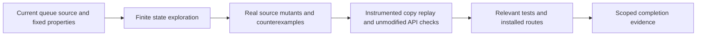

# R-07 Bounded Formal Checking

## Summary

R-07 adapts the existing verification owner with an optional, source-bound bounded-checking procedure. The pilot targets `withLedgerLock`, the existing in-process Promise queue used by work-package mutations. Its finite target model closed at 1,625 states with no violation; two real-source mutants failed for the intended properties. Relevant verification passed: 149 tool tests, 28 skill tests, the Python router, syntax checks, and an isolated six-host installation/doctor.

The implementation adds no production checker, dependency, public skill or workflow. It retains the existing completion contract and authored-gate qualification. The source of the adapted concepts is pstack's create/maintain formal-verification guidance at `cursor/plugins` revision `2776ddd2355d6d6c8747d3964600f28daf62f049`; no upstream code or prose was copied.

## Evidence Flow



## Target and Correspondence

The target is `.agent/tools/work-package.mjs:1368`, exported `withLedgerLock`. Its queue protects ledger read/modify/write sequences used by `createWorkPackage`, `recordWorkPackageResult` and completion-receipt mutations. The proof question is whether callbacks for one normalized ledger path overlap, and whether predecessor rejection prevents a queued callback from executing.

| Source action | Model action and boundary |
|---|---|
| `await mkdir(...)`, then `path.resolve(ledgerPath)` | Registration models the synchronous block after directory creation; registration order is publication order, not public call order |
| Read prior tail, attach `previous.catch(...).then(operation)`, publish `run` | One atomic registration records its predecessor and publishes the new tail |
| Invoke `operation` | Queued to running; enter exactly once |
| `run` fulfills or rejects | Running to settled, with either supplied outcome |
| `await run` continuation, guarded `finally` deletion | Settled to finalized; deletion is allowed only when the stored tail is this call |

The predecessor's `await run` continuation is registered before a successor's catch/then reactions. The model respects predecessor finalization before successor entry. Additional scheduler abstraction and concrete replay correspondence are documented in the retained machine evidence. A model result alone does not establish this mapping.

## Bounds and Claims

The finite domain has two actors, each issuing two calls on one normalized path. An actor issues its next call after its preceding outer call finalizes, including after rejection. Callback settlements are supplied and terminate. The model distinguishes absent, queued, running, settled and finalized calls, predecessor identity, outcome and current queue tail.

Safety means no more than one callback is running for the path. Recovery means drained finite executions invoke every registered callback, including successors of rejected predecessors. These are not scheduler-fairness, eventual-success or starvation-freedom claims. Numeric bounds define the model; an exploration cap with an unexamined frontier yields `INCONCLUSIVE`.

Excluded: cross-process or separate-module queues, aliases resolving to different keys, nonterminating callbacks, arbitrary callback effects, crash recovery, leases/fencing, filesystem atomicity/durability, other runtime platforms, and arbitrarily many actors/calls. The bounded model supplements actual implementation tests.

## Controls and Replay

Expectations are fixed before model execution. The unchanged source is also the known-valid control. Two isolated derivatives change actual source behavior: `unconditional-tail-delete` removes the current-tail guard; `poisoned-predecessor` removes the predecessor rejection catch. The same checker, properties and configuration detect the intended violation. A state-budget control reports incomplete exploration rather than pass.

Counterexamples retain ordered actions and states. Exact enqueue observation uses complete isolated source copies with a synchronous passive hook after tail publication, shared by baseline and mutants. Four observed source-copy paths were validated against the same model transitions. Separate unmodified production API checks are smoke evidence: four callbacks, one intentional rejection and successful subsequent calls, without a contention-sensitivity claim. Rejected mutants qualify sensitivity for these regressions only; they are not defects found in the current implementation.

The shortest abstract counterexamples place B1 registration between A1 settlement and finalization, an order permitted by the conservative scheduler abstraction. The concrete witnesses register B1 before A1 settles. Both mutant receipts explicitly record `shortestAbstractTraceExactlyReplayed: false`; the realizable same-property witnesses and their model states are retained separately. The cleanup witness reaches B1 and A2 running together after A1 deletes B1's tail. The poison witness rejects B1 without invoking it after A1 rejects. Baseline source-copy counterparts prevent both violations. No claim is made that an unreproduced abstract schedule itself demonstrates a runtime defect.

| Variant | States / transitions / terminal states | Result |
|---|---|---|
| Current target / valid control | 1,625 / 1,854 / 304 | PASS within the declared model |
| Unconditional tail deletion | 1,849 / 2,658 / 208 | FAIL: two callbacks running |
| Poisoned predecessor | 1,145 / 1,328 / 190 | FAIL: callback skipped after rejection |
| State cap of one | 1 / 1 / 0 | INCONCLUSIVE; two successor candidates unexamined |

All three uncapped searches completed reachable closure with zero pending frontier, maximum depth 16 and no warnings. No depth cutoff or sampling substitutes for closure. The state cap for ordinary runs is 250,000 and was not reached.

## Verification

Node v24.15.0 supplied the existing test harness. Bounded probes found no Java/TLC/Apalache/Alloy/Spin/CBMC/Z3 commands or candidate Python solver packages in the checked environments; this is not a global installation inventory. No tool was installed. Primary commands:

```powershell
rtk node --test .agent/tools/bounded-formal-checking.test.mjs .agent/tools/bounded-formal-guidance.test.mjs
rtk node .agent/tools/token-benchmark.mjs --baseline .agent/benchmarks/token-baseline.before.json --repeat 3 --output .agent/benchmarks/token-benchmark.after.json
rtk node .agent/tools/framework-audit.mjs --output .agent/benchmarks/framework-audit.after.json
rtk node .agent/tools/framework-audit.mjs --verify-existing .agent/benchmarks/framework-audit.after.json
```

Machine evidence is retained in [the evidence archive](bounded-formal-checking-20261107.evidence.json): fixed expectations, complete source-copy inputs, model/configuration/dependency digests, traces/states, command logs, snapshots and recorded verdicts. Before/after source identity includes the current HEAD plus dirty raw-byte digests; a commit alone does not identify this workspace. Production `work-package.mjs` remained byte-identical to the captured R-07 baseline (`7eb0499c85214e53483b2c8adb50449cc8fde6f4c0ef56bb6ebccb0ca061246e`).

| Check | Observed result |
|---|---|
| Twelve relevant Node test files | 149 passed; zero failed, skipped, cancelled or todo |
| Existing skill suite | 28 passed; zero failed or skipped |
| Python router / syntax | PASS / exit 0 |
| Isolated project installation and doctor | Six hosts; 49 byte comparisons and nine relevant link/anchor checks passed |
| Static context benchmark | Three deterministic passes; original baseline/threshold unchanged; sc-work 1,141, sc-debug 227, sc-eval 182 estimated tokens |
| Source preservation | 814-file pre-change inventory; non-task bytes preserved; no drift during the final scoped checks; nineteen public workflows unchanged |
| Final audit and all-AC gate | Current receipts are bound and validated by `.scratch/completion/r07-bounded-checking-20261107/recipe.json` and `verified-promise.mjs`; generated audit at `.agent/benchmarks/framework-audit.after.json` |

Recorded failed/intermediate attempts remain inspectable. The first compact debug route exceeded its budget at 268 tokens; the final owner route uses 227. The first installation validator incorrectly expected a benchmark receipt that setup intentionally excludes; manifest-backed N/A corrected the validator. A later guidance assertion rejected a line wrap in "unchanged baseline"; the corrected assertion permits whitespace and still requires derivative/baseline replay. The original first model report was overwritten during iteration; its recovered summary discloses that loss and is not the final qualification evidence. Final qualification uses the fully retained current run.

## Changed-Skill Stocktake

Comparison: captured R-07 baseline of 814 files on branch `feature/framework-gap-adoption-20261106`, HEAD `449cbd1a69fbff4b909ce5556d74686994308eea`. Earlier R-01 through R-06 dirty work is outside this change. No pruning or retirement is proposed; usage is unmeasured.

| Existing owner | Changed members / disposition | Reason and affected consumers |
|---|---|---|
| verification-before-completion | SKILL router, claim-evidence reference, new bounded-formal-checking reference / improve | Optional finite-proof specialization; normal completion and authored-gate authority remain; work/debug/eval readers |
| systematic-debugging | SKILL router and advanced-techniques reference / improve | Conditional concurrency/retry/state diagnosis, including section-only readers |
| eval-harness | eval-design reference / improve | Conditional evidence/grader selection |
| integration-checking | SKILL checks / improve | Conditional retry/event/concurrency invariant checks |

The pre-change pressure scenario already rejected an unsafe general-proof claim and an implementation-test waiver. The same-prompt guided rerun is parity, not invented RED/GREEN or measured behavioral improvement. The sequential same-agent inspection passed 38 assertions; the final replay-procedure amendment passed 20 separate assertions without rewriting the earlier response. The real pilot exposed the need to distinguish shortest abstract traces from realizable same-property witnesses. New scenario-specific procedures are justified by that concrete target and audit proposal. Routing tests, source-bound model/replay and installation checks provide separate evidence.

## Evidence of Completion

| Requirement / AC | What was verified | Evidence |
|---|---|---|
| AC-1 | Optional full/compact/section routes; existing authority and nineteen workflows | Guidance route tests, installed paths and baseline comparison |
| AC-2 | Current production queue and actual work-package consumers | Pinned source/call mapping, unmodified API smoke and existing ledger tests |
| AC-3 | Finite state/actions and concrete correspondence, assumptions and exclusions | Model source, inspected mapping, nonvacuity witnesses and retained states |
| AC-4 | Current HEAD, raw dirty/dependency/model/configuration identities and commands | Before/after report identities, final scope snapshots and command logs |
| AC-5 | Valid target and real-source derivatives with fixed semantic verdicts | Exact mutation/hook/import patches, retained complete copies and intended failures |
| AC-6 | Complete finite closure distinguished from an unfinished search | State/transition/frontier counts and INCONCLUSIVE cap control |
| AC-7 | Realizable source-copy witnesses validate the same properties | Four checked model paths, retained abstract traces and explicit nonexact-replay disclosure |
| AC-8 | Relevant tests, installation, benchmark, documentation and preserved work | Recorded verification, evidence archive and final fingerprinted audit/acceptance receipts |

The result supports mutual exclusion and finite rejection recovery in the stated model and concrete source witnesses. It establishes no broader runtime, distributed, filesystem or unbounded liveness guarantee. Changes remain uncommitted on `feature/framework-gap-adoption-20261106`; no commit or push was requested.
