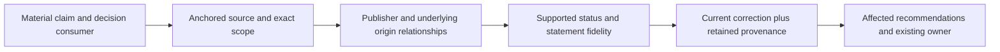

# R-06 Business evidence and statement fidelity

## Summary

R-06 strengthens existing research and delivery owners for important business
claims. It traces underlying evidence origins, preserves pinpoint support and
statement modality, retains correction history and revisits only affected
conclusions. Existing registers, decision authority and template grammar remain.
No skill, workflow, evidence engine or source-scoring system was added.

Both original MOCK writing exercises already handled their cases correctly.
Guided repeats show parity and more explicit traceability, not measured model
improvement. An independent semantic inspection matched all 15 fixed control
verdicts: five valid accepts and ten intended substantive rejections.

## Scope and high-level design

Branch: `feature/framework-gap-adoption-20261106`; HEAD:
`449cbd1a69fbff4b909ce5556d74686994308eea`. The pre-edit baseline pins 812
raw-byte file hashes. Prior framework/R-01 through R-05 work is preserved.

The canonical procedure is the existing
[shared authoring reference](../../.agent/skills/agentic-delivery/references/templates-and-outputs.md#business-claim-evidence-and-fidelity).
Full/compact research and the Research Note skeleton link there conditionally.
BRD/PRD/FSD skeletons already fetch the named Applicability section; an explicit
intra-file link now reaches the business procedure from that section alone.
No consumer must assume the complete reference is loaded.

Claim-level `verified`, `inferred`, `contested` and `unknown` labels are separate
from artifact status, confidence, approval and fulfilled commitments. A bounded
primary/local observation may suffice; there is no universal two-source gate.
Unknown independence does not automatically invalidate adequate direct support.

## Observed semantic exercises

Exact prompts, responses, source bytes/hashes and observations are retained in
the [evidence archive](business-evidence-20261107.evidence.json) and
`.scratch/r06-business-evidence-20261107/`. These are manual source/synthesis
checks and local observations, not a deployed factual-verification service.

| Exercise | Actual outcome and practical limit |
|---|---|
| First baseline and identical guided task | Both correct shared-origin repetition, 30 paying versus 300 trial accounts, August earliest/no pilot commitment, and investigation-only authority. Baseline parity; fictional evidence, no real customer claim. |
| Neutral baseline and identical guided task | Both retain two genuinely independent, scope-matched collections; separate repeated and mismatched-scope material; preserve the corrected October conditional internal-trial commitment. Real commitment modality is not erased. |
| Fresh semantic inspector, fixed oracle excluded from its source grant | 15/15 verdicts match the previously locked oracle: 5 ACCEPT, 10 REJECT, 0 UNKNOWN. Reasons and source anchors independently inspected, not just verdict strings. |
| Actual local-artifact research note | Keeps historical runtime INCONCLUSIVE and P2 fallback proposed; distinguishes static estimates from measured benefit; retains corrected 30-day retention, unchanged operator and unanswered reopened storage choice. No canonical changes or runtime rerun. |

The 15 controls include sufficient single-primary evidence; genuine independent
corroboration; shared-origin/tool/domain repetition; opaque and circular origins;
unsupported scope; incompatible conflicting figures; proposal promotion; a true
corrected conditional commitment; retrieval-order mistakes; stale dependent
calculations; omitted material conditions; unrelated reopening/unauthorized
execution; explicitly labelled inference; and unavailable-proof unknowns.

The inspector used fresh task context and did not receive the separate oracle.
This is a procedural grant, not a claim of model/provider or human independence.
No statistical effectiveness, calibration or reliability improvement is measured.

## Real target and correction boundaries

The read-only enactment consumed approved BRD-PSTACK, its historical evaluation,
the BMad source-lock/audit entries and one explicitly scripted correction-fixture
passage. Its note/metadata preserve exact anchors and qualification limits.
Multiple documents citing the same underlying record do not become independent
confirmations. Recorded approval provenance establishes what the artifact says
was authorized; it is not new verification of an original user instruction.

The actual runtime-benefit target remains **unqualified/unknown**; the historical
pilot is INCONCLUSIVE. P2 is still a proposal in its supplied sources. Scripted
Q1/Q2/Q3 answers are not real user authority. Guidance qualification does not
release those targets or grant execution approval.

Five real inputs are copied byte-for-byte under `real-inputs/` before later R-06
status-document edits. The note's R-06-proposal statement belongs to that captured
audit revision and timestamp, not the later implemented-status row. Original
history and input fingerprints remain inspectable.

One shared-reference pointer was added during actor work. The full-file hash
changed from `83ebb047...` to `f548b565...`; the business-section bytes stayed
identical (`bf65ff66bfb181c28111398d30cdb3cf954238c494e3d84edbe6f956bfbfa5c7`).
Actors retained observed identities and reread/reconciled the final guide rather
than rewriting history. The pre-pointer source is also frozen. Route tests
separately qualify the final section-only loading path.

## Current structural and integration verification

| Command / check | Actual result |
|---|---|
| `node --test --test-name-pattern R06 .agent/tools/workflow-contracts.test.mjs` | Initial intended RED 0/3; missing named-section route RED 2/3; current GREEN 3/3. Severed-edge control rejects missing path/anchor. |
| Exact nine-file affected test suite | 109/109, no failed/skipped; exact argv/timestamps in `verification-summary.json`. All 497 `.agent` source/fixture hashes were unchanged during the run. |
| `npm run test:skills` | 28/28, no fail/skip; counts overlap the affected suite and are not added together. |
| `npm run check`; `npm run test:hooks`; verification Python router | Exit 0; six syntax checks, hook assertion success and `skill router contract: PASS`. |
| Current-source compatibility review | Authoring and research pins updated only after semantic/additivity inspection; old response JSON, source digests and assertions remain unchanged. |
| Token benchmark, `--repeat 3` | Three deterministic passes with unchanged baseline/thresholds; research remains 202/226 estimated-token budget, sc-work untouched at its existing cap. Static estimates are not runtime usage. |
| Isolated project `setup()` | Five runtime/startup files byte-identical; installed startup and named-section links resolve, with no repository-only report link in startup. |

The first affected run was 107/109 due to stale compact research compatibility
pins. Review also found the full research workflow's historical pin. Exact
candidate overrides fixed those mismatches; the failed attempt remains under
`pre-pin-refresh/`. A passing historical evaluation is not new semantic proof.

Installed-runtime source/link checks, final benchmark/audit and the raw baseline
comparison are bound in the existing completion recipe after final docs settle.
Unrelated full tools and UI-catalog Python suites are not rerun for this
instruction/reference/template change.

## Provenance and preservation

Concepts were independently adapted from pinned BMad
`022be9314e4facd16826104a9f8033e1c5ed4fdc` in the
[source lock](../research/upstream-sources-20261106.json):
`bmad-deep-recon/references/verification.md`, `bmad-ingest/SKILL.md`, and meeting/
thread ingestion templates. There is no new upstream freshness claim. The
cross-tool-confirmation shortcut, quotas, BMad runtime and memlogs were not adopted.
Existing licensing, history and canonical authority remain.

The task stocktake covers two skill-owned paths under one existing owner
(`agentic-delivery` reference plus its current-source pin test); research routes,
template and shared tests are affected consumers. Usage remains unmeasured.
All 19 public workflow names remain; only the authorized research workflow and
its compact contract change among those entry points.

## Evidence of Completion

| AC | Outcome evidence |
|---|---|
| AC-1 | Material-only trigger, single-primary positive control and no universal quota |
| AC-2 | Exact source/scope and status checks in actual writing outputs, controls and real note |
| AC-3 | Positive independent support, repeated/unknown/circular-origin controls and real source lineage |
| AC-4 | Proposal rejection, true conditional-commitment acceptance and bidirectional omission controls |
| AC-5 | Preserved prior/current anchors, retrieval-order rejection and affected-only downstream correction checks |
| AC-6 | Advisory note-only outputs; no invented approval, fulfilled benefit or canonical mutation |
| AC-7 | Final real links including section-only applicability, protected skeleton grammar and unchanged public surface |
| AC-8 | Fixed semantic observations, current affected tests, installation/audit, preserved bytes and public docs |

The bound contract/recipe/assertions live at
`.scratch/completion/r06-business-evidence-20261107/`. They verify all criteria
against current inputs using the existing completion gate; no new research engine
or completion mechanism is introduced.

## Limits and next action

MOCK claims are not external business facts. Historical reports were inspected as
records, not remeasured runtime outcomes. Model factual accuracy, live-source
validation and cross-model reliability remain untested. No global installation,
permission change, commit or push was performed. Review the uncommitted R-06 diff
with the earlier adoption work; supporting detail stays in this report/archive.
