# R-02 Isolated Design Alternatives and Blind Rubric

## Summary

R-02 adds an optional comparison procedure to the existing `prototyping`,
`codebase-design` and `eval-harness` owners on
`feature/framework-gap-adoption-20261106`. Consequential unresolved design
questions receive independently constructed, constrained alternatives and a
frozen, anonymous review. Routine choices retain the current direct path.

The change adds one disclosed reference and one Node contract test, with no new
skill, public workflow, provider controller or dependency. Existing authority,
stage gates and prototype-reuse exceptions remain. Public acceptance is complete;
only preference weights/anchors and author mapping are withheld from candidates.

## Evidence of Completion

| AC | Observable result | Evidence |
|---|---|---|
| AC-1 | Comparison is conditional on consequential uncertainty | [Canonical procedure](../../.agent/skills/prototyping/references/design-comparison.md), reached from existing owners; routine choices and artifact-only planning retain their existing paths |
| AC-2 | Independent constrained alternatives share a complete brief | Two fresh-context workers received identical brief/oracle plus distinct feasible storage constraints and separate write locations; both submitted once and passed six public checks. Actual scopes and limits are retained in the [exercise record](design-comparison-20261106.exercise.json) |
| AC-3 | Rubric is frozen before generation and review hides provenance | Frozen input digests/time precede worker dispatch; sanitized packets were hashed before a fresh judge reviewed anonymous Q4/T9. Rubric, packet and submitted code hashes were independently checked; scores locked before mapping disclosure |
| AC-4 | Selection/graft evaluates the actual final artifact | Selected Q4 passed all six checks again; an intentionally incompatible donor snapshot graft was rejected by four assertion failures and one type error. Original predicate/rubric stayed unchanged |
| AC-5 | Existing authority and disposable-code boundaries hold | Six-entrypoint reachability and authority tests pass. Reviewer found and closed a light-tier capture regression with a new RED/GREEN test; full-tier ownership and scoped production-reuse rules remain |
| AC-6 | Documentation, packaging and relevant verification agree | README, SUPER-COMPOUND, WALKTHROUGH, CHANGELOG, state and original recommendation updated; related tests 47/47, skill tests 28/28, zero-finding audit and structural checks. Six installed owner/reference hashes match source; both local procedure targets exist |

## Design and integration

```mermaid
flowchart LR
    Q[Consequential uncertain decision] --> F[Freeze complete brief and private rubric]
    F --> A[Isolated constrained alternatives]
    A --> J[Anonymous read-only review]
    J --> G[Hard gates before preference scores]
    G --> R[Select or graft and retest actual artifact]
    R --> O[Existing authority captures decision and limits]
    O --> D[Retain evidence and dispose of prototype code]
```



The canonical procedure lives under `prototyping/references/design-comparison.md`.
`codebase-design`, `eval-harness`, the compact exploration contract and execution's
existing alternatives reference link to it. Existing full exploration/planning/
execution routes reach those owners; no extra command is needed. Planning stays
artifact-only; runnable evidence returns to exploration. All three edited skill
entrypoints remain below 500 whitespace words.

Source mechanisms were selectively adapted from pinned pstack Arena/Eval and
Matt Pocock Design It Twice. Their identities remain in the
[existing source lock](../research/upstream-sources-20261106.json). Rubric revision
freezing and explicit contamination handling are Super Compound refinements.
The protocol retains failures, dropouts, UNKNOWN, TIE and none-pass outcomes;
hard constraint failure cannot be averaged away by preference scores.

Light-tier comparisons capture the decision in the existing authorized request,
issue or conversation. They do not create a BRD/PRD/FSD merely for comparison.
Full-tier decisions retain the existing BRD/PRD/FSD owner, FSD `TDEC-*` or
qualifying accepted ADR, with qualified issue pointers. Exploration's BRD output
and production code-reuse exception remain unchanged.

## Observed exercise

The synthetic question compared two bounded recent-items module designs with
identical public API, validation, replacement, eviction and snapshot requirements.
One author used a plain list; the other used `OrderedDict`. Workers had fresh
contexts, distinct directories and instructions excluding peer outputs and the
private rubric. The recorded scope is procedural, not an enforced sandbox.

The brief, public six-test oracle and private three-criterion rubric were frozen
at `2026-11-06T07:45:15.495430+00:00`. The coordinator independently reran both
submissions, copied code byte-for-byte into anonymous packets, removed incidental
worker paths from rationales and withheld the source mapping. A fresh judge,
which authored neither candidate, inspected those packets read-only and recorded
evidence for every gate and score before aggregation.

| Anonymous candidate | Public tests | Mandatory gates | Locked preference score |
|---|---:|---|---:|
| Q4 | 6/6 | PASS | 100 |
| T9 | 6/6 | PASS | 87.5 |

The 12.5-point difference exceeds the frozen five-point tie margin. Q4 was
selected; its mapping to the `OrderedDict` submission was disclosed after score
lock. The coordinator verified score arithmetic and artifact/input hashes. This
is a decision under this rubric, not a universal design or measured speed claim.

No graft was justified for the selected base: both APIs already converged.
The actual selected bytes passed the original six checks. As a negative control,
the list candidate's `snapshot` copy was grafted into the mapping representation;
it returned a mapping instead of the required list. The unchanged oracle rejected
it with four failures and one type error. That combination was never selected.
The first evidence collector expected five assertion failures; its classification
was corrected after inspecting the actual four failures plus one type error.
Candidate, oracle and rubric bytes were unchanged; these coordinator reruns are
not independent reliability trials.

The [self-contained exercise JSON](design-comparison-20261106.exercise.json)
retains frozen inputs, source code as evidence data, sanitized packets, digests,
coordinator commands/results, locked judge rationale, disclosed mapping and both
post-review outcomes. The exercise authorizes no application or production code.

An independent reviewer reproduced both candidates, the selection and the
rejected graft from this archive, passing 99 integrity/outcome assertions. The
initial archive normalized CRLF in six supporting packet entries and graft code;
exact UTF-8 byte decoding corrected those strings while preserving every original
digest and locked score. The initial finding/archive remain in local evidence.
After this verification, ten prototype working/replay source files and four
bytecode files were removed from their checked scratch paths. Exact source bytes,
the public oracle and results remain available as evidence data.

## Verification and review

The pre-change pressure probe already resisted sponsor preference, retrospective
criteria changes and incompatible grafts using existing guidance. The post-change
probe supplies the specialized procedure. Both are instruction-based execution
plans, not measured behavior improvement or actual runtime trials. No baseline
failure or reliability gain is invented.

The new contract test initially had two failures for the missing canonical route.
Independent review then found the light-tier capture regression. A fifth test
failed before the tier-aware fix and passed afterward; reviewer reinspection
closed the finding. The skill suite also caught a line-wrapped reuse-exception
phrase; restoring its existing same-line wording preserved that assertion.
Installation exposed a workspace-only bibliography link; pinned primary-source
links now carry attribution without requiring workspace audit files in the app.

Executed relevant commands:

```text
node --test .agent/tools/design-comparison.test.mjs
5/5 PASS; link-removal negative controls and authority preservation

node --test .agent/tools/design-comparison.test.mjs .agent/tools/adaptive-eval.test.mjs .agent/skills/skill-authoring/test-progressive-routers.mjs .agent/tools/workflow-contracts.test.mjs .agent/tools/command-surface.test.mjs
47/47 PASS

npm run test:skills
28/28 PASS

npm run audit
3 benchmark repeats PASS; all-file audit 0 findings; stored receipt verified

node .agent/tools/doc-lint.mjs .agent/skills/prototyping/references/design-comparison.md --json
0 structural findings

node .agent/tools/doc-lint.mjs docs/eval-results/design-comparison-20261106.md --requires-hld --json
0 structural findings
```

An isolated project Codex install/update used the existing `setup.mjs` engine,
with a separate target/home under `.scratch`; the installed canonical procedure
matches source bytes. No user/global configuration was changed. All six changed
installed owners/reference files match source, and both local targets from the
installed canonical procedure exist. Sixty-one `interface-design` files remain
byte-exact from the pre-R-02 snapshot, preserving R-01 work.

Initial `npm run audit` passed its configured threshold but reported three P2
links to this not-yet-written report; that receipt is retained as an initial
observation. Final audit has zero findings; source/link inspection, new-reference
and report structural checks passed. Raw logs, baseline/green probes, independent
reproduction, disposal receipt and targeted RED/GREEN outputs remain under
`.scratch/r02-design-alternatives-20261106/`.

## Limits

Static contract tests verify routing and documented requirements; they do not
enforce operational order or filesystem secrecy. The local exercise demonstrates
one observed application with two workers and one judge. Fresh contexts,
anonymized provenance and shared-model outputs do not prove statistical
independence, bias reduction or general host compliance. Actual model identity
is unknown. Tie, UNKNOWN, dropout and contamination branches have instruction/
inspection coverage, not live trial coverage.

Design ranking is separate from the unchanged repeated paired optimization
protocol; no measured latency, token savings or reliability gain is claimed.
This documentation/instruction change did not rerun the complete framework tools
suite, live external providers, all six host runtimes, or rendered UI checks.
