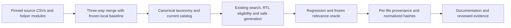

# R-01 Interface Catalog and RTL Refresh

## Summary

R-01 refreshes the existing `interface-design` skill from UI UX Pro Max commit
`b7d5353e0130feb8c5574ef1251f8a1db1873ccb`. The change stays on
`feature/framework-gap-adoption-20261106`, preserving the preceding framework
adoption work. No new skill, workflow, dependency, commit or push is introduced.

Task checks passed: 96 Python tests, the full 90-case oracle's original gates,
16 locked cases, 45 independent source/hash records and the installed offline
runtime. All 588 tool tests also passed with concurrency 4; the default run's
failure is retained below. These are local deterministic checks, not a claim
of measured live-agent performance.

## High-Level Design



## Evidence of Completion

| AC | Required result | Current evidence / status |
|---|---|---|
| AC-1 | Refresh the full active catalog and RTL schema | 35 upstream CSVs refreshed; local web CSV retained. 36 catalogs, 4,210 to 4,357 rows. Independent reconstruction: 3,082 checks passed, no P1/P2 |
| AC-2 | Preserve real local transforms and source history | 106 local cells retained; upstream-deleted fonts and superseded Nuxt/Next guidance archived rather than served as current. [Durable merge ledger](../research/interface-catalog-refresh-20261106.json) verifies actual file hashes and retains affected values |
| AC-3 | Correct canonical identity, RTL and generator behavior | 96/96 combined Python tests passed, no skips. RED/GREEN covers taxonomy/aliases, pre-limit RTL, metadata, mode-compatible styles/palettes, closed grammar, source identities, long fields and no-write rejection; independent review findings resolved |
| AC-4 | Accurate per-file provenance and licensing | 45 source records at b7: 34 mirrored, 11 transformed; historical default retained. Exact source hashes independently read through Git, local hashes verified, 13 provenance tests passed. [Source proof](interface-catalog-refresh-20261106.provenance.json) |
| AC-5 | Regression and relevance tests cover the requested scope | Baseline 36/36; semantic regression 16/16; combined 96/96. Original 90 cases, all numeric floors and 16 locks passed; 12/12 supplemental local web/app negatives. [Full result](interface-catalog-refresh-20261106.relevance.json); initial failure retained below |
| AC-6 | Update the existing framework documentation | Skill/router/reference and README/SUPER-COMPOUND/WALKTHROUGH/CHANGELOG updated; original recommendation marked implemented with historical results retained. Structural lint, 28/28 skill tests, all 588 tool tests with concurrency 4, hooks and the Python router contract passed; three benchmark repeats and zero-finding audit passed |

## Source and merge decisions

The immutable local baseline contains 52 source files. Source HEAD was queried
again and matched the clean sibling checkout at the commit above. The previous
source commit `3da52ff1cab1be91848072ec1be5f493d730fd5f` remains available in Git
and verified archives; per-file revision overrides distinguish refreshed assets
from that historical default. Every baseline catalog hash also matches framework
commit `449cbd1a69fbff4b909ce5556d74686994308eea`, recorded in the ledger for replay.

The result has 28 mirrored source CSVs, 7 transformed source CSVs, and 1 local
web CSV. Preserved transforms include product keyword enrichment, typography
share URLs, valid JavaFX code quoting and actual local wording corrections.
Next.js 16.2+ guidance replaces the superseded 15+ row and its applicability;
obsolete Nuxt v3 cells and ten removed font families remain in the ledger.
Rows are not renumbered to hide source ID gaps.

The new styles schema has stable identities, canonical/supplemental/deprecated
status, aliases/replacements, preferred mode and `rtl_level`. Reasoning follows
the source's closed condition/action grammar. Empty legacy Reasoning/Confidence
cells remain empty; no confidence values are invented. The pristine reasoning
helper and exact source fixtures retain their own source records and MIT notice.

## Behavior and preservation checks

`--rtl` accepts `all`, `full`, `partial` or `caveats` only with an explicit
`style` or `product` domain. Stack, automatic/other-domain and design-system
combinations fail before persistence writes. The full active corpus remains
the scoring basis; RTL eligibility is applied before the result limit, without
refitting a different RTL corpus. Omission and `all` agree on valid catalogs.

Local regression protects acronym queries, native-stack topics, API Developer
Portal retrieval, opt-in GSAP, long snippets, web/app routing, source
signatures/cache invalidation, bounded output, strict CSV and safe persistence.
The old minimal-style golden now resolves its canonical replacement. Generic
`UI` remains searchable; its old exact top row was a corpus-specific ordering,
not a permanent product requirement. GSAP compares raw CSV text and a synthetic
400-character code field rather than lowering the old sample-length threshold.

Independent review exposed explicit-light requests returning dark palettes and
incompatible dark-only styles. Behavioral regressions preceded fixes, and
reviewer reruns verified mode-compatible choices and truthful source derivation.
It also exposed long implementation fields being truncated and unrelated style
preloading coupling other domains; owner fixes and final dispositions are
recorded in the local evidence directory.

## Relevance protocol

The primary gate retains the original source oracle and thresholds byte for
byte: 90 cases, all eight metrics and split floors, 16 locked cases, identity
checks, and source negative controls. Source `web` means the app-interface
catalog, so the adapter explicitly maps those cases to local `app`; local `web`
and the intentional split receive separate preservation tests. This mapping is
reported, not a rewritten judgment or an inflated source denominator.

The frozen local full baseline failed 18 gate checks. Baseline deltas remain
diagnostics because changed catalogs can trade individual retrieval metrics;
they are not a requirement that every metric exceed its old value. Actual local
behavior regression tests and all original source floors/locks remain required.
DEV runs and failed observations are retained; candidate held-out is run only
after the current implementation stabilizes. Neither fixtures nor numeric
thresholds are retuned to make results green.

The first full run passed retrieval floors but found one routing failure and one
locked UWP new-project result. A query naming GSAP/ScrollTrigger is now treated
as explicit toolkit intent; generic motion retains its UX route. New-project
framework selection is distinguished from existing-application migration. The
initial failure is retained in [its own record](interface-catalog-refresh-20261106.initial-failures.json),
and the same oracle passed after behavioral fixes. That rerun is a known regression suite, not an untouched
statistical hold-out or a generalization claim.

## Verification results

| Metric | All | Calibration | Held-out partition |
|---|---:|---:|---:|
| Precision@1 | 0.828947 | 0.923077 | 0.729730 |
| Precision@3 | 0.381579 | 0.401709 | 0.360360 |
| MRR@3 | 0.875000 | 0.944444 | 0.801802 |
| nDCG@3 | 0.865872 | 0.927715 | 0.800686 |
| Negative abstention | 0.980392 | 1.000000 | 0.960784 |
| Routing accuracy | 1.000000 | 1.000000 | 1.000000 |
| Typo recovery@3 | 1.000000 | no typo cases | 1.000000 |
| Design-system coherence | 0.906250 | 1.000000 | 0.812500 |

All original published gates passed. This does not mean every ranked answer is
correct: 200/204 source negative checks abstained; the locked 16/16 gates and
supplemental local 12/12 checks passed. The full result retains every case,
fingerprint and baseline diagnostic delta, including decreases. No universal
quality or generalization claim follows from this curated set.

Executed task commands:

```text
python -m unittest discover -s .agent/skills/interface-design/scripts -p "test_*.py"
96 tests; OK; no skips

python .agent/skills/interface-design/scripts/evaluate_relevance.py --compare-local-baseline .scratch/r01-ui-refresh-20261106/relevance-baseline-full-final.json --write-baseline .scratch/r01-ui-refresh-20261106/relevance-final-02.json
PASS; 90 cases / 76 retrieval / 8 design systems / 204 source negative checks

npm run test:skills
28 tests; 28 passed

npm run test:hooks
hook security tests passed

npm run test:python
96 tests; OK; skill router contract PASS

npm run audit
3 benchmark repeats passed; framework audit 0 findings; stored receipt verified
```

Offline installation and update used the existing `setup.mjs` engine in an
isolated project under `.scratch`. All 45 installed source records matched the
final hashes. Four actual installed CLI cases passed: Apple Native RTL,
explicit named GSAP, UWP new-project guidance and Healthcare design-system
generation, with the imported helper/license present.

The default `npm run test:local` stopped after its tool phase: 587/588 passed.
The unchanged Python-manifest-comment fixture in `.agent/tools/standards.test.mjs`
failed its expected error-message assertion, then passed an isolated retry. A
load/timeout cause is plausible but was not proved. No source or assertion was
changed to accommodate that failure. The unresolved cause is captured in a
[separate tooling follow-up](../todos/2026-11-06-python-manifest-parallel-fixture.md).

The same 50-file, 588-test tool inventory was then run with Node's
`--test-concurrency=4`: **588 passed, 0 failed, 0 skipped**, in 392.3 seconds.
Its inventory uses the existing active-asset filter and the same default
exclusion of the optional `codex-install.test.mjs`. Skill, hooks and Python
phases completed separately as recorded above. This is a passing phased
verification with controlled concurrency; the default wrapper itself is not
reported as passing.

Raw outputs, the exact controlled inventory and immutable snapshots remain
under `.scratch/r01-ui-refresh-20261106/`, including
`framework-test-local-final.log`, `standards-isolated-retry.log` and
`framework-tools-controlled.log`. Distributable evidence is linked above;
benchmark/audit receipts remain under `.agent/benchmarks/`.

## Limits

The upstream CSV validator assumes API-style font URLs and four generated JSON
companions. Running it verbatim on the intentional local transform reports 159
incompatibilities; independent checks instead verify share-URL equivalence and
the actual CSV/runtime contracts. This is not reported as a verbatim validator
pass. The unused JSON companions and absent historical exclusions are identified
in provenance.

These deterministic catalog/CLI tests do not measure live-agent reliability,
prove rendered RTL behavior, verify every external documentation link, or
establish cross-OS performance. Design dials, generic CSS kits and RTL
design-system generation remain outside this refresh.
