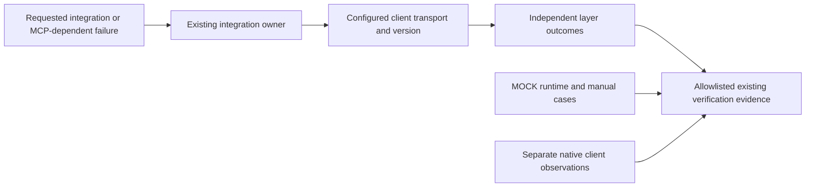

# R-04 MCP diagnostics verification

## Summary

R-04 adds optional transport/version-aware MCP diagnostics to existing integration
and verification owners. Verification produced 605/605 tool tests, 10/10 controlled
runtime cases, 8/8 manual guide cases and 28/28 skill tests. No new skill, public
workflow, production MCP client, dependency or automatic repair was added.

Actual native observations differ by client: the root host channel returned
`Transport closed`; a fresh subagent's bounded project-list call succeeded.
Neither identifies the native transport, principal or scopes. Local fixture
success is not external-provider or root-channel recovery proof.

## Scope and source identity

- Branch: `feature/framework-gap-adoption-20261106`; HEAD
  `449cbd1a69fbff4b909ce5556d74686994308eea`, with earlier adoption/R-01/R-02/R-03
  changes intentionally uncommitted and preserved.
- Canonical detail: [MCP diagnostics](../../.agent/skills/integration-checking/references/mcp-diagnostics.md),
  SHA-256 `e81fd6b84d8bddd15266cb882d2f9387093df03428eaf9020c6a5e7a8d10baaa`.
  Integration, live verification, execution-verification and sc-work compact
  contracts reach this same optional reference. Full workflows need no duplicate
  procedure; all 19 workflow names remain unchanged.
- [GAO source lock](../research/upstream-sources-20261106.json) pins
  `generationappleone/gao-agent` at `4c87466549782f27fe795f962a90e90dc84a7c4a`.
  Only independently expressed diagnostic concepts were adopted. No proprietary
  GAO text, code, templates, configurations, environment dumps or restart commands
  were copied.
- [Evidence archive](mcp-diagnostics-20261106.evidence.json) retains sanitized
  observations and raw-byte, SHA-256-bound synthetic fixtures, harnesses, RED/GREEN
  instruction checks and command records. Invented canaries occur deliberately
  inside the labelled synthetic input fixture; they are not real credentials.

## High-Level Design

The maintained configured client owns protocol negotiation. Modern guidance uses
the [2026-07-28 versioning](https://modelcontextprotocol.io/specification/2026-07-28/basic/versioning)
and [HTTP binding](https://modelcontextprotocol.io/specification/2026-07-28/basic/transports/streamable-http);
legacy initialization follows the [2025-11-25 lifecycle](https://modelcontextprotocol.io/specification/2025-11-25/basic/lifecycle).
The installed Python SDK runtime exercised only the legacy negotiated revision.

## Verification and actual outcomes

All commands run from the repository root; this workspace prefixes shell commands
with `rtk`. Detailed stdout, timestamps, inventories and fingerprints remain in
`.scratch/r04-mcp-diagnostics-20261106/`.

| Check / command | Actual result | Scope |
|---|---|---|
| `node --test .agent/tools/mcp-diagnostics.test.mjs` | RED 0/6, GREEN 6/6, no skip | Guidance routing/profile/safety contract; not runtime interoperability |
| `node --test --test-concurrency=4 <default-active-tool-inventory>` | 605/605, 53 files, 0 failed/skipped/cancelled, exit 0 | Same default inventory as local runner, optional `codex-install` excluded; exact argv/inventory archived |
| `python .scratch/r04-mcp-diagnostics-20261106/verify_mock_transports.py` | 10/10, exit 0; all owned resources stopped | Installed `mcp==1.29.1`; loopback/synthetic stdio only |
| Independent guide application | 8/8 manual, 0 runtime cases | Redaction, authorization ambiguity, error layers, unknown profiles, tool authority and shared cleanup |
| `npm run test:skills` | 28/28, no fail/skip | Progressive routing and existing policies |
| `npm run check`; `npm run test:hooks` | Exit 0; hook assertion suite reports success | Six syntax checks; hook suite reports no numeric count |
| Verification Python router test | `skill router contract: PASS`, exit 0 | Existing verification reference routing |
| Token benchmark `--repeat 3` | 3 consecutive deterministic passes; all 19 routes wired | Static repository estimate only; sc-work 1141/11412, 90.0018%; no host token claim |
| Isolated `setup()` project installation | 5/5 owner/reference/compact files byte-identical | Scratch target and isolated home; no global installation |
| Framework audit and baseline preservation | 0 findings; 805 baseline files checked, 793 unchanged, 12 expected R-04 edits, 0 deleted | Earlier user/adoption work preserved; all other baseline bytes match |
| Post-closeout audit regression tests | 13/13, no fail/skip, exit 0 | Content checker rerun after final documentation edits |

The final controlled tool run was `2026-11-06T13:32:22.953Z` through
`2026-11-06T13:34:57.044Z`. All 722 active inputs and HEAD were unchanged;
before/after inventory digest
`02e2e396e2892fee8b821fff297e4372254c33315907139b02708afa97045a97`.
Subsequent closeout edits affect evidence/status documentation; the content audit
is regenerated and its tests rerun after those edits.

Runtime cases: stdio success; absent tools capability without list/call; Streamable
HTTP success; deprecated HTTP+SSE transport success; tool `isError`; wire JSON-RPC
invalid parameters `-32602`; client SDK deadline `408` (not a wire response);
HTTP 401; HTTP 403; and refused loopback connection. Successful initialization
negotiated `2025-11-25`. Two owned stdio processes and seven owned HTTP threads
stopped; no residual PID files remained. No host configuration or MCP credential
values were read by this fixture harness.

Manual checks inspected all eight fixed synthetic cases against the canonical
guide. They establish instruction coverage, not a runtime sanitizer. Sensitive
outputs must be allowlisted before reaching transcripts, files or displays; a
client that cannot prevent unsafe output leaves that probe unverified.

## Native observations and retained failed attempts

The root call used `list_projects(limit:1, include_details:false)` and received a
host-channel error without a server result. The fresh subagent call returned one
project and total 89 with `isError:false`. Only schema/counts and safe metadata
were retained. These pre-guide native observations do not certify host transcript
redaction, handshake behavior, authentication or global service availability.

The baseline already rejected generic unsafe readiness claims. Its exact scenario,
original response and guided rerun are retained; no failed baseline behavior was
invented. Six new contract tests were genuinely RED before the reference/routes
existed. A later conditional-wording matcher failure was corrected without
changing the guide; that attempt is retained separately.

Three initial benchmark attempts failed the unchanged sc-work ratio threshold.
Equivalent compact wording was shortened while retaining all gates and the new
MCP pointer; thresholds/baselines were not changed. The first broad run recorded
604/605 because its current-tree audit raced compact/benchmark edits. The final
frozen rerun above passed all 605. Earlier failures remain visible in scratch
evidence; no failed broad run is described as successful.

The first closeout recipe passed 23/25 assertions: its parallel audit verification
hit the 45-second deadline, and the lint JSON was encoded UTF-16 by PowerShell.
Failed evidence is retained under the completion packet's `initial-failure/`.
Lint output is now written as UTF-8. Final acceptance reuses separately executed,
source-fingerprinted audit verification, avoiding concurrent duplicate scans.

## Evidence of Completion

| AC | Outcome proof |
|---|---|
| AC-1 | Existing integration/live/compact routes resolve the optional canonical guide; profile branches independently reviewed against primary specifications |
| AC-2 | Runtime success, absent capability, RPC error, tool error, HTTP rejection and timeout remain distinct; manual cases retain unresolved causes |
| AC-3 | Trusted installed client, harmless fixture operations, bounded requests, nine owned resource cleanups; unchanged static no-exec audit boundary |
| AC-4 | Eight manual guide cases cover before-output allowlisting; retained native/runtime summaries omit raw secrets/payloads; no production sanitizer claim |
| AC-5 | Ten labelled MOCK cases and two distinct REAL client observations, with unknowns and unsupported broader claims explicit |
| AC-6 | 605 tool tests, 28 skills, routers/hooks/syntax, static benchmark, isolated installation and final audit/preservation checks bound by the existing completion recipe |

Final recipe, assertion outcomes and the existing completion gate live under
`.scratch/completion/r04-mcp-diagnostics-20261106/`. The recipe verifies current
evidence and source identities; it does not treat command exit alone as acceptance.

## Limits and next action

Modern MCP 2026 runtime compatibility, external OAuth flows, actual provider
credential validity/permissions, root-channel recovery and runtime redaction are
unverified. No global client restart, configuration repair, scope escalation,
credential substitution, dependency installation, commit or push was performed.
The optional full Codex install matrix and unrelated UI catalog Python suite were
not rerun; installation is checked in an isolated target. Review the uncommitted
R-04 diff together with the earlier adoption changes.
