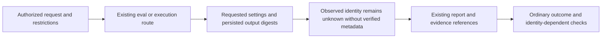

# R-08 Requested and Observed Execution Identity

## Summary

R-08 adapts existing orchestration guidance and the bounded Codex/Claude evaluation executors. Requests, observed serving identity and process outcomes remain separate. Missing verified serving metadata is explicitly `unknown` / `unverified`; configuration, worker text and fixture headers cannot fill that gap. Current verification passed 75 related Node tests, 28 skill tests, syntax, the real configuration projection check and isolated Codex/Claude installation/doctor.

The change retains inherited/explicit model settings, legacy requested `model` fields, existing work-package receipt schemas and nineteen public workflows. It adds no provider, controller, identity classifier or universal identity gate. The procedure independently adapts compound-engineering guidance pinned at `EveryInc/compound-engineering-plugin@7dc50943bbf959dbe6a93a175e41e5fff8395e00` (MIT, copyright 2025 Every); no upstream code/prose was copied.

## Evidence Flow

## Implementation and Limits

- Existing `subagent-orchestration/references/completion-inbox.md#external-execution-receipts` owns the conditional procedure. Full, compact and relevant section/paragraph readers reach that owner.
- `session-baseline.mjs` exports a small shared `executionProvenance` constructor used by its metrics and the existing `codex-pilot.mjs` process result. Persisted stdout/stderr bytes supply artifact references and SHA-256 values. The helper derives no serving identity from output content.
- Requested harness/executable/model/effort retain their actual input values. The baseline harness requests no effort override and records `null`. These CLIs supply no verified provider/intermediary receipt here; provider identity remains unknown.
- Legacy `model`, `modelUsage` and summary `models` retain their existing requested-setting or host-reported-usage meanings. Usage attribution supplies no backend attestation. New `executionProvenance` is additive.
- Process exit, actual work, output verification and cleanup are separate from model identity. Unknown identity does not invalidate an unrelated demonstrated work outcome. An acceptance/comparison that requires trustworthy identity remains unqualified without it.
- Native/established adapter routes retain their authority. Required restrictions must actually be enforceable; requested tools, advertised capabilities and post-edit review admission are distinct from enforcement. No new sandbox is claimed.

Adapter assertions establish what the adapter reports. Family-level observations establish only that scope; neither proves an exact backend model. Preserve requested values, fallback/mismatch history, partial observations and attestation level. A digest binds bytes, not caller identity or the truth of a claim.

## Verification Design

Current source and expectations are captured before the relevant checks. Runtime RED/GREEN tests exercise missing additive receipts, persisted raw-byte hashing including invalid UTF-8/CRLF, spoofed identity hints, configured request values, missing executables and controlled subprocess propagation. Controlled subprocesses are **MOCK**, not provider identity or compatibility certification. Baseline helper/wiring checks do not execute a new live Claude session.

| Current runtime control | Actual result |
|---|---|
| Missing executable | Process failure `ENOENT`; request and empty output digests retained; observed identity unknown |
| Spoofed serving hints | Exit 0; requested `fixed-model` retained, observed model/provider unknown; preflight, grade and trial provenance match persisted bytes |
| Missing persisted stderr | `ENOENT` rejects visibly; no hanging or unhandled receipt-construction promise |

The shared helper hashes bytes without interpreting model/provider fields. Missing-output errors propagate from the Codex child-close handler rather than leaving a pending promise. Raw controlled outputs and the actual receipt objects are retained in machine evidence after temporary fixtures are cleaned up.

The real configuration pilot copies the current model mapping, canonical prompts and native adapters. It expects matching configuration to pass, an isolated projected `model:` change to report configuration drift, and an invalid configured Claude model to raise `MappingError`. Those results concern configuration only. They do not simulate an authenticated observed-model mismatch.

The pre-change pressure response already kept identity Unknown and exact identity Needs Validation. The exact-prompt informed rerun is parity, not an invented baseline RED or measured reliability improvement. Eight separately frozen hypothetical controls inspect trust, stale association, fallback, identity-required outcomes and capability limits; all eight observed decisions match. These are manual **MOCK** decisions, not a runtime classifier. Baseline/guided artifact inspections passed 33 and 41 assertions respectively.

| Verification | Current result |
|---|---|
| Nine related Node test files, concurrency four | 75 passed; zero failed/skipped/cancelled/todo |
| Existing skill suite | 28 passed; zero failed/skipped |
| Syntax and current `agent-projection.mjs --check` | Exit 0; projection proves local configuration only |
| Isolated Codex + Claude project install/doctor | Exit 0; thirteen installed byte comparisons and five receipt links/anchors passed |
| Static context benchmark | Three deterministic passes; sc-work 1,141, execution-verification 679 estimated tokens; original baseline and thresholds retained |
| Source preservation | 819-file captured baseline; unrelated bytes unchanged; no drift during final scoped checks; nineteen public workflows retained |

An initial full Codex test attempt reached its explicit 180-second deadline after seven passing cases. That interrupted attempt remains retained as a timeout, not a full pass. The two changed cases later passed, followed by the full current nine-file suite above. No required tests were skipped. The natural-language execution contract was shortened before the final benchmark to retain its original reduction gate.

## Changed-Skill Stocktake

Comparison: 819-file raw-byte source inventory before R-08, on `feature/framework-gap-adoption-20261106`, preserving prior R-01 through R-07 dirty work. Usage is unmeasured; no rule/skill retirement is proposed.

| Existing owner | Members / disposition | Reason and consumers |
|---|---|---|
| subagent-orchestration | SKILL router, completion-inbox and orchestration-loop / improve | Conditional identity provenance, existing report/receipt flow and session model readers |
| eval-harness | paired-experiments reference / improve | Distinguish requested comparisons, observed identity and controlled evidence |

Shared model guidance and execution contracts route to the same owner. The shared helper reuses the pre-existing Codex-pilot dependency on session-baseline. Work-package assignment and completion-receipt structures remain unchanged.

## Evidence of Completion

[Machine evidence](model-receipts-20261107.evidence.json) retains source identities, expectations, actual controls, runtime tests, command logs and installation results. The existing completion recipe at `.scratch/completion/r08-model-receipts-20261107/recipe.json` binds final assertions to current source and report bytes. Final audit identity is recorded in `.scratch/r08-model-receipts-20261107/audit-verification.json`; the generated audit is `.agent/benchmarks/framework-audit.after.json`.

| Requirement / AC | What was verified | Evidence |
|---|---|---|
| AC-1 | Additive requested/observed provenance, raw output binding and honest unknown identity | Runtime RED/GREEN, three actual MOCK controls and raw-byte helper regression |
| AC-2 | Conditional receipt procedure preserves trust, capability and authority distinctions | Source-bound owner review, exact-prompt parity and eight frozen manual MOCK controls |
| AC-3 | Reachable existing routes, legacy fields, nineteen workflows and original budgets | Section/paragraph route controls, legacy regression tests, current projection and three-pass benchmark |
| AC-4 | Current tests, installation, documentation and preserved baseline | Scoped command receipts, before/after snapshots, installed comparisons, final fingerprinted audit/acceptance receipts |

No live provider execution, exact backend identity, cross-model independence or host capability certification is established by this local evidence. Changes remain uncommitted on `feature/framework-gap-adoption-20261106`; no commit or push requested.
