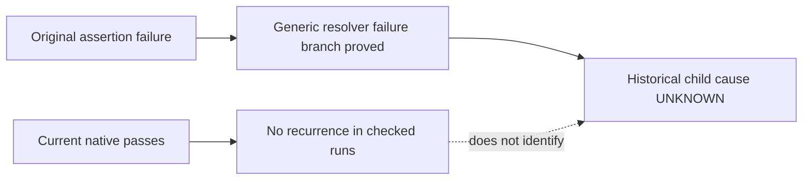

# Python Manifest Flake Investigation

## Summary

Status: **Needs Validation**. Historical cause: **UNKNOWN**. The original
manifest-comment assertion failure is established; its underlying child-process
cause has not been proved. No runtime fix, timeout increase or permanent
concurrency cap is justified by the current evidence.

Two current 58-file default runs passed 631/631 tests: one traced and one bare.
All 69 focused native comment cases passed. The partial historical reconstruction
passed 595/595 tests using the original 50 test filenames and three retained
critical files; its comment parser returned status 0 in 1,295.4227 ms. Together
with the traced full-run comment case, these are 71 native comment witnesses.
These observations show nonreproduction in the checked scope, not resolution of
the historical event. Four separate observation controls also passed; their
deliberate failures are not reproductions.

## Causal Boundary

## Observed Evidence

| Observation | Actual result | Claim supported |
|---|---|---|
| Original R-01 default run | 587/588 passed; manifest-comment case failed its expected conflict regex; whole-test duration 12,733.4694 ms | Historical symptom and generic resolver failure branch; no child-cause attribution |
| Current traced default, 58 files | 631/631 passed; zero failures, skips, cancellations or todo | Current workload did not reproduce the fault; one successful native comment witness |
| Current bare default, 58 files | 631/631 passed; zero failures, skips, cancellations or todo | Pass was also observed without the tracing preload; no child trace claimed for this run |
| Focused native cases | 45 alias-entry plus 24 direct-entry cases; all 69 returned status 0 | Successful real helper execution on the frozen valid comment fixture |
| Native recurrence-attempt aggregate | 71 successful comment calls across traced current, focused and reconstructed runs | No observed native valid-comment failure; bare-run helper status is not traced |
| Reconstructed old 50-file default control | 595/595 passed, zero skips/cancellations; native comment exit 0 in 1,295.4227 ms; no main/copy source drift | Partial reconstruction only: other sources and global machine state remain current |
| Observation qualification | Real valid parser exit 0; malformed TOML exit 2; absent executable ENOENT; isolated control-only sleeper ETIMEDOUT at 50 ms | Four measurement controls passed; primary deadline remains 10,000 ms |

Exact commands, source identities, input/output bytes and process observations
remain in each run's plan and receipts under
`.scratch/python-manifest-flake-20261107/`. Current full-run receipts are
`runs/default-traced-2026-11-06T22-58-56-723Z/summary.json` and `runs/default-bare-2026-11-06T23-11-07-896Z/summary.json` relative to that directory.
Selected evidence and projected command metadata are retained in
`docs/eval-results/python-manifest-flake-20261107.evidence.json`; full environment
value digests remain in ignored local records. The 50-file reconstruction uses a
private Git directory and does not share the main index or object store.

The original failure remains in
`.scratch/r01-ui-refresh-20261106/framework-test-local-final.log:624`.

## Hypotheses

| ID | Hypothesis | Current status and boundary |
|---|---|---|
| H1 | Python exceeded the existing child deadline | NOT_PROVEN. Whole-test duration does not measure child duration; checked native calls did not time out. |
| H2 | Launcher/interpreter startup or bootstrap failed | NOT_PROVEN. No current native launch failure was observed; current alias or binary evidence cannot attest the historical child image. |
| H3 | Python read missing, changed or transiently invalid fixture bytes | NOT_PROVEN. No static shared path was found; endpoint byte equality does not prove bytes read during an unobserved child-open interval. |

The retained original output maps to a nonzero/error resolver result after
ENOENT handling. Its record lacks the discriminating child status/error/signal,
stderr and child elapsed time needed to select among these causes. The search
scope does not establish that such metadata is globally unavailable.

The retained same-file neighboring tests require at least four successful
Python evidence resolutions before the failing comment case. That weakens a
persistent missing/unsupported interpreter as the sole explanation; it does not
exclude a transient or cwd-specific launcher failure. Narrow launcher-log,
Application Error/WER, resource-exhaustion, Defender and default crash-file
searches recovered no matching original diagnostics. Their time window and
retention are incomplete; no global absence is claimed.

A deliberate malformed-input, substituted-parser or injected-delay control can
qualify instrumentation or a specific controlled mechanism. It does not establish
an unforced valid-comment recurrence or the cause of the original event.
The earlier bounded-diagnostics correction remains an observability improvement,
not a demonstrated fix for this flake. Original assertions, phase archives and
historical test results remain intact.

## Evidence of Completion

| Required outcome | Evidence and current status |
|---|---|
| Preserve and map the historical symptom | Verified from the original log and source boundary; [R-01 report](interface-catalog-refresh-20261106.md) retains its original counts |
| Observe real current helper execution | Verified native comment witnesses and traced/bare current default results above; saved raw receipts distinguish deliberate invalid controls |
| Prove a causal mechanism for the valid-comment failure | **Needs Validation**; no native recurrence with discriminating failure metadata |
| Attribute the original event and justify a fix | **Needs Validation**; historical cause UNKNOWN and no runtime fix justified |
| Complete the planned reconstruction and measurement controls | Verified 595/595 partial-reconstruction tests and 4/4 observer controls; neither proves the historical cause |

The root-cause objective remains unfulfilled. Keep the
[investigation TODO](../todos/2026-11-06-python-manifest-parallel-fixture.md)
pending. Continue from a discriminating native failure or recovered original
metadata; do not weaken the fixture assertion or treat a passing schedule as a
causal fix. A new mechanism and historical attribution require separate evidence.
