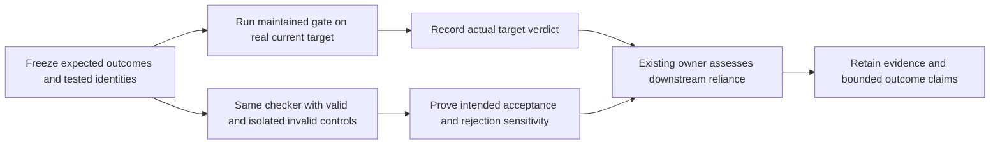

# R-03 Real-Artifact Gate Qualification

## Summary

R-03 extends the existing verification, planning and eval owners with conditional
qualification of newly authored or changed gates. Expected outcomes are fixed
before execution, checked against current real artifacts and representative
rejection controls, and bound to HEAD plus relevant dirty/untracked bytes.
Control sensitivity, actual-target acceptance and whole-system outcomes remain
separate claims. No new public workflow, runtime gate engine or dependency is added.

Actual-artifact inspection exposed a DAG bug: unsupported `Blocked by` tokens
were silently removed. The shared parser now raises `WAVES_INVALID_DEPENDENCY`.
The unchanged real pstack board is correctly rejected, not repaired or qualified.
Legacy FSD readiness failures remain explicit. Work stays on
`feature/framework-gap-adoption-20261106`; previous R-01/R-02 changes are preserved.

## Evidence of Completion

| AC | Observable result | Evidence / current status |
|---|---|---|
| AC-1 | Scoped qualification is reachable through existing owners | [Canonical branch](../../.agent/skills/verification-before-completion/references/claim-evidence.md#authored-or-changed-gates), planning dimension 8, eval design and compact execution routes; focused route/procedure tests pass |
| AC-2 | Expectations precede current real-artifact execution | Four frozen cases matched; actual dependency source accepted, exact P1 missing-import rejection and both real legacy target rejections retained. Independent replay and 51 raw-byte records verified; current HEAD, manifest and source identity recorded |
| AC-3 | Invalid inputs are rejected for the intended reason | DAG regression RED before fix; actual unchanged pstack board now exits 1 with the unsupported-blocker error and no plan output. Isolated original-source sensitivity fails both new regressions |
| AC-4 | Valid behavior and affected consumers remain compatible | Goal-waves/readiness suite 55/55, zero skips; both readiness callers turn parser errors into named BLOCKED gates. Valid relative `.md`/`None` behavior remains; positive derived controls are explicitly synthetic |
| AC-5 | Failed targets, authority and user work stay distinct | Approved FSD/PRD and scratch issue bytes are preserved. Current pstack readiness failure and lack of a genuine valid current issue board are retained, with [legacy-input follow-up](../todos/2026-11-06-legacy-plan-gate-inputs.md) |
| AC-6 | Documentation, packaging and verification agree | Public docs, state and recommendation updated; full default local tool inventory 599/599 with concurrency 4, related checks 122/122, skills 28/28, hooks/check/Python router passed; benchmark 3 repeats and audit 0 findings. Installed runtime/owners and archived inputs independently verified |

## Design



The shared procedure remains in `verification-before-completion`'s existing
Claim Evidence reference. Its router keeps the ordinary Claim Evidence link and
adds a conditional qualification anchor. Planning dimension 8 plans real inputs,
expected verdicts and controls before downstream reliance; it does not demand
qualification before the verifier can be authored. Light work gains no FSD,
enabler or approval prerequisite. Legitimate factual N/A remains distinct from
missing required checks.

The edited planning router was reduced from 592 to 492 whitespace words by
disclosing duplicated UI/enabler detail into its existing references. Coverage,
exact decision IDs, hard readiness gates, LOCAL_ONLY, networked first-slice/
scale-out blocking, conditional hardening and bounded enabler rules remain.
The verification router is 496 words. No rule was removed to make a test pass.

Conceptual source: GSD `f3f3a182627f56267028cf3145239ef8d8154635`, pinned in the
[source lock](../research/upstream-sources-20261106.json). Its
[control helper](https://github.com/open-gsd/gsd-core/blob/f3f3a182627f56267028cf3145239ef8d8154635/tests/helpers/gate-positive-control.cjs)
and [real-tree census](https://github.com/open-gsd/gsd-core/blob/f3f3a182627f56267028cf3145239ef8d8154635/tests/lint-gate-positive-control.test.cjs)
informed intended-reason controls and actual-artifact checks. Its registry,
planning state machine and runtime framework were not copied.

## Runtime results and limits

The dependency-gate example uses the real active Git manifest and actual
`.agent/tools/framework-audit.mjs` bytes. The invalid control preserves those bytes
and appends one valid import declaration for a deliberately absent local module.
The same maintained API returns no findings for the real target and the exact
P1 missing-module finding for the derivative. The derivative is input data; it is
not executed as a broken replacement for the checker. Original source and HEAD
remain unchanged. This proves the local dependency predicate, not all framework
or application behavior.

The actual pstack issue board contains qualified `FSD-PSTACK#GOAL-*` blockers;
the current authoring contract requires relative issue `.md` paths or `None`.
Before the fix, the CLI exited 0 and put four goals into one wave after dropping
the unsupported tokens. After the fix, the same board exits 1 with
`WAVES_INVALID_DEPENDENCY`, emits no plan and retains all original file hashes.
There is no new qualified-ID resolution grammar. Both LOCAL_ONLY and networked
readiness consumers catch this error and return BLOCKED rather than crashing.

No genuine current valid issue board was found: the other shallow board is
retired work. An isolated valid derived control produces three waves; it is not
evidence that the current pstack plan is qualified. Regression tests against an
isolated original module fail for both the missing API exception and incorrect
CLI exit 0, demonstrating sensitivity without toggling live source.

The genuine pstack FSD plus its PRD also exits 1 in readiness: verdict text is
`NOT_APPLICABLE`, but `not-applicable` fails because the required factual
`reason:` leaf is absent. A verdict label alone is insufficient. The other real
framework FSD has no separate matching PRD authority; a missing-PRD invocation
exits 2. An exploratory unrelated-PRD probe is explicitly not authority evidence.
These records do not authorize rewriting approved artifacts or creating a PRD.

## Verification

The pre-change pressure probe already withheld fixture-only acceptance, required
skipped proof and stale-HEAD claims. It is an instruction-based plan, not a
measured failure or reliability improvement. The new route tests initially failed
for the absent qualification branch; the runtime dependency control already
worked. The separate DAG behavioral regression genuinely failed before its fix.

Initial related checks were 120/122 and skills 27/28: remaining failures were
reviewed source-identity pins, not permission to change historical evidence.
Only current candidate compatibility pins were updated after inspecting the
planning disclosure and prior R-02 optional comparison. Historical responses,
source digests, completion pins, expected actions and negative controls remain
unchanged; those old responses do not evaluate R-03 runtime behavior.

The initial token benchmark rejected the added compact work pointer at 89.86%,
and a shorter draft still measured 89.97%. Equivalent compact wording now passes
all three repeats at 1,141/11,412 process tokens (90.0017% reduction); thresholds
and full qualification instructions were preserved. These are static context
budgets, not measured live token savings.

Executed bounded checks include the 55-test connected gate/readiness suite,
three qualification tests, Python router contract, real-source dependency control,
actual invalid board rejection and independent code/authority review. The
[raw-byte qualification record](real-artifact-gates-20261106.evidence.json)
retains frozen expectations, inputs, command/results and scope identities.
Independent review validated all 51 base64/raw-byte records, output hashes,
22 current relevant inputs and original FSD/PRD/issues, then replayed the captured
dependency checker on frozen source/helpers and manifest. Both accepting and
intended rejecting outcomes reproduced. Synthetic and exploratory evidence is
retained separately; neither supplies current plan authority.

Related checks are 122/122 and skill tests 28/28, with no skips; Python router
contract passed. Three benchmark repeats and zero-finding audit passed. An
isolated Codex project installation matches all eight changed runtime/owner files
and rejects the real invalid board with the intended error. No global/user
configuration was changed. All 52 files in the default local tool inventory
passed: **599 tests, zero failures/skips**, with concurrency 4 in 98.0 seconds.
It uses the existing active-asset filter and the same optional
`codex-install.test.mjs` exclusion as `test:tools:local`; the default parallel
wrapper and optional live CLI install test are not claimed as executed.
`npm run check` and hook security tests passed separately. Original R-01/R-02
runtime/data and approved legacy input bytes remain preserved.

Executed closeout commands:

```text
node --test --test-concurrency=4 <the 52 default local tool test files>
599/599 PASS; exact file list: .scratch/r03-real-artifact-gates-20261106/controlled-test-inventory.json

npm run test:skills
28/28 PASS

npm run check
PASS

npm run test:hooks
hook security tests passed

python .agent/skills/verification-before-completion/tests/test_skill_router_contract.py
skill router contract: PASS

npm run audit
3 benchmark repeats PASS; framework audit 0 findings; stored receipt verified
```

The full tool invocation expands the same existing inventory as
`.agent/tools/run-local-tests.mjs`, changing only Node concurrency to four.
Report/reference structural lint and source-preservation checks passed; the
evidence archive uses exact raw bytes instead of newline-normalized text.

Final completion binds the six original AC to the existing
`completion_contract_v1` and maintained recipe under
`.scratch/completion/r03-real-artifact-gates-20261106/`. Component runs preceded
that final binding and are retained with their actual chronology; no earlier
contract timestamp is claimed. The bound recipe performs fresh outcome
assertions and revalidates unchanged deterministic proof before the read-only
`verified-promise.mjs --contract` verdict. No additional runtime gate is added.
Raw evidence remains under `.scratch/r03-real-artifact-gates-20261106/`, with
initial runtime inspection under `.scratch/r03-gate-runtime-20261106/` and
contract RED under `.scratch/r03-gate-qualification-20261106/`.

## Limits

Gate sensitivity does not make a rejected target ready, supply missing authority,
or prove whole-system correctness. Synthetic valid controls and caller fixtures
are labelled separately from actual artifacts. No live host reliability, runtime
token savings, external provider behavior or broad application UI readiness is
claimed. The legacy plan-input follow-up remains unresolved.
