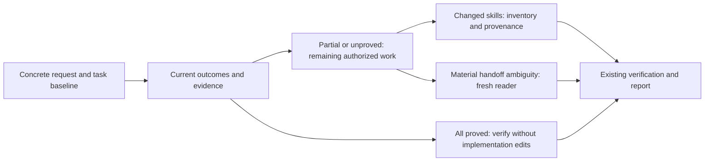

# R-05 Skill maintenance and execution prechecks

## Summary

R-05 adapts existing skill-authoring, brainstorming and execution owners. It
adds bounded changed-skill inventory, provenance checks before pruning, selective
fresh-builder ambiguity checks and an explicit all-outcome precheck before edits.
No new skill, workflow, telemetry, cache, ledger or completion engine was added.

Baseline choices were already correct. The guided repeats show explicit procedure
and parity, not measured behavioral or reliability improvement. Actual local
controls demonstrate no-edit verification, a scoped partial fix, stale-proof
rejection and protection of a seemingly duplicate mandate at a distinct loading boundary.

## Scope and high-level design

Branch `feature/framework-gap-adoption-20261106`, HEAD
`449cbd1a69fbff4b909ce5556d74686994308eea`. The task baseline captures 809 raw-byte
file hashes before edits; earlier R-01 through R-04 changes remain user work.

- [Skill authoring](../../.agent/skills/skill-authoring/SKILL.md) routes stocktake
  and [provenance pruning](../../.agent/skills/skill-authoring/references/structure-and-quality.md).
- [Execution preflight](../../.agent/skills/executing-plans/references/authority-and-workspace.md#execution-preflight-both-tiers)
  compares every outcome, exits implementation when all are proved, and preserves
  completed portions while remaining work continues. Existing completion rules apply.
- [Fresh-builder check](../../.agent/skills/brainstorming/references/questions-and-options.md#fresh-builder-ambiguity-check)
  uses the canonical artifact and necessary references, without author history.
  It returns material questions to existing owners, excludes delegated/nitpick
  choices and introduces no approval or veto.
- Compact work/execution contracts, planning contracts and the skill index route
  these checks conditionally. The public workflow sources remain unchanged.

## Actual changed-skill stocktake

Comparison: the captured task baseline versus current task changes, including
untracked additions and directly affected consumers. The stable stocktake
snapshot contains five modified skill-owned paths across four owners; generic
docs/shared tools are recorded as affected consumers rather than new skills.

| Owner / disposition | Changed members and concrete reason |
|---|---|
| `skill-authoring` / keep reviewed improvement | Router and quality reference now define bounded inventory, unmeasured usage and provenance/successor protection |
| `executing-plans` / keep reviewed improvement | Authority reference adds complete/partial/unproved branches and retains the inline search guard required by reference-only readers |
| `brainstorming` / keep reviewed improvement | Existing questions reference adds a selective reader exercise, existing-owner triage and disclosed reduced-isolation fallback |
| `agentic-delivery` / keep compatibility test | One current reference hash is refreshed after semantic review; assertions and historical response evidence remain unchanged |

Usage is **unmeasured** for all four; no retirement follows from missing reads.
The initial 19-path overall snapshot is timestamped, not a claim about later
report/status edits. Five isolated mapping controls cover reference-only changes,
new untracked members, deleted paths, both rename sides and empty comparison. Detailed path-level reasons, hashes, consumers and control
outcomes are in the [evidence archive](skill-maintenance-20261106.evidence.json).

The baseline separately identifies 82 pre-existing dirty skill paths across 16
owners. Eighty stay byte-identical; the two overlapping paths have explicit R-05
deltas. Prior dirty state is not automatically stocktake scope.

## Verification and observed behavior

Commands run from the repository root unless a disposable case directory is
specified. Shell commands use this workspace's `rtk` prefix. Exact prompts,
commands, source hashes, worker outputs and failed attempts are retained under
`.scratch/r05-skill-maintenance-20261106/` and in the archive.

| Check | Actual outcome and limit |
|---|---|
| `node --test .agent/tools/authoring-prechecks.test.mjs` | Initial RED 1/6, GREEN 6/6; load-boundary regression RED 6/7, then current GREEN 7/7; structural checks are not agent reliability |
| Full default tool inventory, concurrency 4 | 611/611, 54 files, no fail/skip, exit 0 before the load-boundary correction; this broad pass did not detect or qualify that defect |
| Final affected suite, exact 12-file argv saved | 103/103 after restoration, no fail/skip; all 725 source hashes identical during this current run; includes seven R-05 tests and related consumers |
| Fixed authoring/precheck scenarios | Correct baseline decisions retained and repeated after guidance; manual plans, no invented RED |
| Two fresh builder actors, `fork_turns:none` | Both identify one material contradiction in Case A, return it to the owner, and ask no material questions in settled Case B; concrete implementation/check plans retained |
| Complete fixture: `node --test validation.test.mjs` | 2/2, no source/test changes; actor selected verified no-edit branch |
| Partial fixture: same immutable tests | 1/2 RED, then 2/2; only missing `requireName` rejection implemented, `trimName` and test bytes preserved |
| Stale fixture: same checks, read-only | 1/2; historical receipt belongs to different bytes; actor refuses completion and leaves source/test/history unchanged |
| Copied existing `grilling-sdlc-contracts.test.mjs` with `--test-name-pattern "light execution"` | Baseline 1 pass, exact-duplicate removal 1 pass, protected-preflight deletion 1 intended failure; this narrow marker test does not prove protection across loading boundaries; four cases filtered out, zero skipped |
| `npm run test:skills` | 28/28, zero failed/skipped; current-source hash pins reviewed without rewriting historical evaluations |
| `npm run check`, `npm run test:hooks`, verification Python router | Exit 0; six syntax checks, hook assertions and `skill router contract: PASS` |
| Token benchmark `--repeat 3` | Three deterministic passes; sc-work remains 1141/11412, 90.0018%, with original thresholds and baseline |
| Isolated project `setup()` | Ten owner/reference/index/compact/startup files matched source; three installed R-05 procedure links resolve, isolated home/target only |

The 611-test broad run preceded the correction. The final 103-test affected run
and fresh 28-test skill suite cover the changed loading-boundary seam; their
counts overlap and are not added together. No current 612-test full-run claim is
made. Final audit/install evidence is bound in the completion packet. Structural
tests support route/content claims; actual actions support narrower behavior claims.

An attempted removal of the repeated discovery sentence passed the narrow
preflight-marker test. Provenance review then found that compact/reference-only
readers are not guaranteed to load the canonical router rule: the repetition
protects a separate loading boundary. The original inline sentence was restored.
A new regression first failed against that actual draft and rejects a copy with
the guard removed even while the canonical skill retains it. No required
production mandate or stale production rule was deleted. The earlier positive
marker control remains limited evidence, not qualification for that unsafe cut.

Installed-startup inspection also found that its new evidence-report link was
repository-only: that report is not deployed to consuming projects. The link was
removed from startup while remaining in repository documentation; all three R-05
procedure links resolve in the isolated installation. Runtime procedures and
measured benchmark surfaces did not change in this documentation correction.

The pruning harness initially refused a source that changed during capture and
then used the preserved original. Two filtering assumptions were corrected:
Node 24 omits nonmatching test names instead of reporting four skipped tests.
Those attempts remain visible; none is counted as successful control evidence.
One early route-test helper sequencing error was corrected before production
edits; later matchers were made order-insensitive for unordered concepts rather
than forcing prose word order. Original RED and revision notes are retained.

## Source provenance

Adaptations use the pinned local sources in the
[source lock](../research/upstream-sources-20261106.json), not a new freshness claim:

| Source / fixed revision | Adopted concept and preserved boundary |
|---|---|
| ECC `b38be6a7f6350964d59328b52f0624e1d1d552d1`, `skills/skill-stocktake/SKILL.md` | Changed-only review and evidence-backed reasons; no global home-directory scan/cache or inferred retirement from missing usage |
| Compound Engineering `7dc50943bbf959dbe6a93a175e41e5fff8395e00`, `ce-skill-work` and `ce-work` | Rule provenance/successor ownership and already-satisfied check; no new mandates/record system |
| Superpowers `22f0b463e7a5e579904dd6211a520321035526f7`, brainstorming builder check | Fresh-reader material-question triage; no upstream forced commit, blanket approval or one-round limit |

Prior Matt/MIT provenance in the questions reference is byte-preserved; the new
Superpowers adaptation is separately attributed. History, licenses, parser fields,
authority and required gates stay protected. Existing knowledge-refresh and
memory-hygiene owners retain archival authority.

## Evidence of Completion

| AC | Outcome evidence |
|---|---|
| AC-1 | Immutable baseline prompts/responses plus guided repeats; correct baselines explicitly labelled parity |
| AC-2 | Real task baseline, five skill paths/four owners, dispositions/consumers and five mapping controls |
| AC-3 | Provenance veto/restoration of an unsafe duplicate cut, reference-only loading-boundary regression and explicitly limited marker controls |
| AC-4 | Fresh actors' actual material-question/settled-plan outputs, supplied-reference hashes and explicit context limits |
| AC-5 | Existing OPEN/canonical owner retained; no routine-choice checkpoint or new approval/sidecar |
| AC-6 | Fresh 2/2 checks with no implementation edits; actual pre-R-05 R-04 completion gate observed before its source dependencies changed |
| AC-7 | Actual partial RED/GREEN plus stale evidence mismatch/refused completion, immutable satisfied/test portions |
| AC-8 | Existing routes, regression results, unchanged thresholds/public workflows, installation/audit and baseline preservation bound in final recipe |

Final acceptance uses the existing completion contract and recipe at
`.scratch/completion/r05-skill-maintenance-20261106/`; it verifies each criterion
and source identity rather than treating command exit alone as completion.

## Limits and next action

Fresh context proves absence of inherited chat history, not different-model,
provider or human independence. Synthetic local fixtures do not certify production
behavior or broad reliability improvement. The stale fixture deliberately remains
unqualified; its correct rejection does not mean its missing behavior was fixed.
The previous R-04 receipt was valid when observed before R-05; changed dependent
sources make it historical for this later state.

No personal/global skill crawl, new dependency, global installation, permission
change, commit or push was performed. Review the uncommitted R-05 diff with the
earlier adoption work; detailed evidence stays in this report and its archive.
