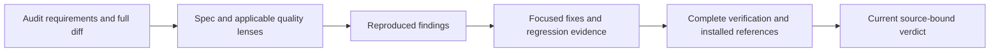

# Final Review: R-01 through R-08

## Summary

Review covers the complete adoption wave against `449cbd1a69fbff4b909ce5556d74686994308eea`, including staged, unstaged and untracked files. The initial inventory contains 156 changed inputs and an 822-file preservation baseline. Four findings were verified and resolved: current-target migration queries selecting legacy guidance, broken installed links, stale follow-up status and missing Python failure diagnostics. Independent delta reviews accepted the fixes; the complete frozen-source verification passed.

**Review verdict: APPROVE.** No confirmed finding remains open in this adoption wave. Completion authority remains the existing source-bound recipe and verified-promise gate described below. Branch remains `feature/framework-gap-adoption-20261106`; no commit or push requested.

## Scope and Review Method

The SPEC review mapped all eight recommendations and 52 derived acceptance criteria to implementation and evidence. Applicable QUALITY lenses cover Python retrieval/data, Node scheduling/evaluators, test/model fidelity, normative authority, context routing, MCP/security, installation/docs, provenance/licensing and evidence integrity. Reviewers record substantive inspected scope, hashes, observations and limits; zero findings never substitute for missing coverage. Original review records are retained with their as-read identities. Changed findings receive separate current-source delta review.

| Phase | Reviewed behavior | Coverage |
|---|---|---|
| R-01 | Selective catalog refresh, provenance, ranking/cache, RTL and legacy/current applicability | Python/data, provenance and SPEC |
| R-02 | Independent constrained designs, blind rubric, selected-result retest and authority | Runtime, owner, test-quality and evidence |
| R-03 | Real-target gate controls, DAG readiness and qualification/target separation | Runtime, SPEC, owner and test-quality |
| R-04 | Layered MCP diagnosis, bounded probes, redaction and owned cleanup | Security/MCP, routing and evidence |
| R-05 | Stocktake, protected pruning, fresh-builder ambiguity and satisfied-work precheck | Owner, routing, SPEC and evidence |
| R-06 | Independent origins, statement fidelity and selective correction propagation | Owner, SPEC and evidence |
| R-07 | Finite queue model, real-source mutants, realizable witnesses and exclusions | Test-quality, runtime, SPEC and evidence |
| R-08 | Requested/observed provenance, raw output binding, capability/trust distinctions | Runtime, security, routing, SPEC and evidence |

## Findings and Disposition

| ID | Severity / owner | Trigger and impact | Correction / status |
|---|---|---|---|
| ui-python-P2-001 | P2 / interface-design | `migrate from Svelte 4 to current Svelte using runes` filters to deprecated rows because the source version selects the generation | Resolved in the shared classifier: source/destination use the same numeric grammar, including Three.js `rN`; explicit destination versions outrank current/latest qualifiers. Five RED/GREEN iterations remain retained. Final 21-test GREEN and independent 386 classifier / 29 alias / 31 public-search checks passed across 22 stacks. Provenance refreshed to the accepted bytes; original oracle unchanged |
| DOC-INSTALL-001 | P2 / shipped documentation | Seven SUPER/SETUP links resolve in the repository but fail in a clean installation because their targets are not shipped | Resolved with shipped owner references/self-contained setup examples. Actual installation RED/GREEN includes a controlled missing-link check; final six-host installation verifies shipped bytes and links |
| DOC-STATUS-002 | P2 / adoption report | Present-tense summary still calls implemented R-04 through R-08 proposals | Resolved: current pointer links all eight phase reports and this review. Independent before/after inspection confirms initial-stage measurements and historical machine JSON remain separate |
| reliability-P3-001 | P3 / standards diagnostics | Every Python parser nonzero/error/timeout becomes the same generic conflict, hiding the failure class | Resolved with bounded status/signal/error and stderr byte count/SHA-256; no private stderr content is returned. Real malformed inputs remain fail-closed; targeted RED/GREEN and independent delta passed. Existing timeout and fallback rules are unchanged |

Finding identity follows origin and root cause, not line offsets. Initial reproduction, exact source identities, proposed correction, disposition and subsequent checks remain linked in the machine evidence. No failing mandatory check may be deferred as a passing result.

The historical manifest fixture flake was not reproduced: one isolated plus eight parallel runs passed, with real Python exit zero. Parallel startup took longer but remained below the existing deadline. Timeout as the original cause is still unproved. The existing [investigation TODO](../todos/2026-11-06-python-manifest-parallel-fixture.md) remains open; the diagnostic fix does not claim to resolve that historical event. No assertion weakening, timeout increase or permanent concurrency workaround is justified by this probe.

## Verification

The second complete run passed all 11 commands against a frozen 737-path active inventory, with no source drift, timeout, skipped test or cancellation:

| Check | Observed result |
|---|---|
| Syntax/configured checks | PASS |
| Every active Node tool test, including installer tests | 631/631 PASS |
| Skill contracts | 28/28 PASS |
| Hook security | PASS |
| Full interface-design Python discovery | 99 tests, OK |
| Python router contract | PASS |
| Original frozen relevance oracle | 90 cases, PASS; zero threshold/identity failures |
| Source agent projection | PASS |
| Isolated installation/doctor | Six configured adapters healthy; 130 shipped-byte comparisons and 111 installed path/anchor checks PASS |

The tool command selects every sorted active `.agent/tools/*.test.mjs`, including `codex-install.test.mjs`, with `--test-concurrency=4`. This changes scheduling only; no name filter, omission or permanent runner change is used. The unchanged baseline and thresholds remain authoritative. Relevance retained 76 retrieval, 8 design-system and 204 negative checks; 200/204 negatives abstain, rather than a claim of perfect abstention.

The first integrated run was 630/631 Node tests: the audit caught this draft report linking to its not-yet-created evidence archive. All other commands passed. The dangling draft link was removed before the second complete run; both attempts and their source identities remain retained. This was a final-report assembly error, not an ignored mandatory failure.

After the frozen run, only the reviewed README, walkthrough, changelog, project-state and final-review prose changed, plus generated evidence. Final closure uses the existing three-repeat benchmark at unchanged budgets, a generated and independently verified current framework audit with zero findings, and the existing completion recipe. Their live receipts are bound separately to avoid an archive/audit hash cycle. The 822-path physical preservation check separately includes retired assets; it does not confuse active-inventory exclusions with deleted files.

Historical R-01 through R-08 machine records remain immutable. This review supplies new integrated evidence rather than rewriting past measurements. The current-status pointer in the initial adoption Markdown report is maintained separately from its historical results.

## Evidence of Completion

Machine evidence at `docs/eval-results/final-review-r01-r08-20261107.evidence.json` retains the 11 review lenses, four finding dispositions, final delta reviews, actual regression controls and integrated command receipts. Historical/intermediate records keep their original identities; they are not silently promoted to final-source acceptance.

The four-criterion contract and recipe live at `.scratch/completion/final-review-r01-r08-20261107/`. `assertions.json`, `outcomes.json` and `evidence.json` record actual checks; `verified-promise.mjs --contract .scratch/completion/final-review-r01-r08-20261107/contract.json` supplies the current completion decision. Benchmark and audit references in the archive are deliberately path-only; the final contract and driver separately verify their current raw receipts and source digests.

| Requirement / AC | Required outcome |
|---|---|
| AC-1 | Substantive SPEC/QUALITY coverage across all eight recommendations |
| AC-2 | Verified fixes, regression sensitivity and current independent delta review |
| AC-3 | Complete current verification without hidden failures/skips or unsupported runtime claims |
| AC-4 | Consistent documentation, valid installed references and preserved historical/unrelated work |

Local tests and static host adapters do not certify live provider identity, modern MCP service behavior, real browser rendering, cross-process locking or unbounded formal correctness. Existing R-07/R-08 evidence limits remain in force.
